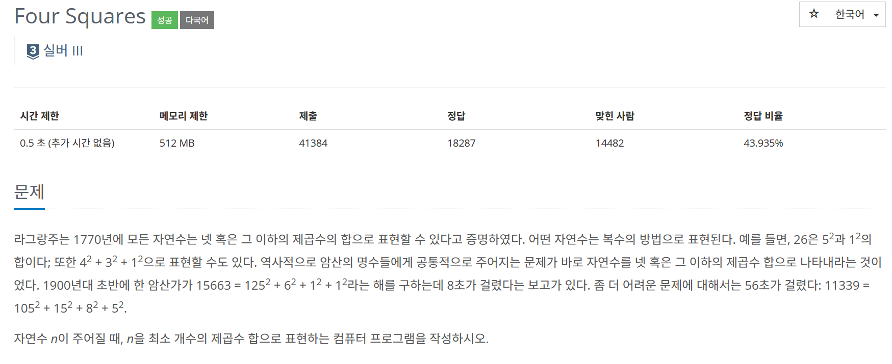
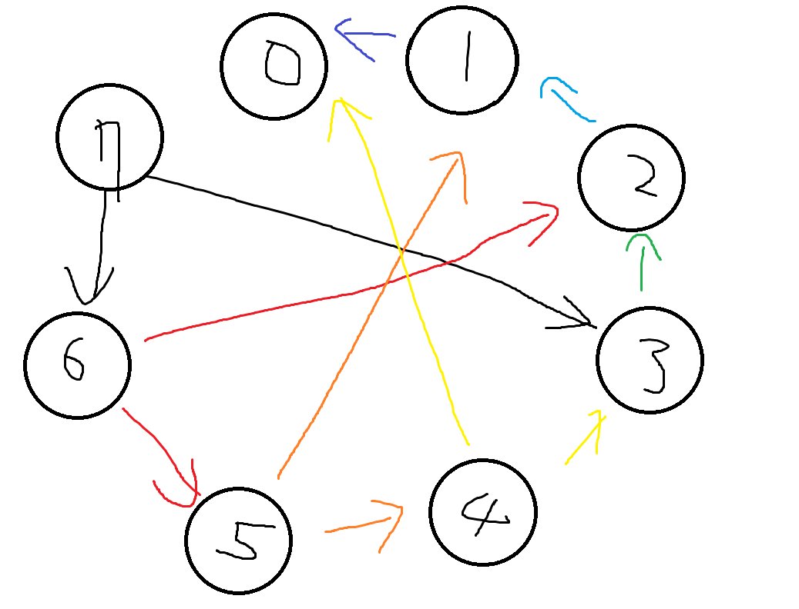

[상위 페이지 · Dynamic Programming](/study/algorithms/dynamic-programming/)



## 문제 태그

- 그래프 이론
- BFS
- DP
- 브루트 포스

## 아이디어

- 문제를 푸는 방법으로는 두가지가 있음. 하나는 BFS이고 하나는 DP임
- BFS로 푸는 방법으로는 우선 위 문제를 다음과 같이 그래프로 모델링 할 수 있음.
    
    
    
    이러한 그래프에서 n → 0까지의 최소 깊이를 찾는것과 동일함
    
- DP로 푸는 방법으로는 다음과 같은 점화식이 나옴
    
    $$
    dp[i] = \underset{j=1,j^2 \le i}{min}(dp[i],dp[i - j^2] + 1)
    $$
    
    - 기저사례 : dp[0] = 0
    - 위 점화식에 따라 dp테이블을 채운 뒤 dp[n]을 출력

## 정답

```python
import sys
from collections import deque

n = int(input())

# ========================= BFS 풀이 ===============================
queue = deque()
queue.append((n,0))
visited = [False] * (n+1)
while queue:
    node,count = queue.popleft()
    if node == 0:
        print(count)
        break

    if count > 4:
        break

    temp = int(node ** 0.5) + 1

    for i in range(temp):
        next_node = node - i ** 2
        if next_node >= 0 and not visited[next_node]:
            visited[next_node] = True
            queue.append((next_node,count+1))

# =========================== DP 풀이 =============================
dp = [i for i in range(n+1)]
dp[0] = 0
for i in range(n+1):
    for j in range(1,int(i**0.5)+1):
        dp[i] = min(dp[i], dp[i - j**2] + 1)
print(dp[n])

```
