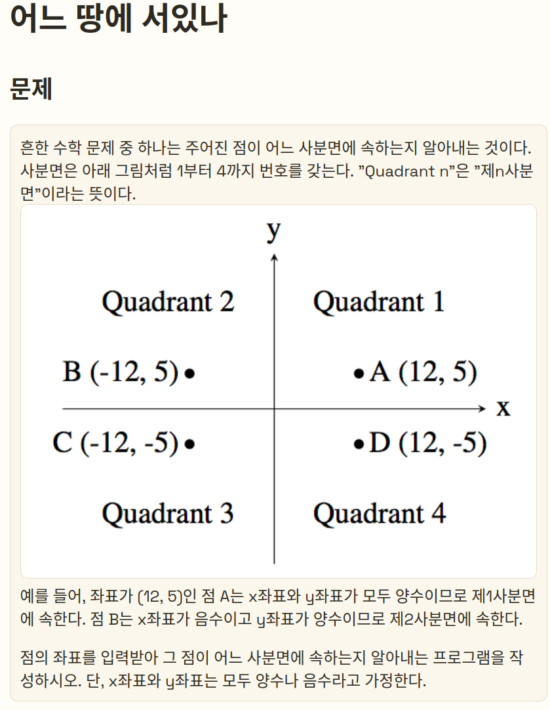

[상위 페이지 · 동아리 코테 정답](/study/algorithms/etc/dongari-kote-jeongdab/)



문제 태그

- [Implementation](/study/algorithms/implementation/)
- 조건 분기

## 예시 워크스루

입력이 12, 5인 경우를 기준으로 본다.

1. x가 0보다 큰지 확인한다.
2. y가 0보다 큰지 확인한다.
3. 두 조건이 모두 참이므로 제1사분면으로 결정한다.
4. 출력값 1을 출력한다.

## 아이디어

x와 y의 부호 조합은 네 가지뿐이므로 조건문 네 줄로 바로 분기하면 된다.

## CPP 코드

```cpp
#include <bits/stdc++.h>
using namespace std;

int main() {
    ios::sync_with_stdio(0);
    cin.tie(0);

    int x, y;
    cin >> x >> y;

    int ans;
    if (x > 0 && y > 0) ans = 1;
    else if (x < 0 && y > 0) ans = 2;
    else if (x < 0 && y < 0) ans = 3;
    else ans = 4;

    cout << ans << '\n';
}
```

## 파이썬 코드

```python
import sys
input = sys.stdin.readline

x = int(input())
y = int(input())

if x > 0 and y > 0:
    ans = 1
elif x < 0 and y > 0:
    ans = 2
elif x < 0 and y < 0:
    ans = 3
else:
    ans = 4

print(ans)
```

## 파이썬 숏코딩 코드

```python
x=int(input())
y=int(input())
print(1 if x>0 and y>0 else 2 if x<0 and y>0 else 3 if x<0 and y<0 else 4)
```

## 검증

- 시간복잡도: O(1)
- 공간복잡도: O(1)
- 코너 케이스: x와 y가 모두 음수인 경우도 별도 분기로 처리한다.

## 참고 개념정리

- [Implementation](/study/algorithms/implementation/)
