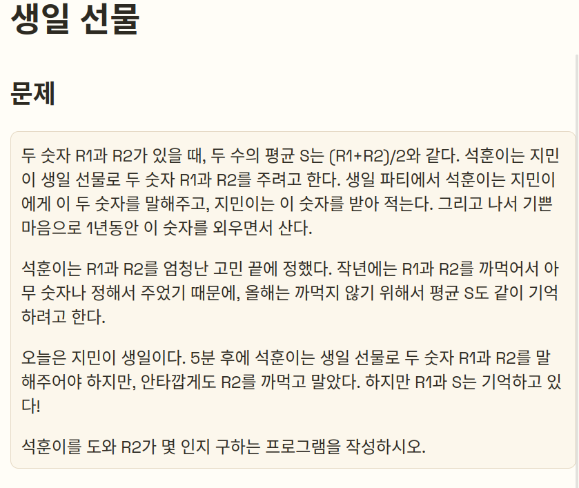

[상위 페이지 · 동아리 코테 정답](/study/algorithms/etc/dongari-kote-jeongdab/)



## 문제 태그

- [Math](/study/algorithms/math/)
- 일차식 변형

## 예시 워크스루

입력이 11, 15인 경우를 기준으로 본다.

1. 평균 식은 (R1 + R2) / 2 = S 이다.
2. 식을 정리하면 R2 = 2S - R1 이다.
3. 값을 대입하면 R2 = 30 - 11 이다.
4. 출력값 19를 출력한다.

## 아이디어

평균 공식 하나만 정리하면 바로 답이 나온다.

## CPP 코드

```cpp
#include <bits/stdc++.h>
using namespace std;

int main() {
    ios::sync_with_stdio(0);
    cin.tie(0);

    int r1, s;
    cin >> r1 >> s;

    int ans = 2 * s - r1;
    cout << ans << '\n';
}
```

## 파이썬 코드

```python
import sys
input = sys.stdin.readline

r1, s = map(int, input().split())
ans = 2 * s - r1
print(ans)
```

## 파이썬 숏코딩 코드

```python
a,b=map(int,input().split())
print(b*2-a)
```

## 검증

- 시간복잡도: O(1)
- 공간복잡도: O(1)
- 코너 케이스: 음수 입력도 식 자체가 그대로 성립한다.

## 참고 개념정리

- [Math](/study/algorithms/math/)
