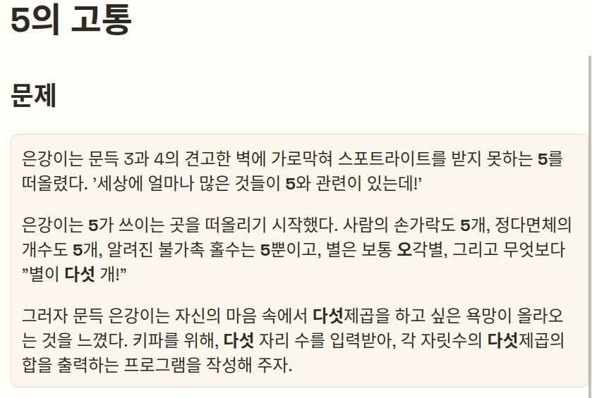

[상위 페이지 · 동아리 코테 정답](/study/algorithms/etc/dongari-kote-jeongdab/)



## 문제 태그

- [Math](/study/algorithms/math/)
- 자릿수 처리

## 예시 워크스루

입력이 12345인 경우를 기준으로 본다.

1. 각 자리 숫자는 1, 2, 3, 4, 5 이다.
2. 다섯제곱은 1, 32, 243, 1024, 3125 이다.
3. 합은 1 + 32 + 243 + 1024 + 3125 이다.
4. 출력값 4425를 출력한다.

## 아이디어

문자열로 읽고 각 문자를 숫자로 바꿔서 다섯제곱 누적합만 구하면 된다.

## CPP 코드

```cpp
#include <bits/stdc++.h>
using namespace std;

int main() {
    ios::sync_with_stdio(0);
    cin.tie(0);

    string n;
    cin >> n;

    int ans = 0;
    for (char c : n) {
        int d = c - '0';
        ans += d * d * d * d * d;
    }

    cout << ans << '\n';
}
```

## 파이썬 코드

```python
import sys
input = sys.stdin.readline

n = input().strip()
ans = 0
for c in n:
    d = int(c)
    ans += d ** 5

print(ans)
```

## 파이썬 숏코딩 코드

```python
print(sum(int(c)**5 for c in input().strip()))
```

## 검증

- 시간복잡도: O(길이)
- 공간복잡도: O(1)
- 코너 케이스: 0이 포함된 자리도 0의 다섯제곱이 0이라 그대로 처리된다.

## 참고 개념정리

- [Math](/study/algorithms/math/)
