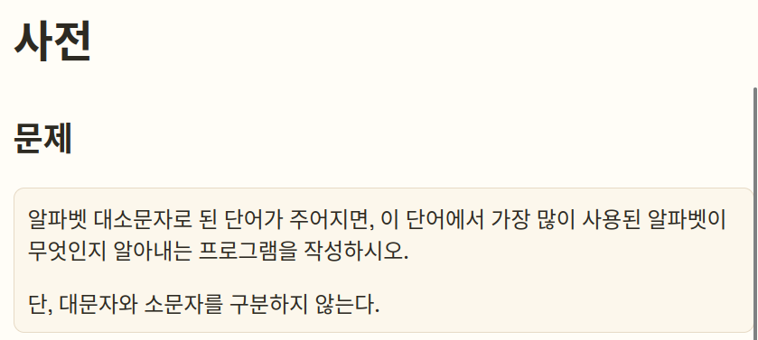

[상위 페이지 · 동아리 코테 정답](/study/algorithms/etc/dongari-kote-jeongdab/)



## 문제 태그

- [String](/study/algorithms/string/)
- 빈도 배열

## 예시 워크스루

입력이 Mississipi 인 경우를 기준으로 본다.

1. 대소문자 구분이 없으므로 모두 대문자로 바꾼다.
2. M은 1번, I는 4번, S는 4번, P는 1번 나온다.
3. 최댓값 빈도는 4인데 I와 S가 동시에 가진다.
4. 최빈 문자가 여러 개이므로 물음표를 출력한다.

## 아이디어

알파벳 26칸 배열로 빈도를 센다. 최댓값을 가진 문자가 하나면 그 문자를 출력하고, 둘 이상이면 물음표를 출력한다.

## CPP 코드

```cpp
#include <bits/stdc++.h>
using namespace std;

int main() {
    ios::sync_with_stdio(0);
    cin.tie(0);

    string s;
    cin >> s;

    vector<int> cnt(26, 0);
    for (char c : s) {
        c = toupper(c);
        cnt[c - 'A']++;
    }

    int mx = *max_element(cnt.begin(), cnt.end());
    int k = 0;
    char pick = '?';
    for (int i = 0; i < 26; i++) {
        if (cnt[i] == mx) {
            k++;
            pick = char('A' + i);
        }
    }

    char ans = (k == 1 ? pick : '?');
    cout << ans << '\n';
}
```

## 파이썬 코드

```python
import sys
input = sys.stdin.readline

s = input().strip().upper()
cnt = [0] * 26

for ch in s:
    cnt[ord(ch) - 65] += 1

mx = max(cnt)
idx = [i for i, v in enumerate(cnt) if v == mx]
ans = '?' if len(idx) > 1 else chr(idx[0] + 65)
print(ans)
```

## 파이썬 숏코딩 코드

```python
s=input().strip().upper()
d=[s.count(chr(65+i)) for i in range(26)]
m=max(d)
print('?' if d.count(m)>1 else chr(d.index(m)+65))
```

## 검증

- 시간복잡도: O(문자열 길이)
- 공간복잡도: O(1)
- 코너 케이스: 길이가 1이면 그 문자 자체가 최빈 문자로 출력된다.

## 참고 개념정리

- [String](/study/algorithms/string/)
