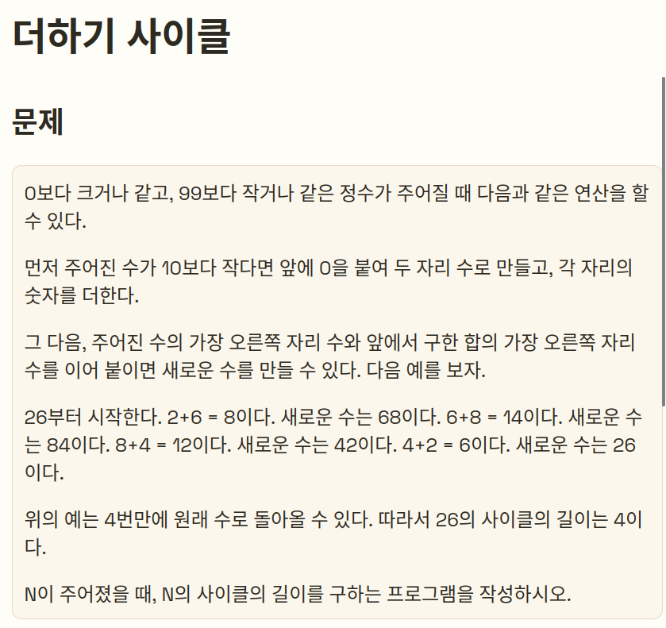

[상위 페이지 · Etc](/study/algorithms/etc/)



## 문제 태그

- [Implementation](/study/algorithms/implementation/)
- 반복 시뮬레이션

## 예시 워크스루

입력이 26인 경우를 기준으로 본다.

1. 시작값 26에서 자릿수 합은 8이다.
2. 새 수는 기존 일의 자리 6과 합의 일의 자리 8을 이어 붙인 68이다.
3. 같은 연산을 반복하면 84, 42, 26 순서가 나온다.
4. 원래 수 26으로 돌아오는데 4번 걸리므로 답은 4이다.

## 아이디어

현재 수를 계속 갱신하면서 시작 수로 다시 돌아오는 시점을 센다. 갱신식은 새 수 = 일의 자리 곱하기 10 + 자릿수 합의 일의 자리 이다.

## CPP 코드

```cpp
#include <bits/stdc++.h>
using namespace std;

int main() {
    ios::sync_with_stdio(0);
    cin.tie(0);

    int n;
    cin >> n;

    int cur = n;
    int ans = 0;

    do {
        int s = cur / 10 + cur % 10;
        cur = (cur % 10) * 10 + (s % 10);
        ans++;
    } while (cur != n);

    cout << ans << '\n';
}
```

## 파이썬 코드

```python
import sys
input = sys.stdin.readline

n = int(input())
cur = n
ans = 0

while True:
    s = cur // 10 + cur % 10
    cur = (cur % 10) * 10 + (s % 10)
    ans += 1
    if cur == n:
        break

print(ans)
```

## 파이썬 숏코딩 코드

```python
n=int(input())
c=n
a=0
while 1:
 c=(c%10)*10+((c//10+c%10)%10)
 a+=1
 if c==n:break
print(a)
```

## 검증

- 시간복잡도: O(사이클 길이)
- 공간복잡도: O(1)
- 코너 케이스: 시작값이 0이면 한 번 연산 후 바로 0으로 돌아와 1을 출력한다.

## 참고 개념정리

- [Implementation](/study/algorithms/implementation/)
