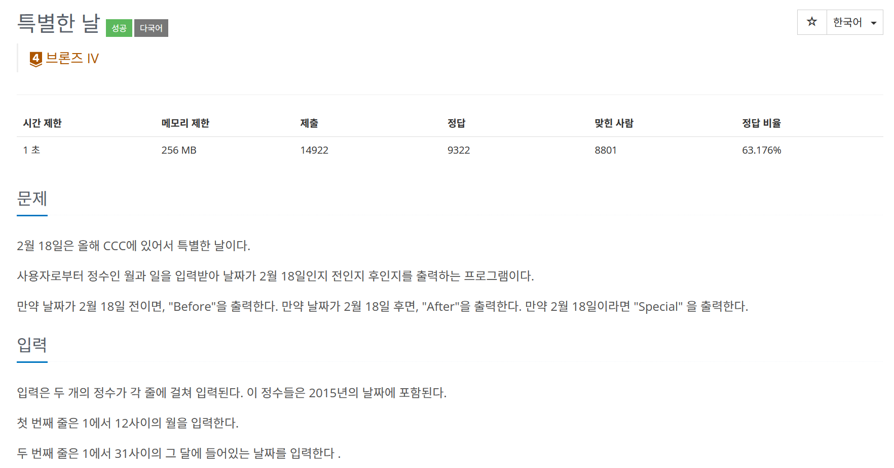

[상위 페이지 · 어셈블리어 문제 풀이](/study/algorithms/etc/eosembeulrieo-munje-puli/)



## 아이디어

- cmp에서는 비교를 할때 레지스터에 옮겨서 비교를 하거나 크기를 명시해줘야한다.
    
    ```nasm
    mov eax, month
    cmp eax, 2
    ; 를 하거나
    cmp DWORD [month]
    ; 자료형을 명시
    ```
    

## 정답

```nasm
section .data
    input : db "%d", 0
    
    month : dd 0
    day : dd 0
    
    BEFORE : db "Before",0
    AFTER : db "After",0
    SPECIAL : db "Special",0

section .text
    global main
    extern scanf
    extern printf

main:
    push rbp
    
    mov rdi, input
    lea rsi, [month]
    mov rax, 0
    call scanf
    
    mov rdi, input
    lea rsi, [day]
    mov rax, 0
    call scanf
    
    cmp DWORD [month], 2
    
    jg after
    jl before
    je same_month
    
same_month:
   cmp DWORD [day], 18
   
   jg after
   jl before
   
   mov rdi, SPECIAL
   mov rax, 0
   call printf
   jmp exit
   
before:
   mov rdi, BEFORE
   mov rax, 0
   call printf
   jmp exit
   
after:
   mov rdi, AFTER
   mov rax, 0
   call printf
   jmp exit
   
exit:
   pop rbp
   mov rax,0
   ret
```
