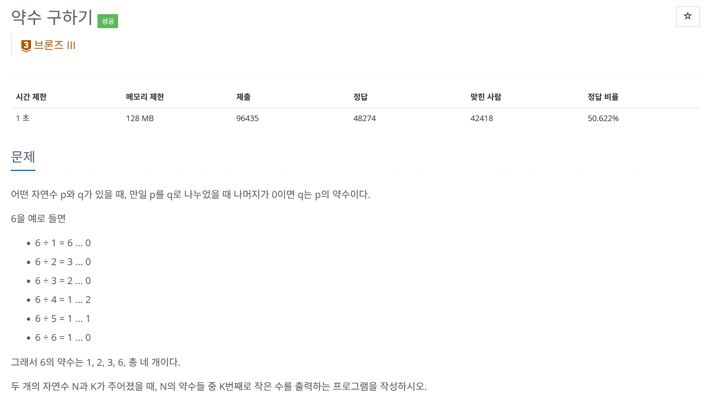

[상위 페이지 · 어셈블리어 문제 풀이](/study/algorithms/etc/eosembeulrieo-munje-puli/)



## 아이디어

- mov rax , 0보다 xor rax, rax가 더 간지난다
- div 이전에 edx를 초기화 시켜야한다
- div시에 eax에 몫이 edx에 나머지가 들어간다.

## 정답

```nasm
section .data
    input : db "%d %d", 0
    output : db "%d", 10, 0

    N : dd 0
    K : dd 0

    result : dd 0

section .text
    global main
    extern scanf, printf

main:
    push rbp

    push r12
    push r13

    mov rdi , input
    lea rsi , [N]
    lea rdx , [K]
    xor rax , rax
    call scanf

    mov r8d , 0
    mov r12d , 1
    mov r13d , [N]

loop_start:
    cmp r12d, r13d
    jg loop_end

    mov eax , [N]
    mov ecx , r12d

    xor edx , edx
    div ecx

    cmp edx , 0
    jne ncommon
    
    inc r8d

    cmp r8d , [K]
    je found_common

ncommon:
    inc r12d
    jmp loop_start

found_common:
    mov eax , r12d
    mov [result] , eax
    jmp loop_end

loop_end:
    mov eax , [result]
    mov rdi , output
    mov rsi , rax
    xor rax , rax
    call printf
    jmp exit

exit:
    pop r13
    pop r12

    mov rax , 0
    pop rbp
    ret
```
