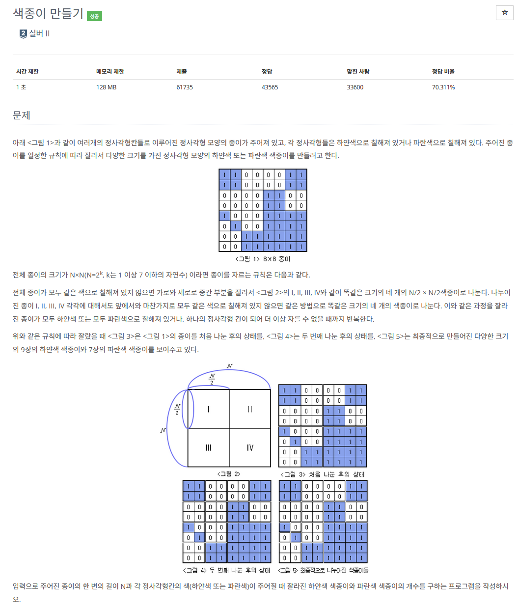

[상위 페이지 · 실버](/study/algorithms/etc/silver/)



## 문제 태그

- 재귀
- 분할 정복

## 아이디어

- 어려울거 없는 재귀 문제임으로 문제대로 구현해주면 된다.

## 정답

```python
n = int(input())
graph = [list(map(int, input().split())) for _ in range(n)]
result = [0, 0]

def recursive(x, y, size):
    color = graph[x][y]

    for i in range(x, x + size):
        for j in range(y, y + size):
            if graph[i][j] != color:
                half = size // 2
                recursive(x, y, half)
                recursive(x, y + half, half)
                recursive(x + half, y, half)
                recursive(x + half, y + half, half)
                return
    result[color] += 1

recursive(0, 0, n)
print(*result,sep='\n')

```
