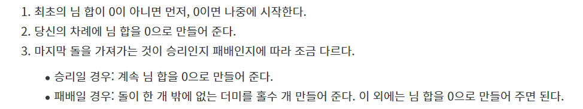

[상위 페이지 · 플레](/study/algorithms/game-theory/platinum/)

[https://www.acmicpc.net/problem/11694](https://www.acmicpc.net/problem/11694)


## 아이디어

스프라그 그런디는 마지막 돌을 가져가면 승리하는 즉 노멀게임 기준의 이론이기때문에 마지막 돌을 가져가면 패배하는 비노멀게임에서는 좀 다르게 적용 된다.

솔직히 이론이고 뭐고 그냥 예제를 보며 직관적으로 규칙을 도출했다.

1. 만약에 돌의 개수가 한개인 돌무더기 밖에 없다
    1. 돌무더기의 개수가 짝수면 선공 승
    2. 돌무더기의 개수가 홀수면 후공 승
2. 만약에 돌의 개수가 한개인 돌무더기의 개수가 짝수라면
    1. 그런디 값이 0이면 선공 승리
    2. 그런디 값이 0이 아니면 후공 승리
3. 만약에 돌의 개수가 한개인 돌무더기의 개수가 홀수라면
    1. 그런디값이 0이면 후공승리
    2. 그런디값이 0이 아니면 선공 승리

위 규칙을 따라 작성한 코드도 정답으로 처리 됐지만 사실 여기에는 푸는 방법이 따로 존재한다

그 방법은 



에 따라

1. 돌이 1개인 더미가 없을 경우, 님 합이 0이 아니면 선공, 0이면 후공이 승리한다.

2. 돌이 1개인 더미가 홀수 개일 경우, 님 합이 0이 아니면 선공, 0이면 후공이 승리한다.

3. 돌이 1개인 더미가 짝수 개일 경우, 돌이 1개가 아닌 임의의 더미를 돌이 1개인 더미로 만들었을 때, 님 합이 0이 아니면 선공, 0이면 후공이 승리한다.

이 로직으로 짜야하는것이다.

## 정답

```python
import sys

def main():
    input = sys.stdin.readline
    n = int(input())
    stones = list(map(int,input().split(" ")))
    x = 0
    flag = False

    for t in stones:
        x ^= t
        if t > 1:
            flag = True

    if flag:
        print("koosaga" if x else "cubelover")
    else:
        print("cubelover" if x else "koosaga")

if __name__ == "__main__":
    main()

```
