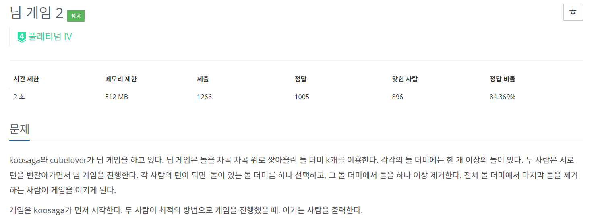

[상위 페이지 · 플레](/study/algorithms/game-theory/platinum/)

[https://www.acmicpc.net/problem/11868](https://www.acmicpc.net/problem/11868)



## 아이디어

가장 기본적인 스프라그 - 그런디 문제이다.

가장 오리지널 님 게임에서 각 돌무더기에서 그런디수는 각자의 돌 개수와 같으며 모두 xor 계산 해주면 이 게임판의 그런디 수가 나온다.

## 정답

```python
N = int(input())
grundy_num = 0
stones = list(map(int,input().split()))
for i in stones:
    grundy_num ^= i
if grundy_num == 0:
    print("cubelover")
else:
    print("koosaga")
```
