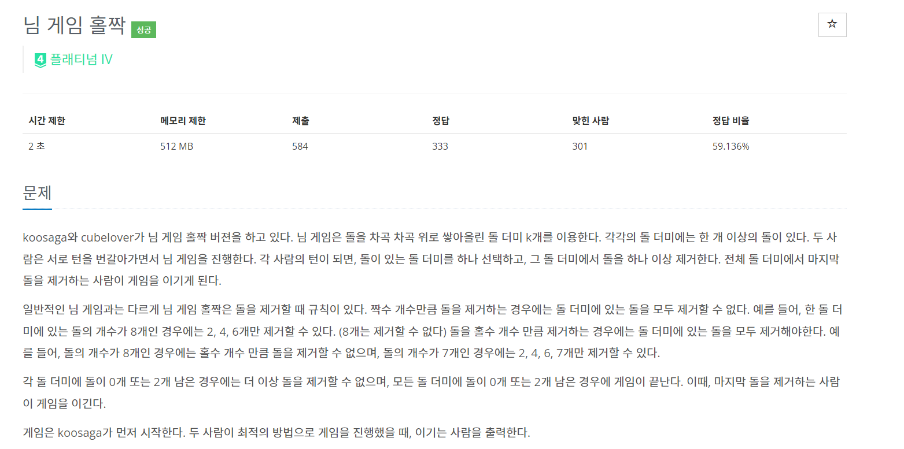

[상위 페이지 · 플레](/study/algorithms/game-theory/platinum/)

[https://www.acmicpc.net/problem/11871](https://www.acmicpc.net/problem/11871)



## 아이디어

다시 한번 이러한 문제를 풀 때에는 그런디 수를 잘 구하는게 핵심이라는걸 느꼈다

그런디 수를 구해보자면

0 = *0
*1 = *1
*2 = *0
*3 = {*1 *0} = *2
*4 = {*2} = {*0} = *1
*5 = {*0 *3 *1} = {*0 *2 *1} = *3
*6 = {*2 *4} = {*0 *1} = *2
*7 = {*0 *5 *3 *1} = {*0 *3 *2 *1} = *4
*8 = {*2 *4 *6} = {*0 *1 *2} = *3

짝수는 n//2-1
홀수는 n//2+1

의 그런디 값을 가지게 된다.

그런디 값을 구하는 방법을 알았으니 스프라그 - 그런디 이론에 따라 모든 돌무더기의 그런디값을 모두 xor 해주면 된다.

## 정답

```python
N = int(input())
stones = list(map(int, input().split()))
grundy_num = 0
for i in stones:
    if i % 2 == 0:
        grundy_num ^= i // 2 - 1
    else:
        grundy_num ^= i // 2 + 1

if grundy_num == 0:
    print("cubelover")
else:
    print("koosaga")
```
