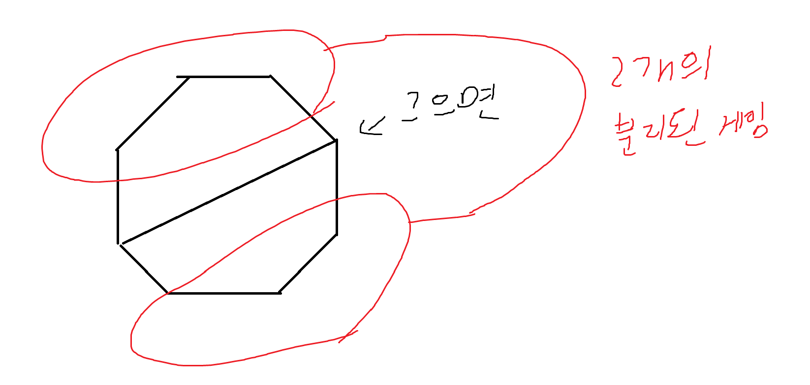

[상위 페이지 · 플레](/study/algorithms/game-theory/platinum/)


## 문제 태그

- 게임 이론

## 아이디어



1. 다각형 가운데에 선을 그으면 2개의 분리된 게임이 나온다는것을 알아야함.
2. 고로 $$g(i) = mex({g(k) \oplus g(i-2-k))}$$
3. 이는 값이 일정하진 않음으로 dp로 구해준다.

## 정답

```python
import sys
input = sys.stdin.readline

N = int(input())

g = [0] * (N + 1)
if N >= 2:
    g[2] = 1

for i in range(3, N + 1):
    visited = [False] * i
    for left in range(i // 2 + 1):
        right = i - 2 - left
        x = g[left] ^ g[right]
        if x < i:
            visited[x] = True
    mex = 0
    while visited[mex]:
        mex += 1
    g[i] = mex

print(1 if g[N] != 0 else 2)

```
