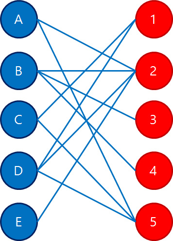
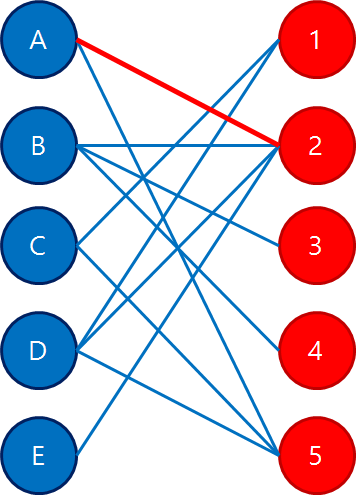
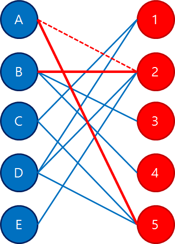
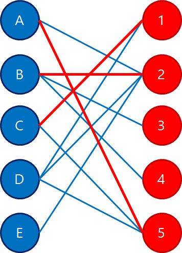
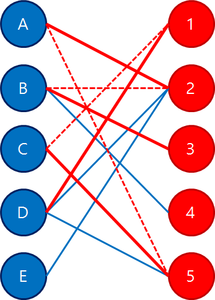
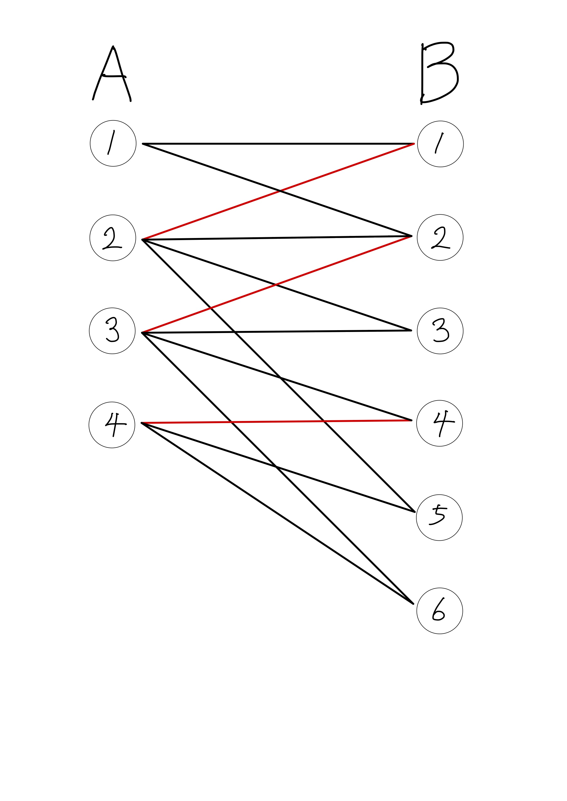
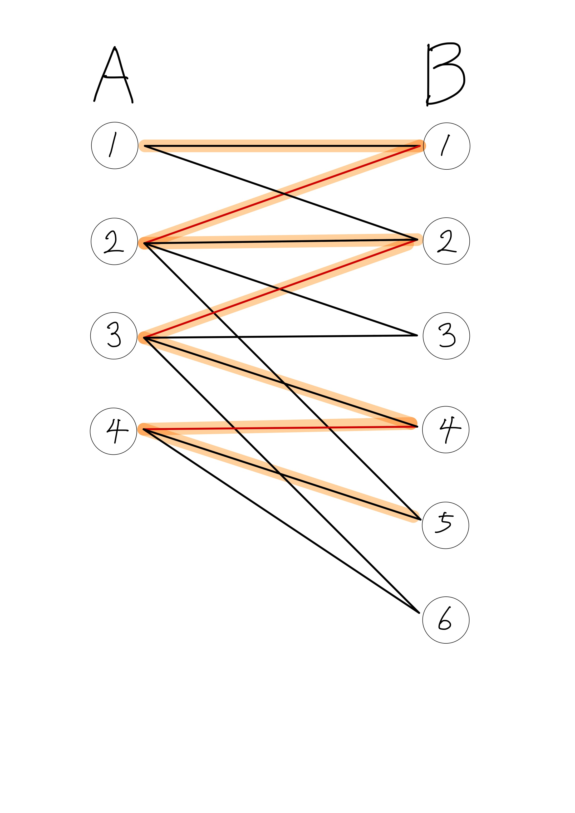
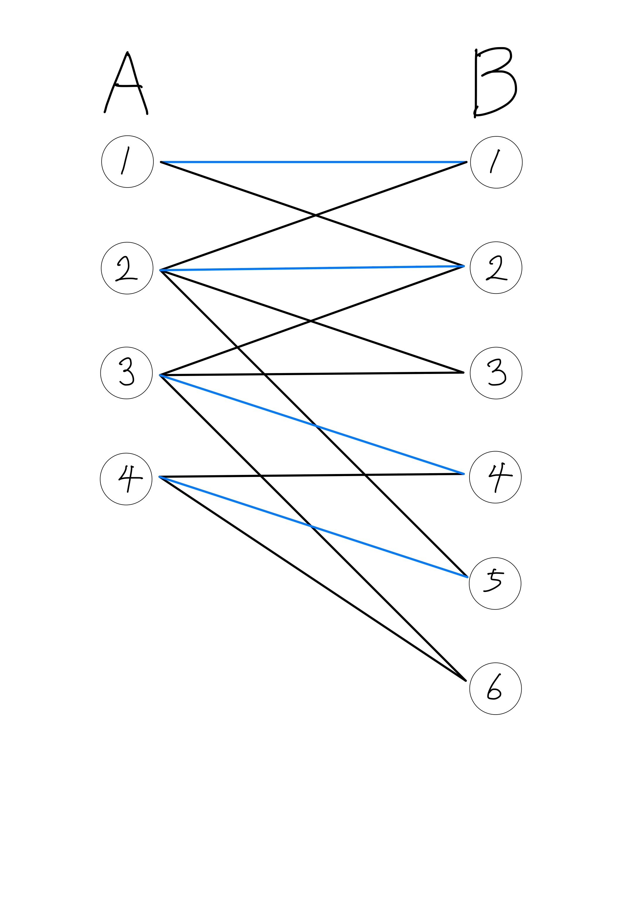

[상위 페이지 · Graph](/study/algorithms/graph/)

## 선행 지식

- DFS
- 최대 유량 (있으면 좋음)

## 설명

이분 매칭은 그래프 이론에서 사용되는 알고리즘으로, 두 개의 그룹으로 나누어진 정점들이 각각 다른 그룹에 있는 정점들과 연결되도록 매칭시키는 알고리즘이다. 이 알고리즘은 매우 효율적으로 구현될 수 있고, 다양한 분야에서 활용된다.

대표적인 예시로는 결혼식에서의 자리 배치, 학생들의 체육 대회 참가 팀 배정 등이 있다.

이분 그래프는 각각의 정점이 두 개의 그룹으로 나누어져 있으며, 각 그룹 내의 정점들끼리는 서로 연결되어 있지 않고, 그룹 간의 정점들끼리만 연결되어 있는 그래프이다.

결국 이분매칭으로 구하고자 하는건 “최대 매칭 수”이다. 간선의 용량이 1인 이유는 매칭을 한다는 것은 어떤 정점이 그것이 가리키는 위치의 다른 정점을 점유한 상태를 말하며 각 정점은 한 개씩만 점유 가능하고 여러개의 정점을 점유할 수 없기 때문이다.

이분 매칭 알고리즘은 대표적으로 'Hopcroft-Karp' 알고리즘이 있다. 이 알고리즘은 시간 복잡도가 $$O(E \times \sqrt V)$$로 매우 효율적이다.

## 프로세스



이렇게 연결 돼 있는 그래프가 있다고 하자.

먼저 A는 어떤거랑 연결해도 상관 없다.



다음 B를 매칭 시켜줄때는 2가 이미 A와 매칭이 돼 있기 때문에 A에게 다시 매칭 할 수 있냐고 요청한다. 요청 결과 A는 5와 매칭 가능하여 A는 5와 B는 2와 매칭한다.



다음 C는 1과 매칭이 가능한데 1은 아무와도 매칭이 되지 않았음으로 1과 매칭시켜준다.



다음은 D, D는 1과 매칭을 시도하여 C에게 다시 매칭을 요청한다. C는 5와 매칭을 시도하지만 A가 이미 점유 중이여 A에게 다시 매칭할것을 요청한다. A는 2번과 매칭을 시도하지만 2번은 B와 이미 매칭이 돼 있다. A는 B에게 다시 매칭할 것을 요청하며 최종적으로 B가 매칭이 성공 되어 모든 매칭을 바꿔 줄 수 있다.



마지막 E는 2와 매칭을 시도한다. 2에는 A가 점유중임으로 A에게 재 매칭을 요청한다. A는 5번하고 매칭을 시도한다. 5번은 C와 매칭이 되어 있기 때문에 C에게 재 매칭을 할 것을 요청하고 C는 1번하고 매칭을 시도한다. 1번은 D하고 매칭이 되어 있음으로 D는 2번에게 매칭할 것을 요청하지만 이미 2번은 이번 시도에서 E에게 사용이 됐음으로 매칭을 실패한다. 다음 5번을 매칭하려하지만 5번도 2번과 마찬가지로 이번 전체적인 매칭시도에서 A에게 사용이 됐음으로 실패한다. D가 매칭을 실패함으로써 모든 매칭은 실패로 돌아가 E는 매칭을 실패하게 된다.

따라서 위 그래프는 총 4개의 매칭이 최대의 매칭 수 이다.

만약 두번의 매칭이 필요하다면 이분 매칭을 두번 돌려주면 된다.

## 예시 코드

```python
import sys

input = sys.stdin.readline
N,M = map(int,input().split())
adj = {}
for i in range(1,N+1):
    favorite_nums = list(map(int,input().split()))[1:]
    adj[i] = favorite_nums

def dfs(num,visited,matched):
    if visited[num]:
        return False
    visited[num] = True
    for i in adj[num]:
				# 매칭이 돼 있지 않거나, 매칭이 돼 있다면 재 매칭을 요청해서 둘 중 성공하면 매칭 성공.
        if matched[i] == -1 or dfs(matched[i],visited,matched):
            matched[i] = num
            return True
    return False

def nf():
    matched = [-1] * (M + 1)
    flow = 0
    for i in range(1,N+1):
        visited = [False] * (N+1)
				# 매칭에 성공했아면 최대 매칭 수 + 1
        if dfs(i,visited,matched):
            flow += 1
    return flow

print(nf())
```

## 호프크로프트 카프 알고리즘

### 용어 정리

- Alternating Path (교차 경로): 매칭되지 않은 A 그룹의 정점에서 시작하여 매칭되지 않은 간선과 매칭된 간선이 번갈아 나타나는 경로
- Augmenting Path (증가 경로): 매칭되지 않은 정점에서 시작하여 매칭되지 않은 정점으로 끝나는 교차경로

### 동작 설명

우선 아래는 빨간색으로 매칭 되어 있는것을 볼 수 있다



아래는 정점 1에서 시작하여 5까지 이어진 증가 경로중 하나임.



이 증가 경로에 해당하는 모든 간선들을 토글해주면 마법같이 매칭 개수가 + 1됨



고로 증가 경로를 찾지 못한다면 그것이 최대 매치인것.

### 수도 코드

```
function HopcroftKarp(G = (U ∪ V, E)):
    pairU[u] := NIL for all u in U
    pairV[v] := NIL for all v in V
    matching := 0

    while BFS():
        for each u in U:
            if pairU[u] == NIL and DFS(u):
                matching := matching + 1

    return matching

function BFS():
    queue Q
    for each u in U:
        if pairU[u] == NIL:
            dist[u] := 0
            enqueue(Q, u)
        else:
            dist[u] := ∞
    dist[NIL] := ∞

    while Q not empty:
        u := dequeue(Q)
        if dist[u] < dist[NIL]:
            for each v adjacent to u:
                if dist[pairV[v]] == ∞:
                    dist[pairV[v]] := dist[u] + 1
                    enqueue(Q, pairV[v])
    return dist[NIL] != ∞

function DFS(u):
    if u != NIL:
        for each v adjacent to u:
            if dist[pairV[v]] == dist[u] + 1 and DFS(pairV[v]):
                pairU[u] := v
                pairV[v] := u
                return true
        dist[u] := ∞
        return false
    return true

```

### 구현

```python
from collections import deque

def hopcroft_karp(graph,n = -1,m = -1):
    """
    Hopcroft-Karp 알고리즘 (최대 이분 매칭)
    :param graph: 왼쪽 정점 기준 인접 리스트 (graph[u] = [v1, v2, ...])
    :return: (최대 매칭 수, match_left 리스트)
    """
    n_left = n if n != -1 else len(graph)
    n_right = m if m != -1 else max((v for adj in graph for v in adj), default=-1) + 1

    match_left = [-1] * n_left
    match_to = [-1] * n_right
    level = [0] * n_left

    def bfs():
        queue = deque()
        for u in range(n_left):
            if match_left[u] == -1:
                level[u] = 0
                queue.append(u)
            else:
                level[u] = float('inf')
        found = False
        while queue:
            u = queue.popleft()
            for v in graph[u]:
                w = match_to[v]
                if w == -1:
                    found = True
                elif level[w] == float('inf'):
                    level[w] = level[u] + 1
                    queue.append(w)
        return found

    def dfs(u):
        for v in graph[u]:
            w = match_to[v]
            if w == -1 or (level[w] == level[u] + 1 and dfs(w)):
                match_left[u] = v
                match_to[v] = u
                return True
        return False

    match_count = 0
    while bfs():
        for u in range(n_left):
            if match_left[u] == -1 and dfs(u):
                match_count += 1

    return match_count, match_left

```

### 그림 출처

[https://nhrwv.github.io/ps/글쓰기/2022/12/31/Hopcroft-Karp/](https://nhrwv.github.io/ps/%EA%B8%80%EC%93%B0%EA%B8%B0/2022/12/31/Hopcroft-Karp/)
