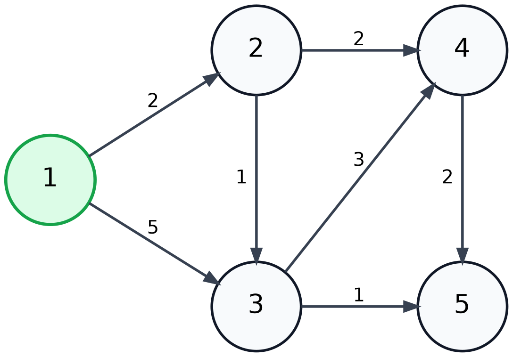
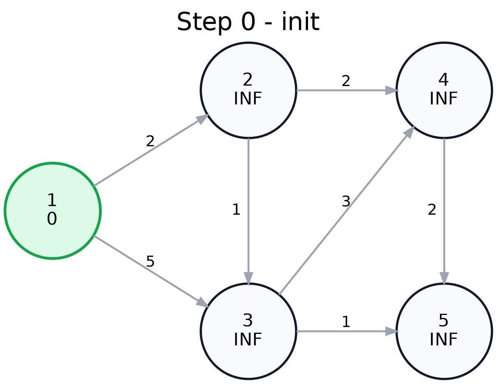
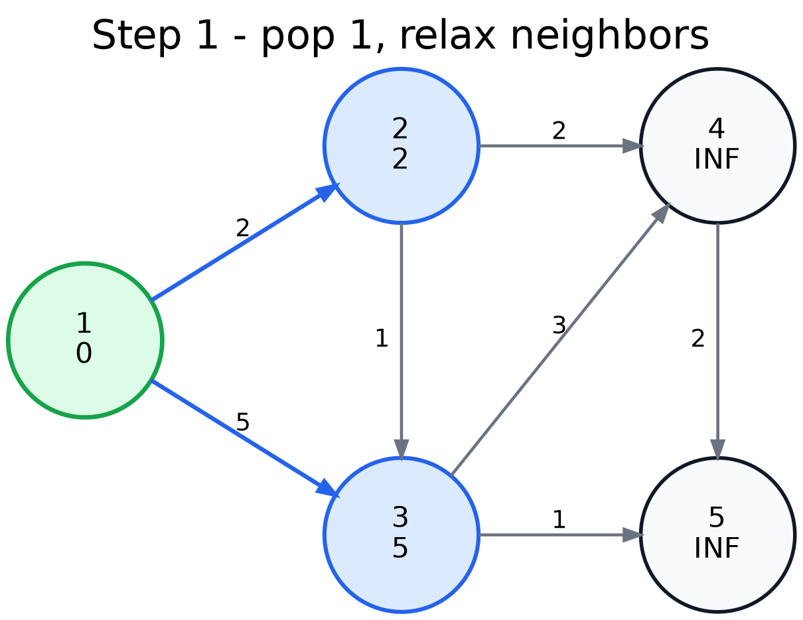
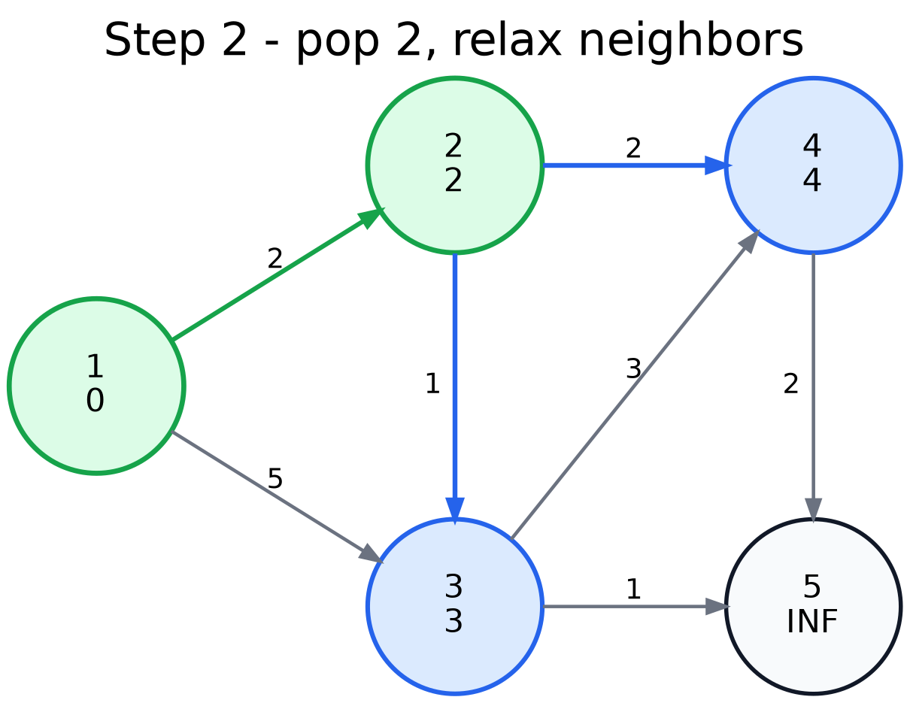
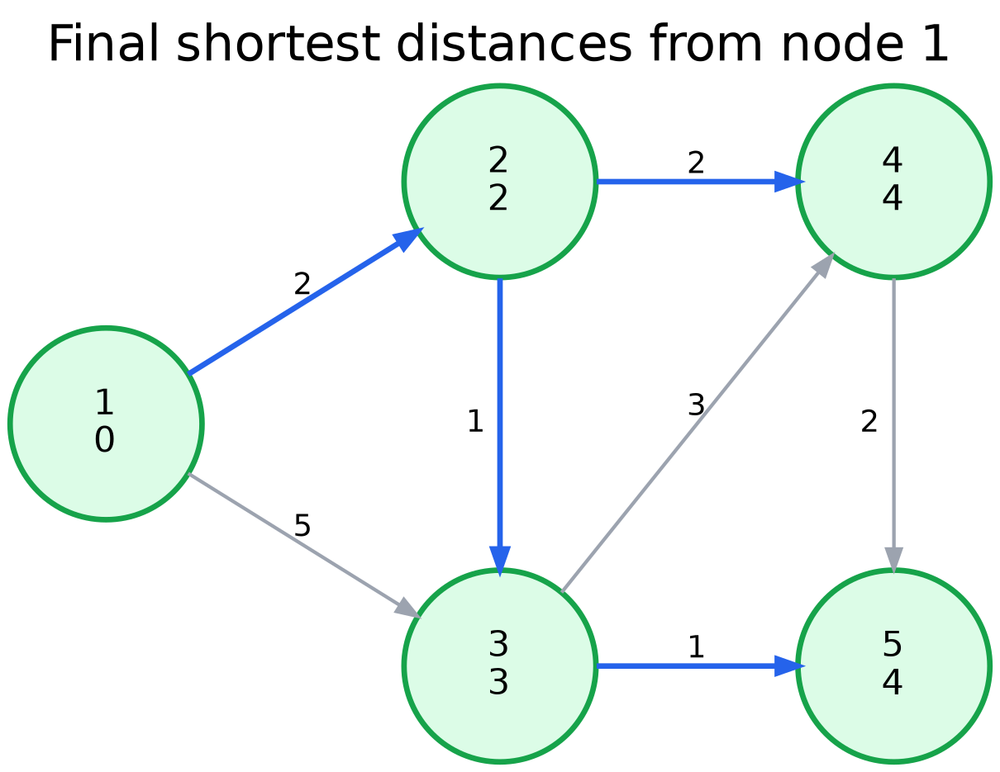
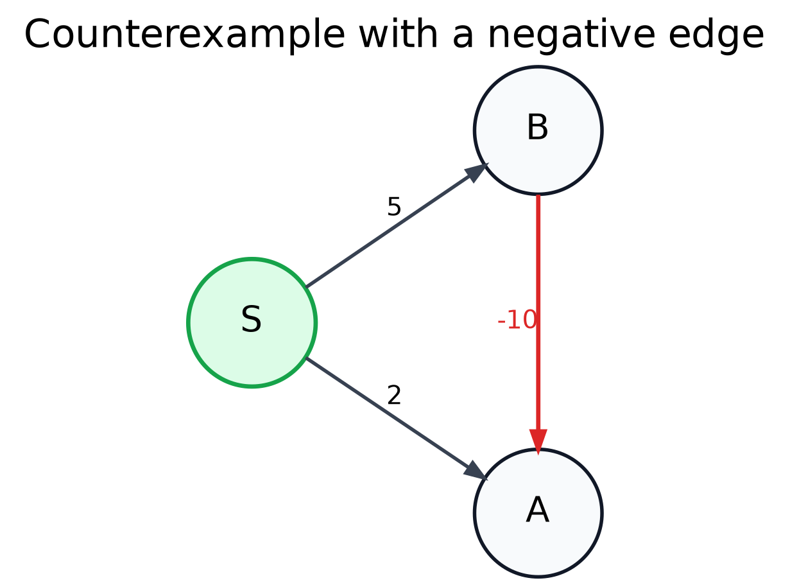

[상위 페이지 · Graph](/study/algorithms/graph/)

## 선행지식

- [Graph](/study/algorithms/graph/)
- [Priority Queue](/study/algorithms/data-structure/priority-queue/)

## 기본 개념

다익스트라 알고리즘은 시작 정점 하나가 주어졌을 때, 모든 정점까지의 최단 거리를 구하는 알고리즘이다.

가중치가 음수가 아닌 그래프에서 사용할 수 있으며, 매 단계에서 현재까지 최단 거리가 가장 작은 정점을 확정하는 방식으로 동작한다.

## 예시 워크스루



예시 그래프는 정점 1에서 시작한다.

- 간선 가중치: 1→2(2), 1→3(5), 2→3(1), 2→4(2), 3→4(3), 3→5(1), 4→5(2)

### 초기화



- 거리 배열: [0, INF, INF, INF, INF]
- 우선순위 큐: (0, 1)

### 정점 1 확정 후 완화



- 2의 거리: 2
- 3의 거리: 5
- 거리 배열: [0, 2, 5, INF, INF]

### 정점 2 확정 후 완화



- 3의 거리: min(5, 2+1)=3
- 4의 거리: 4
- 거리 배열: [0, 2, 3, 4, INF]

### 정점 3 확정 후 완화

- 5의 거리: min(INF, 3+1)=4
- 거리 배열: [0, 2, 3, 4, 4]

### 정점 4, 5를 순서대로 확정



- 추가 갱신 없음
- 최종 거리: [0, 2, 3, 4, 4]

## 성립 조건 / 정리

### 조건

- 모든 간선 가중치가 0 이상이어야 한다.
- 그래프는 방향 그래프와 무방향 그래프 모두 가능하다.

### 정리

- 우선순위 큐에서 꺼낸 정점의 거리는 확정 최단 거리다.
- 음수 가중치가 존재하면 위 정리가 깨질 수 있다.

$$
\text{if } d[v] > d[u] + w(u,v),\ \ d[v] = d[u] + w(u,v)
$$

## 동작 원리

### 전체 흐름

1. 시작 정점 거리를 0으로 두고 나머지는 INF로 둔다.
2. 우선순위 큐에서 현재 거리 최솟값 정점을 꺼낸다.
3. 해당 정점에서 나가는 간선을 따라 완화 연산을 수행한다.
4. 거리가 줄어든 정점을 우선순위 큐에 넣는다.
5. 큐가 빌 때까지 반복한다.

### 불변식

- 확정된 정점의 거리는 더 이상 줄어들지 않는다.
- 큐에는 아직 확정되지 않은 후보 거리만 남는다.

### 왜 맞는가

음수 가중치가 없으면 이미 가장 짧은 후보 거리보다 더 짧은 우회 경로가 뒤늦게 나타날 수 없다.

따라서 최솟값으로 꺼낸 정점은 그 순간 최단 거리가 확정된다.

## 절차(구현 기준)

1. 인접 리스트를 구성한다.
2. 거리 배열을 INF로 초기화하고 시작 정점만 0으로 둔다.
3. 우선순위 큐에 (0, 시작 정점)을 넣는다.
4. 큐에서 (거리, 정점)을 꺼낸다.
5. 꺼낸 거리와 현재 배열 값이 다르면 오래된 항목이므로 건너뛴다.
6. 인접 간선을 순회하며 완화 연산을 수행한다.
7. 갱신이 발생하면 새 거리로 큐에 넣는다.

## 복잡도

- 시간복잡도: O((V+E)logV)
- 공간복잡도: O(V+E)
- 병목 구간: 우선순위 큐 push, pop 연산과 간선 완화 반복

## 실패/반례 패턴



- 음수 간선 존재: 정점 확정 논리가 깨져 잘못된 결과가 나올 수 있다.
- 오래된 큐 원소 미처리: 동일 정점이 여러 번 꺼내져 시간 낭비가 커진다.
- INF 값 설정 실수: 정수 범위를 넘거나 비교가 꼬여 갱신이 누락될 수 있다.

## 구현

```python
import sys
import heapq

input = sys.stdin.readline
INF = 10**18

def dijkstra(n, adj, start):
    dist = [INF] * (n + 1)
    dist[start] = 0
    pq = [(0, start)]

    while pq:
        cur_d, u = heapq.heappop(pq)
        if cur_d != dist[u]:
            continue

        for v, w in adj[u]:
            nd = cur_d + w
            if nd < dist[v]:
                dist[v] = nd
                heapq.heappush(pq, (nd, v))

    return dist

def solve():
    n, m = map(int, input().split())
    start = int(input())

    adj = [[] for _ in range(n + 1)]
    for _ in range(m):
        u, v, w = map(int, input().split())
        adj[u].append((v, w))

    dist = dijkstra(n, adj, start)

    out = []
    for i in range(1, n + 1):
        if dist[i] == INF:
            out.append("INF")
        else:
            out.append(str(dist[i]))
    print("\n".join(out))

if __name__ == "__main__":
    solve()
```

## 시뮬레이션

[https://codepen.io/Creeper0809/pen/empEeJQ](https://codepen.io/Creeper0809/pen/empEeJQ)
