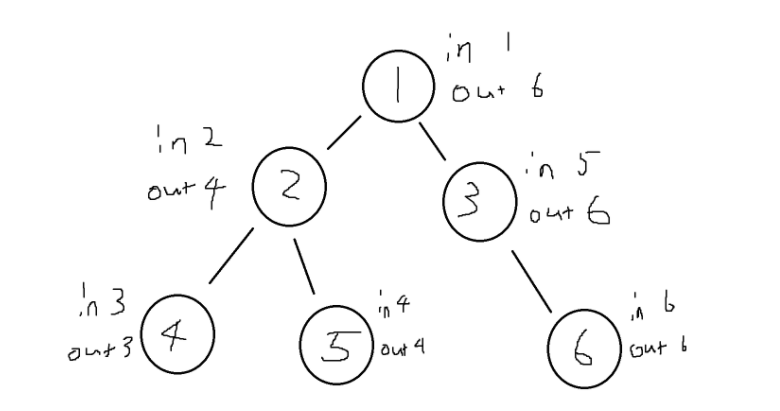
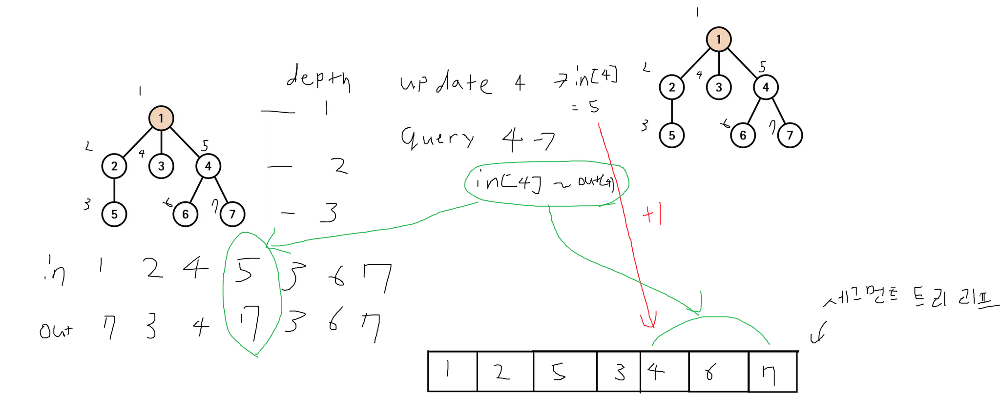

[상위 페이지 · Graph](/study/algorithms/graph/)

트리 구조에서 특정 서브트리의 정보를 효율적으로 관리하기 위한 자료구조 기법이다. 트리를 선형으로 펼쳐서 표현하는 방식으로, 세그먼트 트리와 함께 사용하면 트리 상의 다양한 쿼리를 빠르게 처리할 수 있다.

## 주요 특징

- 트리를 DFS 순회하면서 각 정점을 방문할 때마다 기록하여 선형 배열로 변환한다
- 한 정점이 여러 번 등장할 수 있다 (들어갈 때와 나올 때)
- 서브트리의 정보가 배열에서 연속된 구간으로 표현된다

## 활용 분야

- 서브트리의 합, 최대값, 최소값 등을 구하는 쿼리
- 트리의 경로 상의 정점들의 정보를 관리
- 트리의 구조를 동적으로 변경하는 연산 처리

이 기법은 특히 트리에서의 구간 쿼리와 업데이트가 빈번한 문제에서 효율적인 해결책을 제공한다.

## 알고리즘 동작



| idx | 1 | 2 | 3 | 4 | 5 | 6 |
| --- | --- | --- | --- | --- | --- | --- |
| in | 1 | 2 | 5 | 3 | 4 | 6 |
| out | 6 | 4 | 6 | 3 | 4 | 6 |

DFS로 트리를 순회하면서 각 노드에 대해 in(처음 방문 시간)과 out(마지막 방문 시간)을 기록한다. 위 예시에서 보면, 노드 2는 in[2]=2일 때 처음 방문하고 out[2]=4일 때 마지막으로 방문한다. 이렇게 기록된 in/out 시간을 이용하면 임의의 두 노드 u, v에 대해 u가 v의 조상인지를 O(1)에 판별할 수 있다 (in[u] <= in[v] <= out[u]).

## Python 구현 예시

다음은 Euler Tour Technique의 기본적인 Python 구현 예시이다:

```python
class EulerTourTree:
    def __init__(self, n):
        self.n = n
        self.adj = [[] for _ in range(n)]
        self.tour = []
        self.first = [-1] * n
        self.last = [-1] * n
        
    def add_edge(self, u, v):
        self.adj[u].append(v)
        self.adj[v].append(u)
    
    def dfs(self, node, parent):
        # 노드에 처음 방문할 때의 인덱스 저장
        self.first[node] = len(self.tour)
        self.tour.append(node)
        
        for child in self.adj[node]:
            if child != parent:
                self.dfs(child, node)
                self.tour.append(node)  # 자식 노드에서 돌아올 때도 기록
        
        # 노드를 마지막으로 방문할 때의 인덱스 저장
        self.last[node] = len(self.tour) - 1
    
    def build(self, root=0):
        self.dfs(root, -1)
        return self.tour

# 사용 예시
if __name__ == "__main__":
    # 노드가 5개인 트리 생성
    ett = EulerTourTree(5)
    
    # 트리 구조 정의 (예: 0-1-2-3-4 형태의 선형 트리)
    ett.add_edge(0, 1)
    ett.add_edge(1, 2)
    ett.add_edge(2, 3)
    ett.add_edge(3, 4)
    
    # Euler Tour 생성
    tour = ett.build(0)
    print("Euler Tour:", tour)
    print("First occurrence:", ett.first)
    print("Last occurrence:", ett.last)
```

이 코드는 기본적인 Euler Tour를 구현한 것으로, 실제 응용에서는 이를 세그먼트 트리와 결합하여 사용하는 경우가 많다.

코드 실행 결과로 각 노드의 첫 방문 시점과 마지막 방문 시점을 알 수 있으며, 이를 통해 서브트리의 범위를 쉽게 파악할 수 있다.

## 세그먼트 트리와의 활용



Euler Tour Technique와 세그먼트 트리를 함께 사용하면 트리 상의 다양한 쿼리를 효율적으로 처리할 수 있다. 주요 활용 방법은 다음과 같다:

- **서브트리 쿼리 처리:** ETT로 변환된 선형 배열을 세그먼트 트리로 관리하면, 특정 노드의 서브트리에 대한 구간 쿼리를 O(log N)에 처리할 수 있다
- **경로 쿼리 처리:** 두 노드 간의 경로상의 정보를 관리할 때, LCA와 함께 사용하여 효율적으로 처리 가능

```python
class SegmentTree:
    def __init__(self, arr):
        self.n = len(arr)
        self.tree = [0] * (4 * self.n)
        self.build(arr, 0, 0, self.n-1)
    
    def build(self, arr, node, start, end):
        if start == end:
            self.tree[node] = arr[start]
            return
        
        mid = (start + end) // 2
        self.build(arr, 2*node+1, start, mid)
        self.build(arr, 2*node+2, mid+1, end)
        self.tree[node] = self.tree[2*node+1] + self.tree[2*node+2]
    
    def query(self, node, start, end, left, right):
        if right < start or end < left:
            return 0
        if left <= start and end <= right:
            return self.tree[node]
            
        mid = (start + end) // 2
        return (self.query(2*node+1, start, mid, left, right) + 
                self.query(2*node+2, mid+1, end, left, right))

# ETT와 세그먼트 트리 결합 예시
def process_subtree_query(ett, seg_tree, node):
    # node의 서브트리 구간 [first[node], last[node]] 쿼리
    result = seg_tree.query(0, 0, ett.n-1, ett.first[node], ett.last[node])
    return result
```

위 코드에서 볼 수 있듯이, ETT로 얻은 first[]와 last[] 배열을 이용해 서브트리의 구간을 특정하고, 이 구간에 대해 세그먼트 트리로 쿼리를 수행할 수 있다.

### 시간 복잡도

- **전처리:** ETT 생성 O(N), 세그먼트 트리 생성 O(N)
- **쿼리:** 서브트리/경로 쿼리 처리 O(log N)
- **업데이트:** 단일 노드 값 변경 O(log N)

이러한 조합은 특히 트리에서의 구간 합, 최대/최소값, XOR 등의 쿼리를 처리할 때 매우 효율적이다.
