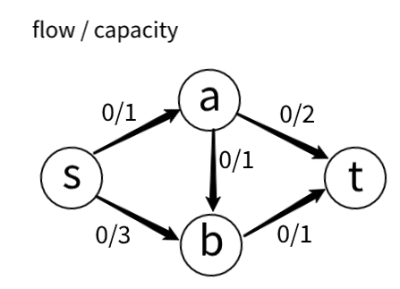
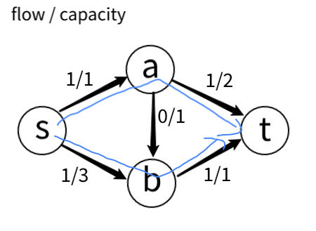
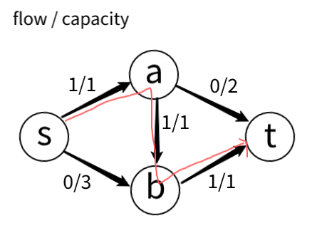
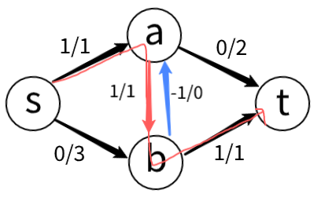
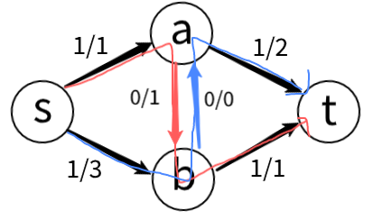
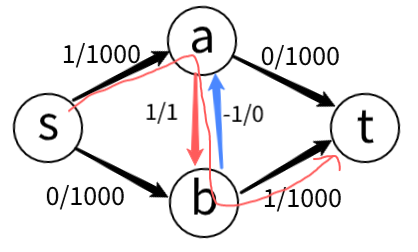
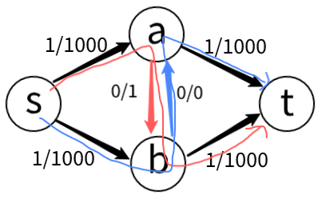
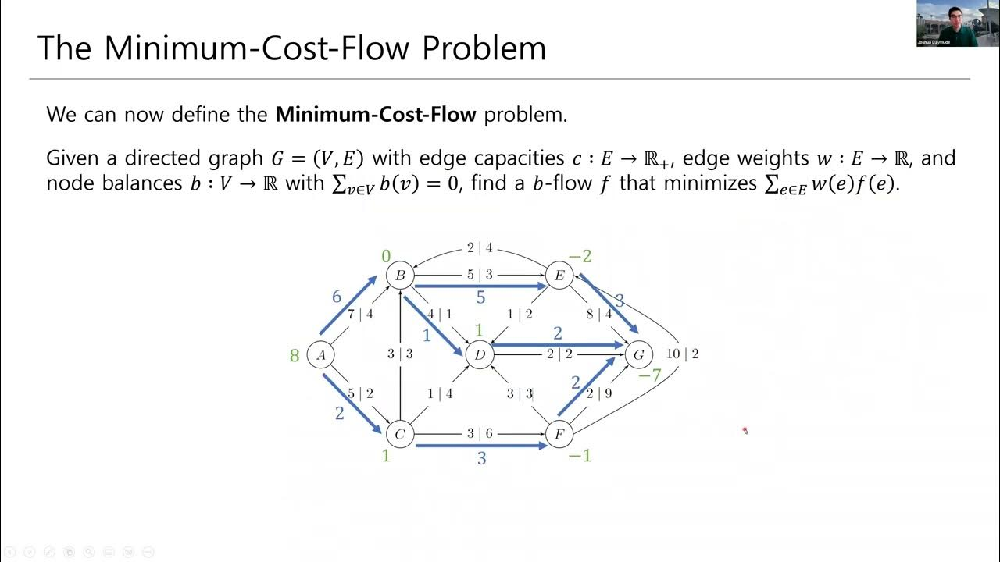
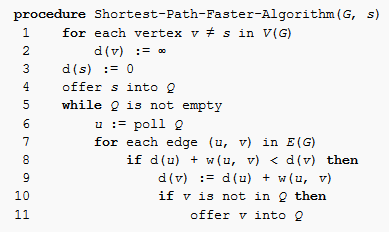

[상위 페이지 · Graph](/study/algorithms/graph/)

## 선행지식

- DFS

## 설명

최대 유량(Maximum Flow Problem)은 네트워크 플로우 이론에서 중요한 알고리즘이다. 이 문제는  Source에서 Sink로 가는 그래프에서, 가능한 최대로 유량을 흘려보내는 방법을 찾는 것이다. 각 간선은 유량이 통과할 수 있는 최대 용량을 가지고 있으며, 우리의 목표는 이 제약조건을 지키면서 소스에서 싱크로 최대한 많은 유량을 보내는 것이다.

## 용어 정리

- **용량(Capacity)**
    - c(u, v)는 정점 u에서 v로 가는 간선이 최대로 수용할 수 있는 유량의 양을 의미한다. 이는 간선의 가중치로 표현된다.
- **유량(Flow)**
    - f(u, v)는 정점 u에서 v로의 간선에 실제로 흐르고 있는 유량을 의미한다. 항상 용량보다 작거나 같아야 한다(f(u, v) ≤ c(u, v)).
- **잔여 용량(Residual Capacity)**
    - 간선의 용량과 현재 흐르는 유량의 차이를 의미한다. r(u, v) = c(u, v) - f(u, v)
    - 즉, 해당 간선에 추가적으로 더 흘려 보낼 수 있는 여유 용량이다.
- **소스(Source)**
    - 유량이 시작되는 정점으로, 네트워크의 시작점이다. 모든 유량은 소스에서 시작하여 싱크로 흐른다.
- **싱크(Sink)**
    - 모든 유량이 최종적으로 도착하는 정점이다. 네트워크의 종착점이다.
    - 네트워크 유량 알고리즘은 소스에서 싱크로 흐를 수 있는 최대 유량을 계산한다.
- **증가 경로(Augmenting Path)**
    - 소스에서 싱크까지 추가 유량을 흘려보낼 수 있는 경로이다. 이 경로의 모든 간선은 양수의 잔여 용량을 가지고 있어야 한다.

## **Ford-Fulkerson & Edmonds-Karp Algorithm**

포드-풀커슨: 최대 유량 문제를 해결하는 기본적인 방법론을 제시했다.

에드몬드-카프: 포드-풀커슨의 알고리즘을 BFS를 사용하여 효율적으로 구현한 방식이다.

포드-풀커슨 알고리즘의 기본 개념:

- 모든 간선의 유량을 0으로 초기화한다.
- 소스에서 싱크로 가는 증가 경로를 찾는다.
- 찾은 경로에서 흘릴 수 있는 최대 유량(경로 상 간선들의 잔여 용량 중 최소값)을 계산한다.
- 해당 경로의 모든 간선에 계산된 유량을 추가한다.
- 더 이상 증가 경로를 찾을 수 없을 때까지 위 과정을 반복한다.

여기서 증가 경로에 흐를 수 있는 최대 값은 해당 경로 상의 모든 간선 중 잔여 용량이 가장 작은 간선의 값이다.

아래와 같은 방향 그래프가 있다면



이 그래프의 최대 유량 경로는 아래와 같다.



만약에 S→A→T가 아닌 S→A→B→T의 경로가 먼저 찾아졌다면 S→B→T의 엣지로는 더 이상 유량을 흘릴 수 없다. 이렇게 된다면 이는 최대 유량이 아니게 된다.



위 같은 문제를 해결하기 위해 유량의 대칭성이라는 속성이 있다. 유량의 대칭성이란 

$$f(u,v) = -f(v,u)$$ : v→u로 1만큼 흐른다면 u→v에도 -1만큼 흐를 수 있다는 속성이다.

하지만 a→b로 가는 엣지는 존재해도 b→a로 가는 엣지는 존재하지 않는다. 이때는 b→a에는 용량이 0인 간선이 존재한다고 가정하고 생각을 한다.

해당 엣지에서 흐를 수 있는 잔여량은 아래와 같이 계산한다

$$r(b,a) = c(b,a) - f(b,a) =0 - ( -f(a,b) ) = 0 - ( -1 ) = 1$$

이와 같은 성질을 이용하면 S→B→A→T라는 새로운 경로를 만들 수 있게 된다.



b→a 의 역방향인 a→b의 플로우가 -1이 됨으로 결국 유량은 상쇄 된다.



그래서 총 유량은 2로 구해진다.

## 구현

증가 경로는 소스 → 싱크까지의 최단 경로를 찾는 BFS를 사용하여 구한다.

BFS 구현 시 다음 정점을 queue에 넣는 조건:

- 해당 간선의 잔여 용량이 있어야 한다
- **r(from, to) = capacity[from][to] - flow[from][to]** > 0
- 방문한 정점에 부모가 없어야 한다 (최단거리 보장)

조건을 만족하는 정점은 경로 추적을 위해 to의 부모로 from을 저장한다.

BFS로 증가 경로를 찾은 후:

- 경로를 역추적하며 흐를 수 있는 최소 용량(amount)을 계산한다
- 정방향 간선은 flow를 amount만큼 증가시킨다
- 역방향 간선은 flow를 amount만큼 감소시킨다 (유량의 대칭성)

이 과정을 source에서 sink로 더 이상 유량을 흘려보낼 수 없을 때까지 반복한다.

```python
import math
 
sz = 128
 
def bfs(flow, capacity, source, sink):
  q = [source]
  parent = [-1] * sz
  parent[source] = source
  while len(q) != 0:
    item = q.pop(0)
    for i in range(sz):
      if parent[i] == -1 and capacity[item][i] - flow[item][i] > 0:
        q.append(i)
        parent[i] = item
  return parent
 
def maxFlow(capacity, source, sink):
  flow = [[0] * sz for _ in range(sz)]
  rst = 0
  while True:
    parent = bfs(flow, capacity, source, sink)
    if parent[sink] == -1:
      return rst
    p = sink
    amount = math.inf
    while p != source:
      amount = min(amount, capacity[parent[p]][p] - flow[parent[p]][p])
      p = parent[p]
    rst += amount
    p = sink
    while p != source:
      flow[parent[p]][p] += amount
      flow[p][parent[p]] -= amount
      p = parent[p]
 
def solve():
  n = int(input())
  capacity = [[0] * sz for _ in range(sz)]
  for _ in range(n):
    p, q, c = input().split()
    p = ord(p)
    q = ord(q)
    c = int(c)
    capacity[p][q] += c
    capacity[q][p] += c
  print(maxFlow(capacity, ord('A'), ord('Z')))
 
solve()
```

## DFS가 아닌 BFS로 알고리즘을 구현하는 이유

앞서 말했듯 알고리즘을 구현하는데엔 DFS가 아닌 BFS 구현한다. 이는 경로의 최적화를 위해서인데 예시를 들어보자

아래와 같은 방향 그래프가 있다고 가정을 한다.



만약 DFS를 통해 S→A→B→T의 경로를 찾았다면 용량의 최소인 1이 새로운 유량으로 추가 될 것이다.

그리고 S→B→A→T의 경로로 유량을 흘린다면  S→A→B→T와 마찬가지로 1이 새로운 유량으로 추가 될 것이다.



이때 알고리즘의 종료 조건은 더 이상 source → sink의 경로 중 더 이상 유량을 흘려보낼 수 없을 때까지이므로 s->a->b->t와 s->b->a->t의 경로가 번갈아 찾아지면서 최대 유량인 1000회 동안 반복된다.

BFS는 무조건 source → sink까지의 최단거리를 보장해주기 때문에 이런 상황이 발생하지 않는다.

## **Minimum Cost Maximum Flow (MCMF)**



Minimum Cost Maximum Flow 통칭 MCMF 이는 최대유량 그래프에서 가중치까지 생긴 문제이다. 최소 비용으로 최대유량을 흘리는 방법론이다.

단순히 생각하면 가중치가 없는 그래프에서 최단경로를 찾던 BFS에서 가중치가 있을때에 사용하는 다익스트라, 벨만포드, SPFA를 사용하는것 뿐이다.



SPFA 수도 코드

가중치 또한 유량과 같게 생각하여 정방향으로 흐르면 + 역방향으로 흐르면 -해준다고 생각하면 편하다.

이때 가중치가 -인 경우가 있음으로 다익스트라보다는 벨만포드나 SPFA를 사용함이 바람직하다.

## 디닉(DINIC) 알고리즘
