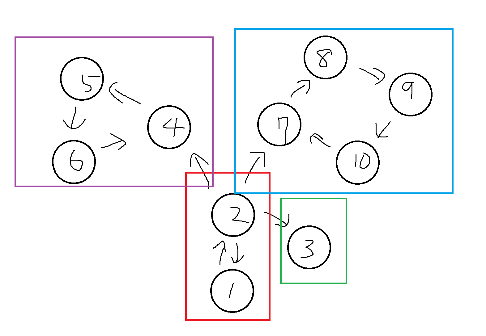

[상위 페이지 · Graph](/study/algorithms/graph/)

SCC란 유향 그래프(Directed Graph) 안에서 서로 강하게 연결되어 있는 정점들의 부분집합을 의미한다. 즉, 같은 SCC에 속한 모든 정점들은 서로 도달 가능한 경로가 존재한다.

"강하게 연결"되어 있다는 것은 하나의 사이클이 형성되는 경우를 뜻한다. 이는 그래프 이론에서 중요한 개념으로, 하나의 SCC 내의 임의의 두 정점 u와 v 사이에는 항상 u에서 v로 가는 경로와 v에서 u로 가는 경로가 모두 존재한다는 것을 의미한다. 다시 말해, 같은 SCC 내에서는 어떤 정점에서 시작하더라도 모든 다른 정점들을 방문할 수 있고, 다시 원래 정점으로 돌아올 수 있는 경로가 존재한다.

좀 더 형식적으로 표현하면:

- 유향 그래프 $$G = (V, E)$$에서, 정점 집합 $$C \subseteq V$$가 **강하게 연결**되어 있다는 것은 $$\forall u, v \in C$$, $$u$$에서 $$v$$로 가는 경로와 $$v$$에서 $$u$$로 가는 경로가 모두 존재함을 의미한다.
- SCC는 이러한 성질을 가지는 **최대 집합**으로, 더 이상 다른 정점을 포함할 수 없다.

그래프를 SCC들로 분해하면 각 SCC는 하나의 정점으로 압축될 수 있으며, 이렇게 압축된 그래프는 항상 DAG(Directed Acyclic Graph) 형태가 된다. 이런 특성은 복잡한 그래프 문제를 단순화하는 데 매우 유용하게 활용된다.



이때 사이클이 없는 단일 노드(자기 자신으로 돌아오는 경로가 없는 정점)도 하나의 독립적인 SCC로 취급한다. 따라서 그래프의 모든 정점은 반드시 어떤 SCC에 속하게 된다.

## 타잔 알고리즘

타잔 알고리즘(Tarjan's Algorithm)은 1972년 로버트 타잔(Robert Tarjan)이 제안한 알고리즘으로, 유향 그래프에서 강한 연결 요소를 효율적으로 찾아내는 방법이다. 이 알고리즘은 DFS를 기반으로 하며, 단 한 번의 탐색으로 모든 SCC를 찾아낼 수 있다는 장점이 있다.

### 알고리즘의 핵심 아이디어

타잔 알고리즘은 각 정점에 대해 두 가지 값을 유지한다:

- $$\text{id}[v]$$: 정점 $$v$$가 DFS에서 방문된 순서
- $$\text{low}[v]$$: 정점 $$v$$에서 DFS 스패닝 트리의 간선을 통해 도달할 수 있는 정점들 중 가장 작은 $$\text{id}$$ 값

스택을 사용하여 현재 탐색 중인 정점들을 관리하며, $$\text{id}[v] = \text{low}[v]$$인 경우 해당 정점 $$v$$가 SCC의 루트임을 의미한다. 이때 스택에서 $$v$$까지의 모든 정점들을 꺼내면 하나의 완전한 SCC를 구성할 수 있다.

### 알고리즘의 동작 과정

1. 그래프의 각 정점에 대해 DFS를 수행한다.
2. 정점을 방문할 때마다 $$\text{id}$$와 $$\text{low}$$ 값을 초기화하고 스택에 push한다.
3. 인접한 정점들을 탐색하면서 $$\text{low}$$ 값을 갱신한다:
    - 아직 방문하지 않은 정점이면 재귀적으로 DFS를 수행하고 $$\text{low}$$ 값을 갱신한다.
    - 이미 스택에 있는 정점이면(즉, 현재 탐색 경로에 포함된 정점이면) $$\text{low}$$ 값을 갱신한다.
4. DFS가 끝난 후, $$\text{id}[v] = \text{low}[v]$$이면 $$v$$를 SCC의 루트로 판단하고, 스택에서 $$v$$까지의 모든 정점을 pop하여 하나의 SCC를 형성한다.

### 시간 복잡도

타잔 알고리즘의 시간 복잡도는 $$O(V + E)$$이다. 여기서 $$V$$는 정점의 개수, $$E$$는 간선의 개수를 의미한다. 각 정점과 간선을 정확히 한 번씩만 방문하기 때문에 매우 효율적이다.

### 구현

```python
def tarjan_scc(graph):
    n = len(graph)
    id_counter = [0]
    ids = [-1] * n
    low = [0] * n
    on_stack = [False] * n
    stack = []
    sccs = []
    
    def dfs(at):
        stack.append(at)
        on_stack[at] = True
        ids[at] = low[at] = id_counter[0]
        id_counter[0] += 1
        
        # 인접한 정점들을 방문
        for to in graph[at]:
            if ids[to] == -1:  # 아직 방문하지 않은 정점
                dfs(to)
            if on_stack[to]:  # 스택에 있는 정점 (현재 경로에 포함)
                low[at] = min(low[at], low[to])
        
        # SCC의 루트를 찾은 경우
        if ids[at] == low[at]:
            scc = []
            while True:
                node = stack.pop()
                on_stack[node] = False
                scc.append(node)
                if node == at:
                    break
            sccs.append(scc)
    
    # 모든 정점에 대해 DFS 수행
    for i in range(n):
        if ids[i] == -1:
            dfs(i)
    
    return sccs
```

이 알고리즘은 코사라주 알고리즘(Kosaraju's Algorithm)과 함께 SCC를 찾는 대표적인 방법으로, 실제 프로그래밍 대회나 실무에서 널리 사용된다.
