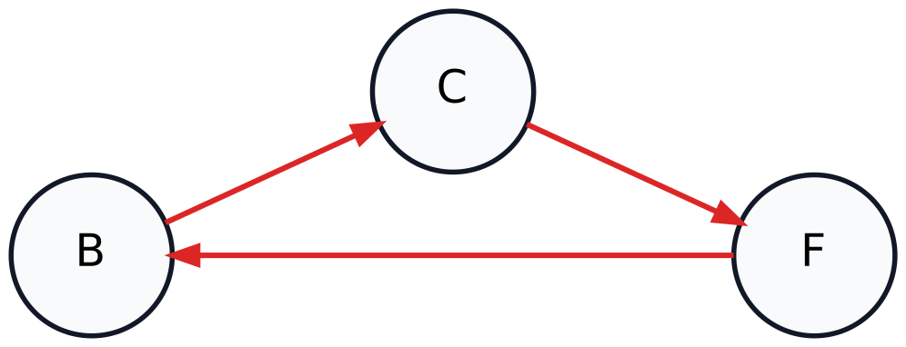
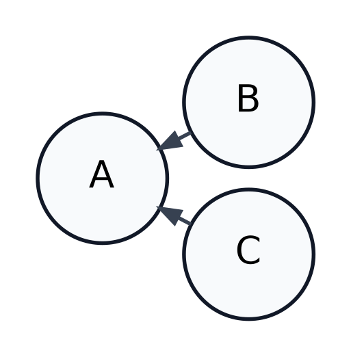
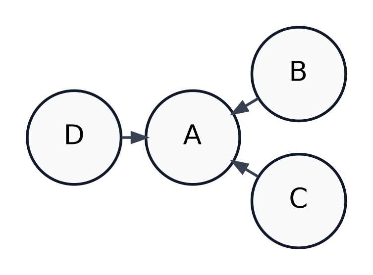
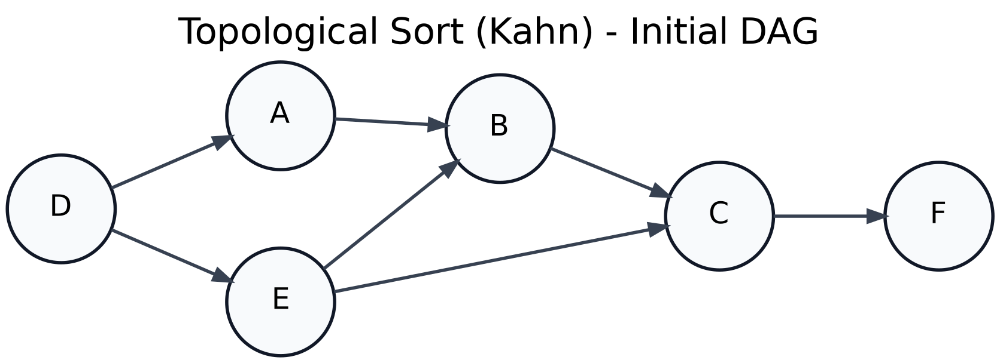
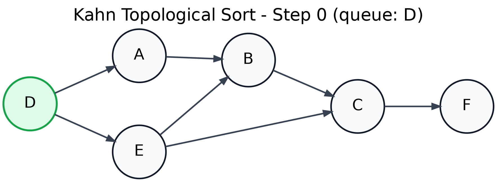
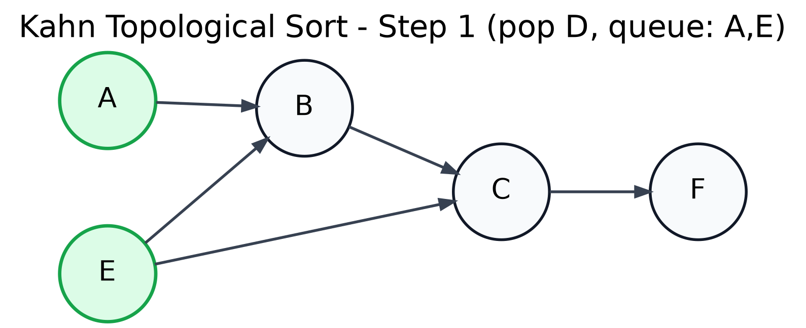
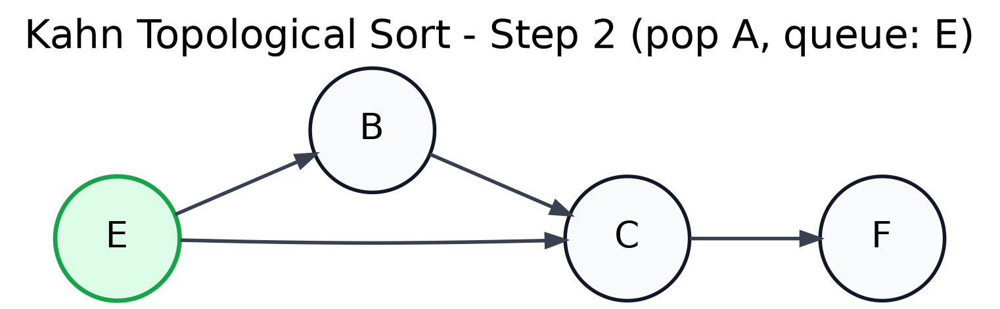

[상위 페이지 · Graph](/study/algorithms/graph/)

## 선행지식

- [Graph](/study/algorithms/graph/)
- [Queue](/study/algorithms/data-structure/queue/)

## 기본 개념

위상 정렬은 유향 그래프에서 모든 간선의 시작 정점이 도착 정점보다 먼저 오도록 정점을 나열하는 방법이다.

선후 관계가 있는 작업 순서를 결정할 때 사용한다.

## 성립 조건

- 그래프가 유향 그래프여야 한다.
- 그래프에 사이클이 없어야 한다.



사이클이 있는 그래프 예시

위 조건을 만족하는 그래프를 유향 비순환 그래프라고 하며, 위상 정렬은 이 경우에만 정의된다.

## 접근 방식 비교

위상 정렬은 카한 방식과 DFS 후위 순회 기반 방식으로 구현할 수 있다.

- DFS
    - 장점: 구현이 단순하고 스택 기반 흐름이 명확하다.
    - 단점: 사이클 판별 로직을 별도로 정확히 넣어야 한다.
- 카한 방식
    - 장점: 진입 차수 0 정점 큐 관리가 직관적이고, 처리 정점 수로 사이클 판별을 함께 할 수 있다.
    - 단점: 큐와 진입 차수 배열을 동시에 관리해야 한다.

아래 설명은 카한 방식 기준이다.

## 동작 원리

카한 방식은 각 정점의 진입 차수를 관리하면서, 진입 차수가 0인 정점부터 큐에서 꺼내 순서를 확정한다.

간선을 제거하듯 인접 정점의 진입 차수를 감소시키고 새로 0이 된 정점을 큐에 넣는 과정을 반복한다.



위 그림에서는 A의 진입 차수가 2다.



세 번째 간선이 추가되면 A의 진입 차수는 3이 된다.

## 절차(구현 기준)

1. 모든 정점의 진입 차수를 계산한다.
2. 진입 차수가 0인 정점을 큐에 넣는다.
3. 큐에서 정점을 꺼내 결과 순서에 추가한다.
4. 꺼낸 정점에서 나가는 간선을 따라 인접 정점의 진입 차수를 1 감소시킨다.
5. 감소 결과가 0이면 해당 정점을 큐에 넣는다.
6. 큐가 빌 때까지 반복하고, 처리한 정점 수가 전체 정점 수보다 작으면 사이클이 있다고 판단한다.

진입 차수는 각 정점이 0이 되는 순간이 최대 한 번이므로 별도 방문 배열 없이 구현할 수 있다.

## 예시 워크스루



초기 상태에서 진입 차수가 0인 정점은 D 하나다.

따라서 큐의 시작 상태는 D다.

|  | A | B | C | D | E | F |
| --- | --- | --- | --- | --- | --- | --- |
| 진입 차수 | 1 | 2 | 2 | 0 | 1 | 1 |

<table><tbody><tr><th scope="row">큐</th><td>D</td></tr></tbody></table>



D를 큐에서 꺼내고, D에서 나가는 간선을 제거하듯 인접 정점의 진입 차수를 1씩 감소시킨다.

|  | A | B | C | D | E | F |
| --- | --- | --- | --- | --- | --- | --- |
| 진입 차수 | 0 | 2 | 2 | 0 | 0 | 1 |

A와 E의 진입 차수가 0이 되므로 두 정점을 큐에 넣는다.

<table><tbody><tr><th scope="row">큐</th><td>A</td><td>E</td></tr></tbody></table>



다음으로 A를 큐에서 꺼내고, A에서 나가는 간선 반영으로 인접 정점의 진입 차수를 감소시킨다.

|  | A | B | C | D | E | F |
| --- | --- | --- | --- | --- | --- | --- |
| 진입 차수 | 0 | 1 | 2 | 0 | 0 | 1 |

이 단계에서는 새롭게 진입 차수 0이 된 정점이 없으므로 큐에는 E만 남는다.

<table><tbody><tr><th scope="row">큐</th><td>E</td></tr></tbody></table>



E를 큐에서 꺼낸 뒤 E와 연결된 정점의 진입 차수를 감소시킨다.

|  | A | B | C | D | E | F |
| --- | --- | --- | --- | --- | --- | --- |
| 진입 차수 | 0 | 0 | 1 | 0 | 0 | 1 |

B는 진입 차수가 0이 되어 큐에 들어가고, C는 아직 1이므로 대기한다.

<table><tbody><tr><th scope="row">큐</th><td>B</td></tr></tbody></table>


이후에는 B, C, F가 순서대로 진입 차수 0이 되며 같은 방식으로 처리된다.


최종 위상 정렬 순서 예시는 D -> A -> E -> B -> C -> F 다.

## 복잡도

- 시간복잡도: O(V + E)
- 공간복잡도: O(V + E)
- 병목 구간: 모든 간선을 한 번씩 순회하며 진입 차수를 감소시키는 구간

## 실패/반례 패턴

- 사이클이 있는 그래프: 처리 정점 수가 전체 정점 수보다 작아진다.
- 연결 요소가 여러 개인 그래프: 시작 시 진입 차수 0 정점을 전부 큐에 넣지 않으면 일부 정점이 누락된다.
- 중복 간선이 있는 그래프: 진입 차수 증가와 감소를 간선 수만큼 정확히 반영해야 한다.

## 구현

```python
import sys
from collections import deque

input = sys.stdin.readline

def topological_sort(n, edges):
    adj = [[] for _ in range(n + 1)]
    indegree = [0] * (n + 1)

    for u, v in edges:
        adj[u].append(v)
        indegree[v] += 1

    q = deque(i for i in range(1, n + 1) if indegree[i] == 0)
    order = []

    while q:
        cur = q.popleft()
        order.append(cur)

        for nxt in adj[cur]:
            indegree[nxt] -= 1
            if indegree[nxt] == 0:
                q.append(nxt)

    if len(order) != n:
        return None
    return order

def solve():
    n, m = map(int, input().split())
    edges = [tuple(map(int, input().split())) for _ in range(m)]

    order = topological_sort(n, edges)
    if order is None:
        print("cycle")
    else:
        print(*order)

if __name__ == "__main__":
    solve()
```
