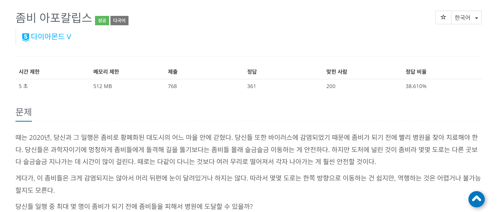
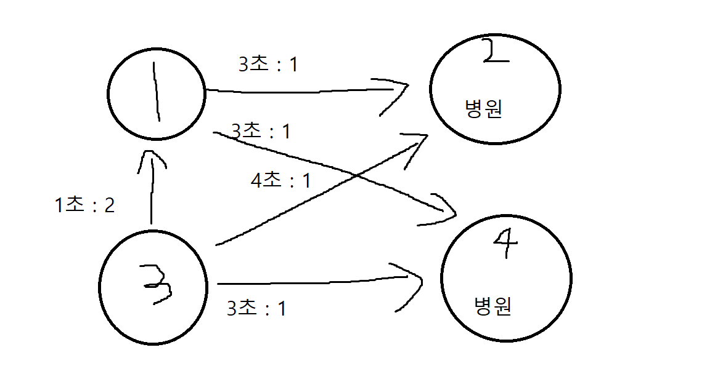
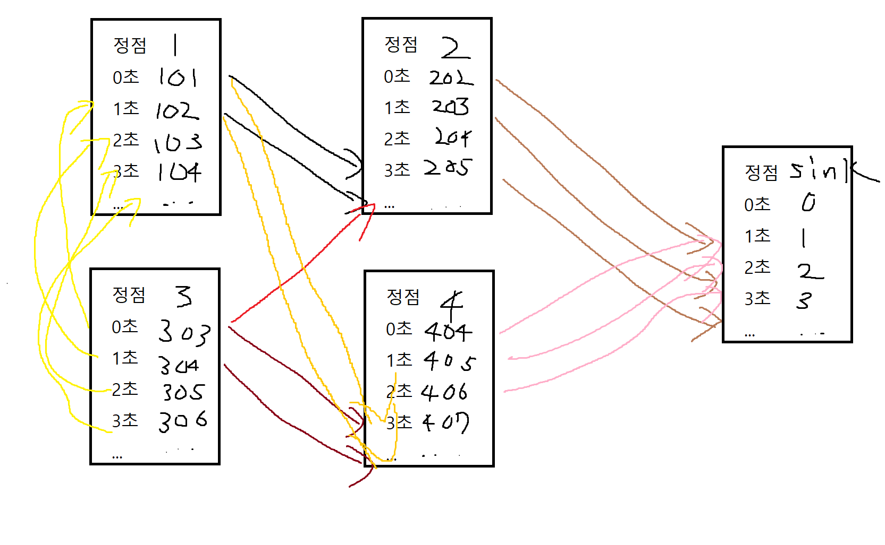

[상위 페이지 · 다이아](/study/algorithms/graph/diamond/)

[https://www.acmicpc.net/problem/10319](https://www.acmicpc.net/problem/10319)



## 아이디어

- 정점을 시간으로 분할 - 애드몬드 - 카프 알고리즘은 단위시간으로 해결하는 알고리즘이라 통과하는데 제각각인  유량을 정점이 시간에 대한 정보를 가지게 하여 그래프를 모델링하면 애드몬드 카프 알고리즘에선 통과 시간을 신경 쓸 필요 없음
예)
100 -> 정점 1의 0초
205 -> 정점 2의 5초
정점 1부터 정점 2까지 4초가 걸린다면
100 -> 204
101 -> 205
...
100 + j -> 200 j + t
단 (j+t < s)
- 가만히 있을때도 고려
100 -> 101
101 -> 102
...
100 + j -> 100+j+1
단 (j+1<s, capacity는 무한)
- 병원을 하나의 가상의 정점 sink로 모음
- 애드몬드 - 카프 알고리즘으로 모델링 된 그래프 최대유량 순회



- ***정점 분할***



- min(일행, 함수(애드몬드 - 카프)값)
- 시간복잡도
    - V(정점)의 최대 = 1000 * 100(시간으로 분할)
    - E(간선)의 최대 = 1000 * 100(시간으로 분할)
    - F의 최대 = 100 * 100
    - 원래 애드몬드 - 카프 알고리즘의 시간복잡도는 $$min(O(VE^2),O(EF))$$
        
        $$O(VE^2) = 100000 * 100000^2$$
        
        $$O(EF) = 100000 * 100 * 100$$
        
        아무리 작아봐야 100,000,000이상의 계산 수행이 필요하여 시간복잡도가 커진다
        
        하지만 이 문제에선 최대 유량이 100으로 유량이 100에 도달시 즉시 종료해준다면
        
        10,000,000으로 충분히 빠르다
        

---

## 답(pypy3 정답, python3 시간초과)

```python
import sys
from collections import deque

N = int(input())
graph = list()
INF = sys.maxsize

class Edge:

    def __init__(self, point, to, capacity):
        self.capacity = capacity
        self.point = point
        self.to = to
        self.flow = 0
        self.inverse_edge = None

    def getRemain(self):
        return self.capacity - self.flow

    def push(self, value):
        self.flow += value
        self.inverse_edge.flow -= value

def buildEdge(a, b, capacity):
    to, come = Edge(a, b, capacity), Edge(b, a, 0)
    come.inverse_edge = to
    to.inverse_edge = come
    graph[a].append(to)
    graph[b].append(come)

def BFS(source, path):
    queue = deque()
    queue.append(source)
    while queue and path[0] is None:
        now = queue.popleft()
        for connectedEdge in graph[now]:
            there = connectedEdge.to
            if connectedEdge.getRemain() > 0 and path[there] is None:
                queue.append(there)
                path[there] = connectedEdge
                if there == 0:
                    return True
    return False

def getFlow(source,g):
    total = 0
    while True:
        path = [None for _ in range(len(graph))]
        if not BFS(source, path):
            break

        minFlow = INF
        current = 0
        while current != source:
            minFlow = min(minFlow, path[current].getRemain())
            current = path[current].point

        current = 0
        while current != source:
            path[current].push(minFlow)
            current = path[current].point

        total += minFlow
        if total > g:
            return g
    return total

def solve():
    n = int(input())
    global graph
    graph = [list() for _ in range((n + 1) * 101)]
    nowPos, g, s = map(int, input().split())

    # 병원을 하나의 가상 정점 sink(0)으로 모음
    m = int(input())
    for _ in range(m):
        x = int(input())
        for time in range(s + 1):
            buildEdge(x * 101 + time, 0, INF)

    # 정점을 시간으로 분할
    r = int(input())
    for _ in range(r):
        a, b, p, t = map(int, input().split())
        for time in range(s - t + 1):
            buildEdge(a * 101 + time, b * 101 + time + t, p)

    # 가만히 있을 때를 고려
    for i in range(1, n + 1):
        for time in range(s):
            buildEdge(i * 101 + time, i * 101 + time + 1, INF)

    print(getFlow(nowPos * 101,g))

while N != 0:
    solve()
    N -= 1

```

pypy3은 맞았지만 python에서 틀린것을 보완하기 위해 다른 블로그 탐색

## 답2(pypy3정답, python3 정답)

```python
import sys
from collections import deque

N = int(input())
graph = list()
INF = sys.maxsize

class Edge:

    def __init__(self, to, capacity):
        self.capacity = capacity
        self.to = to
        self.flow = 0
        self.inverse_edge = None

    def getRemain(self):
        return self.capacity - self.flow

    def push(self, value):
        self.flow += value
        self.inverse_edge.flow -= value

def buildEdge(a, b, capacity):
    to, come = Edge(b, capacity), Edge(a, 0)
    come.inverse_edge = to
    to.inverse_edge = come
    graph[a].append(to)
    graph[b].append(come)

def BFS(source, visited, path):
    queue = deque()
    queue.append(source)
    while queue and visited[0] == -1:
        now = queue.popleft()
        for connectedEdge in graph[now]:
            there = connectedEdge.to
            if connectedEdge.getRemain() > 0 and visited[there] == -1:
                queue.append(there)
                visited[there] = now
                path[there] = connectedEdge
                if there == 0:
                    return True
    return False

def getFlow(source):
    total = 0
    while True:
        visited = [-1 for _ in range(len(graph))]
        path = [None for _ in range(len(graph))]
        if not BFS(source, visited, path):
            break
        minFlow = INF
        current = 0
        while current != source:
            minFlow = min(minFlow, path[current].getRemain())
            current = visited[current]

        current = 0
        while current != source:
            path[current].push(minFlow)
            current = visited[current]

        total += minFlow
        if total > 100:
            return 100
    return total

def solve():
    n = int(input())
    global graph
    graph = [list() for _ in range((n + 1) * 101)]
    maxCap, g, s = map(int, input().split())

    # 병원을 하나의 가상 정점 sink(0)으로 모음
    m = int(input())
    for _ in range(m):
        x = int(input())
        for time in range(s + 1):
            buildEdge(x * 101 + time, 0, INF)

    # 정점을 시간으로 분할
    r = int(input())
    for _ in range(r):
        a, b, p, t = map(int, input().split())
        for time in range(s - t + 1):
            buildEdge(a * 101 + time, b * 101 + time + t, p)

    # 가만히 있을 때를 고려
    for i in range(1, n + 1):
        for time in range(s):
            buildEdge(i * 101 + time, i * 101 + time + 1, INF)

    print(min(g, getFlow(maxCap * 101)))

while N != 0:
    solve()
    N -= 1
```

솔직히 위나 아래나 차이가 없어보이는데 왜 첫번째 답은 시간초과가 나는지 잘 모르겠다.
