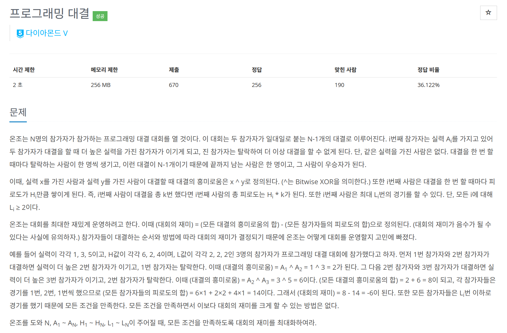
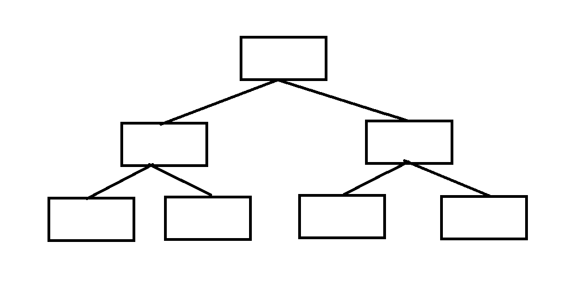
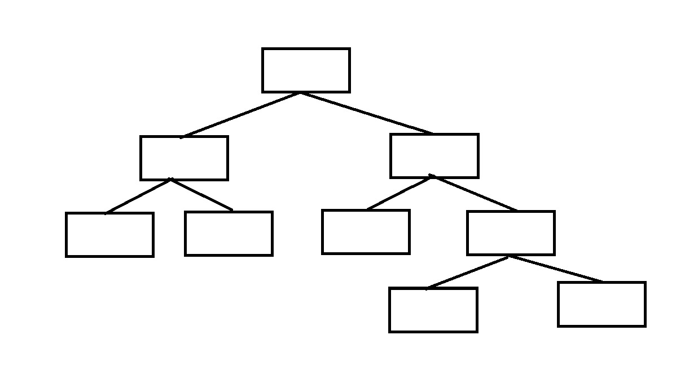

[상위 페이지 · 다이아](/study/algorithms/graph/diamond/)



## 문제 태그

- 그래프 이론
- 최대 유량
- 최소비용 최대유량

## 아이디어



- 일반적인 관념에 따라 이러한 완전 이진트리 토너먼트 대진표를 만들어야 하는줄 알아서 헷갈렸었지만 아래와 같은 불균형한 토너먼트 대진표가 가능함을 알아야함



- H[i] + H[j] -(A[i] ^ A[j])가 최소로 되어야함 (반전, -cost가 최대재미)
- 엣지는 총 3가지의 종류가 있음
    - 1회 패배 보장 엣지
        - source → 패배자
        - 승리자를 제외한 모든 참가자는 단 1회만 패배할것을 보장해야한다. 용량 1, 비용 0으로 이어준다
    - 참가자 → extra j (A[i] < A[j]인 모든 j): 용량 1, 비용 H[i] + H[j] -(A[i] ^ A[j])
    - extra i → sink : 용량 L[i] - 1 (승리자는 L[i]). 비용 0
- 그래프를 모델링해서 음수 가중치가 존재함으로 spfa 최대유량 최소비용 알고리즘을 돌리면 된다.

## 정답

```python
from collections import deque
import sys

class Edge:
    def __init__(self, to, cap, cost):
        self.to = to
        self.cap = cap
        self.cost = cost
        self.flow = 0
        self.rev = None

def add_edge(graph, fr, to, cap, cost):
    forward = Edge(to, cap, cost)
    backward = Edge(fr, 0, -cost)
    forward.rev = backward
    backward.rev = forward
    graph[fr].append(forward)
    graph[to].append(backward)

def spfa(graph, s, t, dist, parent):
    n = len(graph)
    in_queue = [False] * n
    dist[:] = [float('inf')] * n
    dist[s] = 0
    queue = deque([s])
    while queue:
        u = queue.popleft()
        in_queue[u] = False
        for e in graph[u]:
            if e.cap - e.flow > 0 and dist[e.to] > dist[u] + e.cost:
                dist[e.to] = dist[u] + e.cost
                parent[e.to] = (u, e)
                if not in_queue[e.to]:
                    in_queue[e.to] = True
                    queue.append(e.to)
    return dist[t] != float('inf')

def min_cost_max_flow(graph, s, t):
    flow = 0
    cost = 0
    n = len(graph)
    dist = [0] * n
    parent = [None] * n
    while spfa(graph, s, t, dist, parent):
        path_flow = float('inf')
        v = t
        while v != s:
            u, e = parent[v]
            path_flow = min(path_flow, e.cap - e.flow)
            v = u
        v = t
        while v != s:
            u, e = parent[v]
            e.flow += path_flow
            e.rev.flow -= path_flow
            cost += path_flow * e.cost
            v = u
        flow += path_flow
    return flow, cost

input = sys.stdin.readline
N = int(input())
A = [0] + list(map(int, input().split()))
H = [0] + list(map(int, input().split()))
L = [0] + list(map(int, input().split()))

winner = 1
for i in range(2, N + 1):
    if A[i] > A[winner]:
        winner = i

source = 0
sink = 2 * N + 1
graph = [[] for _ in range(2 * N + 2)]

for i in range(1, N + 1):
    if i != winner:
        add_edge(graph, source, i, 1, 0)

for i in range(1, N + 1):
    for j in range(1, N + 1):
        if i != j and A[i] < A[j]:
            add_edge(graph, i, N + j, 1, H[i] + H[j] - (A[i] ^ A[j]))

for i in range(1, N + 1):
    cap = L[i] if i == winner else L[i] - 1
    add_edge(graph, N + i, sink, cap, 0)

flow, cost = min_cost_max_flow(graph, source, sink)
print(-cost)
```
