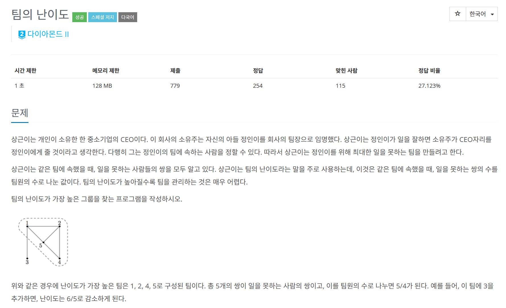

[상위 페이지 · 다이아](/study/algorithms/graph/diamond/)



## 문제 태그

- 그래프 이론
- 이분 탐색
- 매개 변수 탐색
- 최대유량
- 최대유량 최소컷

## 아이디어

- 목표는 서브트리 S에 대해 “간선의 개수 / 정점의 개수”를 최대화 하는 S를 찾는것
- 그래프 모델링
    - source → 각 간선 노드, 용량 1
    - 각 간선 노드 → 해당 간선의 두 정점 노드, 용량 무한대
    - 각 정점 노드 → sink, 용량 g
- 이 네크워크 그래프에서 최대유량은 M-max_S[간선의 개수 - g * 정점의 개수]과 같음
- g가 증가함에 따라 “- g * 정점의 개수”는 감소하게 됨
- 따라서 “f(g) = M-max_S[간선의 개수 - g * 정점의 개수] > 0”에서  ≤으로 전환되는 지점이 단조적으로 존재함. 고로 이분 탐색이 가능

## 정답

```python
import sys
from collections import deque

EPS = 1e-9

class Dinic:

    def __init__(self, n):
        self.n = n
        self.graph = [{} for _ in range(n)]
        self.level = [-1] * n
        self.iter = [0] * n

    def add_edge(self, u, v, cap):
        self.graph[u][v] = cap
        self.graph[v][u] = 0

    def bfs(self, s):
        self.level = [-1] * self.n
        self.level[s] = 0
        q = deque([s])
        while q:
            u = q.popleft()
            for v, cap in self.graph[u].items():
                if cap > EPS and self.level[v] < 0:
                    self.level[v] = self.level[u] + 1
                    q.append(v)

    def dfs(self, u, t, f):
        if u == t:
            return f

        neighbors = list(self.graph[u].keys())
        while self.iter[u] < len(neighbors):
            v = neighbors[self.iter[u]]
            cap = self.graph[u][v]

            if cap > EPS and self.level[u] < self.level[v]:
                d = self.dfs(v, t, min(f, cap))
                if d > EPS:
                    self.graph[u][v] -= d
                    self.graph[v][u] += d
                    return d
            self.iter[u] += 1
        return 0

    def max_flow(self, s, t):
        flow = 0
        while True:
            self.bfs(s)
            if self.level[t] < 0:
                return flow
            self.iter = [0] * self.n
            while True:
                f = self.dfs(s, t, float('inf'))
                if f < EPS:
                    break
                flow += f

    def get_s_side_nodes(self, s):
        s_side_nodes = set()
        q = deque([s])
        s_side_nodes.add(s)
        while q:
            u = q.popleft()
            for v, cap in self.graph[u].items():
                if cap > EPS and v not in s_side_nodes:
                    s_side_nodes.add(v)
                    q.append(v)
        return s_side_nodes

input = sys.stdin.readline
N, M = map(int, input().split())
pairs = [list(map(int, input().split())) for _ in range(M)]

low = 0.0
high = float(M)

for _ in range(100):
    g = (low + high) / 2
    source = 0
    sink = 1
    num_nodes = 2 + N + M

    dinic = Dinic(num_nodes)

    total_pair_value = 0

    for i in range(M):
        u, v = pairs[i]
        pair_node_idx = N + 2 + i
        person_node_u_idx = u + 1
        person_node_v_idx = v + 1

        dinic.add_edge(source, pair_node_idx, 1.0)
        total_pair_value += 1.0

        dinic.add_edge(pair_node_idx, person_node_u_idx, float('inf'))
        dinic.add_edge(pair_node_idx, person_node_v_idx, float('inf'))

    for i in range(N):
        person_node_idx = i + 2
        dinic.add_edge(person_node_idx, sink, g)

    min_cut_val = dinic.max_flow(source, sink)

    if total_pair_value - min_cut_val > EPS:
        low = g
    else:
        high = g

if high < EPS:
    print(1)
    print(1)
    exit(0)

g = high - EPS
source = 0
sink = 1
num_nodes = 2 + N + M
dinic_final = Dinic(num_nodes)

for i in range(M):
    u, v = pairs[i]
    pair_node_idx = N + 2 + i
    person_node_u_idx = u + 1
    person_node_v_idx = v + 1
    dinic_final.add_edge(source, pair_node_idx, 1.0)
    dinic_final.add_edge(pair_node_idx, person_node_u_idx, float('inf'))
    dinic_final.add_edge(pair_node_idx, person_node_v_idx, float('inf'))

for i in range(N):
    person_node_idx = i + 2
    dinic_final.add_edge(person_node_idx, sink, g)

dinic_final.max_flow(source, sink)
final_cut_nodes = dinic_final.get_s_side_nodes(source)

team = []
for i in range(N):
    person_node_idx = i + 2
    if person_node_idx in final_cut_nodes:
        team.append(i + 1)

print(len(team))
print("\n".join(map(str, sorted(team))))
```
