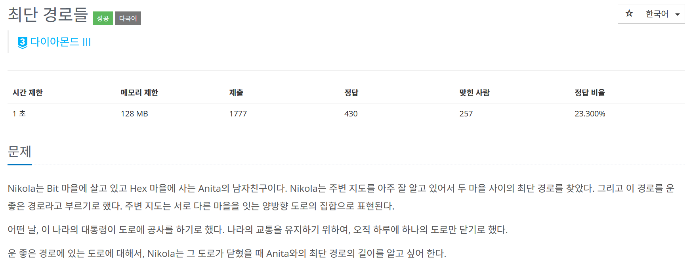

[상위 페이지 · 다이아](/study/algorithms/graph/diamond/)



## 문제 태그

- 자료구조
- 그래프 이론
- 트리
- 세그먼트 트리
- 최단 경로
- 다익스트라
- lazy propagation 세그먼트 트리

## 아이디어

- 주어진 최단 경로의 간선을 하나씩 순서대로 제거했을 때 각 경우에 대한 새로운 최단거리를 효율적으로 찾는 문제임
- 주어진 그래프에서 최단경로와 그 외의 우회로로 분리를 하여 우회로 그래프를 별도로 만든다
- 세그먼트 트리를 이용해 추가비용의 최소값을 구간별로 관리 함
    - 추가비용은 우회로를 통해 특정 경로 노드까지 도달하는거리 - 원래 경로로의 거리
- 다익스트라를 이용해 우회로를 탐색하여 세그먼트 트리의 추가 비용을 최소로 유지해준다
- 최종 답 = 원래 최단 경로 길이 + 조회된 추가 비용

## 정답

```python
import sys
import heapq
from collections import defaultdict

input = sys.stdin.readline
sys.setrecursionlimit(10**6)
INF = float('inf')

def dijkstra_add_source(dist, heap, residual, path_index, st, dist_path):
    while heap:
        cost, node = heapq.heappop(heap)
        if cost > dist[node]:
            continue
        for to, w in residual[node]:
            new_cost = cost + w
            if new_cost < dist[to]:
                dist[to] = new_cost
                heapq.heappush(heap, (new_cost, to))
                if to in path_index:
                    j = path_index[to]
                    st.update(j, new_cost - dist_path[j])

class SegmentTree:
    def __init__(self, n):
        self.n = n
        self.tree = [INF] * (4 * n)
        self.build(1, 1, n)

    def build(self, node, l, r):
        if l == r:
            self.tree[node] = INF
            return
        mid = (l + r) // 2
        self.build(2 * node, l, mid)
        self.build(2 * node + 1, mid + 1, r)
        self.tree[node] = min(self.tree[2 * node], self.tree[2 * node + 1])

    def update(self, idx, val):
        self._update(1, 1, self.n, idx, val)

    def _update(self, node, l, r, idx, val):
        if l == r:
            self.tree[node] = val
            return
        mid = (l + r) // 2
        if idx <= mid:
            self._update(2 * node, l, mid, idx, val)
        else:
            self._update(2 * node + 1, mid + 1, r, idx, val)
        self.tree[node] = min(self.tree[2 * node], self.tree[2 * node + 1])

    def query(self, start, end):
        return self._query(1, 1, self.n, start, end)

    def _query(self, node, l, r, start, end):
        if start > r or end < l:
            return INF
        if start <= l and r <= end:
            return self.tree[node]
        mid = (l + r) // 2
        return min(self._query(2 * node, l, mid, start, end), self._query(2 * node + 1, mid + 1, r, start, end))

n, m, a, b = map(int, input().split())
graph = defaultdict(list)
for _ in range(m):
    u, v, w = map(int, input().split())
    graph[u].append((v, w))
    graph[v].append((u, w))

k, *path_list = map(int, input().split())
p = [0] + path_list

dist_path = [0] * (k + 1)
for i in range(1, k):
    u = p[i]
    v = p[i+1]
    for to, ww in graph[u]:
        if to == v:
            dist_path[i+1] = dist_path[i] + ww
            break

d = dist_path[k]
residual = defaultdict(list)
for u in graph:
    for to, w in graph[u]:
        residual[u].append((to, w))

for i in range(1, k):
    u = p[i]
    v = p[i+1]
    residual[u] = [(to, w) for to, w in residual[u] if to != v]
    residual[v] = [(to, w) for to, w in residual[v] if to != u]

path_index = {p[j]: j for j in range(1, k+1)}
st = SegmentTree(k)
dist = [INF] * (n + 1)
heap = []
answers = []

for tt in range(1, k):
    new_cost = dist_path[tt]
    curr_node = p[tt]
    if new_cost < dist[curr_node]:
        dist[curr_node] = new_cost
        heapq.heappush(heap, (new_cost, curr_node))
        st.update(tt, new_cost - dist_path[tt])

    dijkstra_add_source(dist, heap, residual, path_index, st, dist_path)

    min_extra = st.query(tt + 1, k)
    if min_extra == INF:
        answers.append(-1)
    else:
        answers.append(int(d + min_extra))

for ans in answers:
    print(ans)
```
