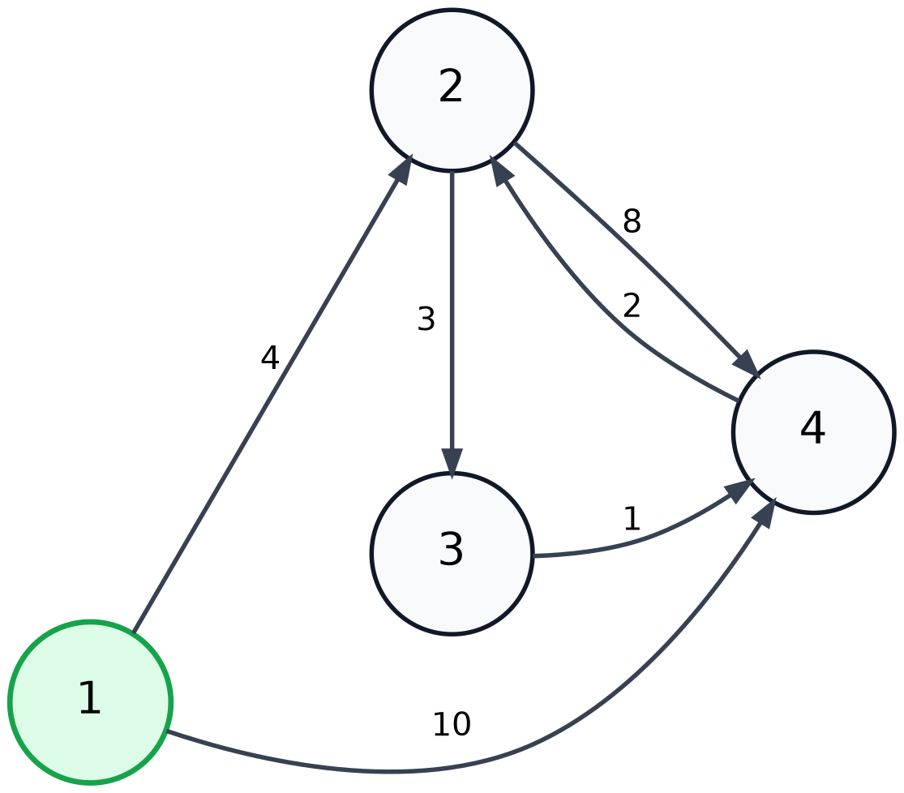
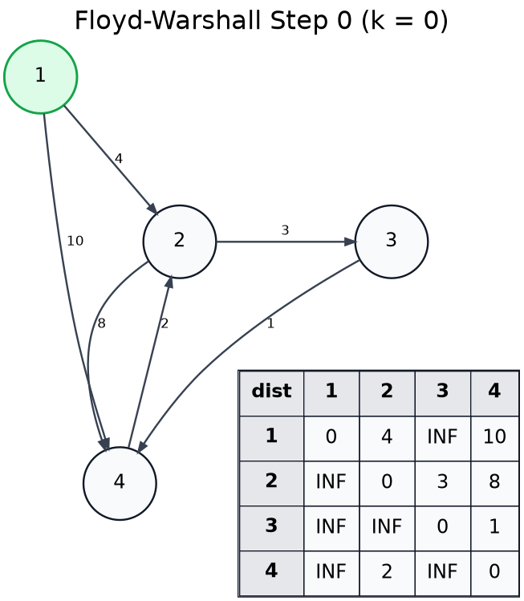
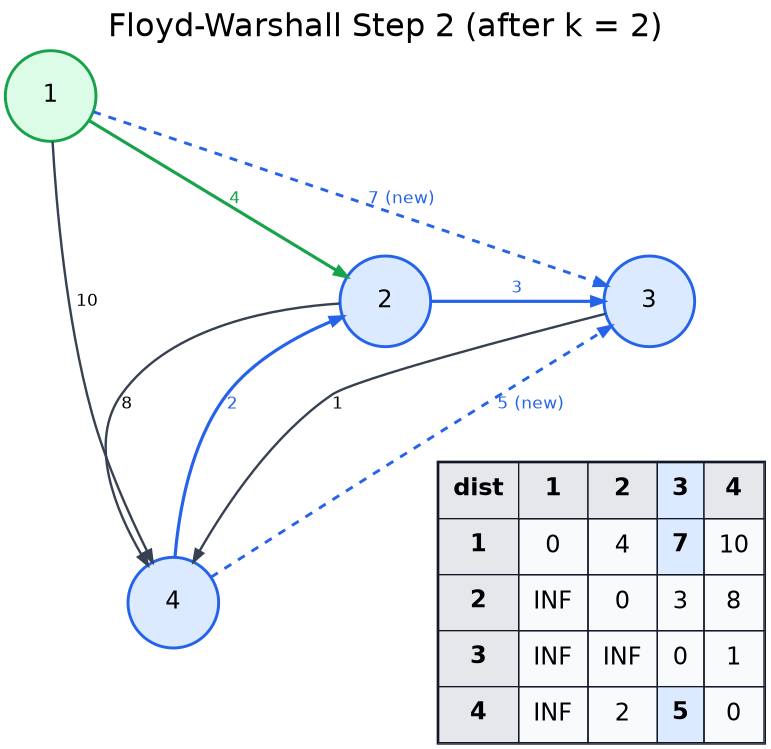
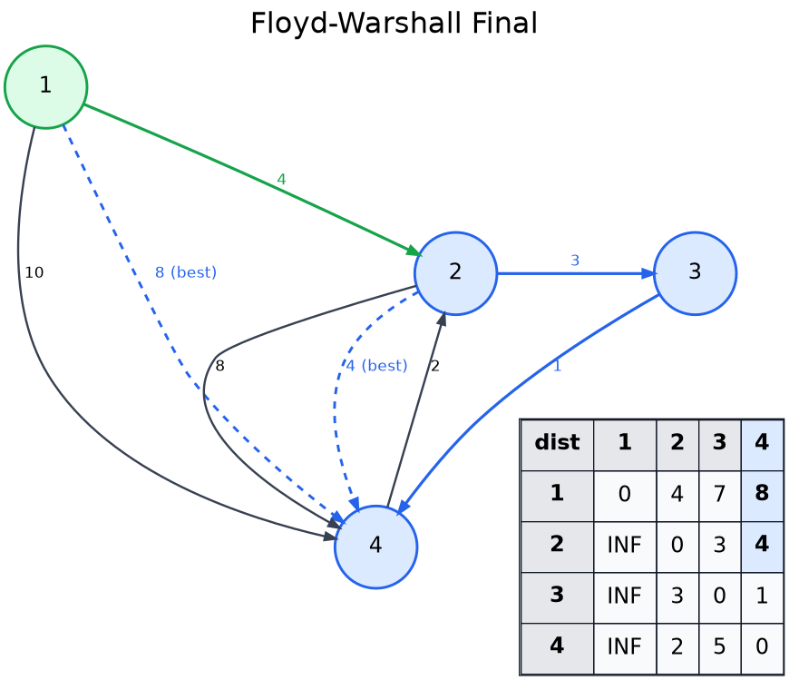
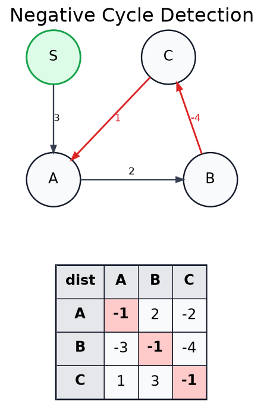

[상위 페이지 · Graph](/study/algorithms/graph/)

## 기본 개념

플로이드 워셜은 모든 정점 쌍 최단 거리를 한 번에 구하는 알고리즘이다.

중간 정점 집합을 단계적으로 확장하면서 거리 행렬을 갱신한다.

음수 간선은 허용하지만, 음수 사이클이 있으면 최단 거리 개념이 성립하지 않는다.

## 선행지식

- [Graph](/study/algorithms/graph/)
- [Dijkstra](/study/algorithms/graph/dijkstra/)
- [**Bellman-Ford**](/study/algorithms/graph/bellman-ford/)
- 방향 그래프
- 인접 행렬

## 예시 워크스루

예시 그래프 정점은 1, 2, 3, 4다.

첫 번째 이미지는 워크스루 전체에서 기준이 되는 원본 그래프다.

이후 단계 이미지도 정점 위치를 동일하게 유지하므로, 선 색상과 행렬의 강조 셀만 비교하면 어떤 값이 바뀌었는지 빠르게 읽을 수 있다.



간선은 다음 여섯 개를 사용한다.

- 1번에서 2번으로 가중치 4
- 1번에서 4번으로 가중치 10
- 2번에서 3번으로 가중치 3
- 2번에서 4번으로 가중치 8
- 3번에서 4번으로 가중치 1
- 4번에서 2번으로 가중치 2

### 단계 0 초기 상태

이 그림은 알고리즘 시작 직후 상태를 보여준다.

상단 그래프에서 초록색 1번은 시작 정점이고, 회색 실선은 입력으로 주어진 원본 간선이다.

하단 dist 행렬은 초기값이며, 대각 원소는 모두 0, 직접 간선이 있는 칸만 유한값으로 채워지고 나머지는 INF다.

즉 1행은 1→2=4, 1→4=10만 값이 있고, 2행은 2→3=3, 2→4=8, 3행은 3→4=1, 4행은 4→2=2만 초기 반영된 상태다.

사진을 읽을 때는 상단 간선 라벨과 하단 행렬 값을 한 줄씩 대응해서 보면 된다.

예를 들어 상단 1→4의 라벨 10은 하단 행렬의 (1,4)=10과 정확히 대응하고, 간선이 없는 1→3은 하단에서 INF로 남는다.



### 단계 2 중간 정점 2까지 반영



이 단계는 중간 정점으로 1, 2만 허용했을 때의 결과다.

상단 그래프의 파란 점선은 이번 단계에서 새로 갱신된 경로를 뜻한다.

1→3은 1→2→3 경유로 4+3=7이 되어 INF에서 7로 바뀌고, 4→3은 4→2→3 경유로 2+3=5가 되어 INF에서 5로 바뀐다.

하단 행렬에서는 이 두 칸 (1,3), (4,3)만 파란 강조 셀로 표시되어 어떤 값이 새로 갱신됐는지 바로 확인할 수 있다.

### 최종 단계 전체 반영 완료



모든 중간 정점을 허용한 뒤의 최종 상태다.

상단 그래프의 파란 점선 1→4, 2→4는 기존 직접 간선보다 더 짧은 최종 최단 경로를 의미한다.

1→4는 직접 경로 10보다 1→2→3→4 경유 8이 더 짧아 8로 확정되고, 2→4는 직접 경로 8보다 2→3→4 경유 4가 더 짧아 4로 확정된다.

하단 행렬에서도 4열의 핵심 값이 1행 8, 2행 4로 반영되어 그래프에서 본 갱신 결과가 수치로 일치함을 확인할 수 있다.

## 성립 조건 / 정리

### 조건

- 음수 간선이 있어도 동작한다.
- 음수 사이클이 있으면 최단 거리 개념이 무너진다.

### 정리

- 중간 정점 집합을 점점 확장하면 모든 경유 경로가 반영된다.
- 반복 종료 후 행렬이 모든 정점 쌍 최단 거리를 담는다.

$$
\mathrm{dist}[i][j] = \min\left(\mathrm{dist}[i][j],\ \mathrm{dist}[i][k] + \mathrm{dist}[k][j]\right)
$$

## 동작 원리

### 전체 흐름

1. 거리 행렬을 초기화한다.
2. 중간 정점 k를 바깥 반복으로 둔다.
3. 시작 정점 i, 도착 정점 j를 순회하며 갱신한다.

### 불변식

- 중간 정점 1부터 k까지만 허용했을 때의 최단 거리가 반복 종료 시점의 행렬에 저장된다.

### 왜 맞는가

직접 경로와 k를 경유하는 경로를 모두 비교해 더 짧은 값을 유지하므로, 허용 중간 정점 범위를 넓힐수록 정답에 수렴한다.

## 음수 사이클 판정

반복이 모두 끝난 뒤 아래 조건이 성립하면 음수 사이클이 존재한다.

$$
\exists i\ \text{such that}\ \mathrm{dist}[i][i] < 0
$$



캡션

- 상단 그래프: 음수 사이클을 구성하는 간선을 빨간색으로 표시
- 하단 매트릭스: 대각 원소가 음수가 된 셀을 강조
- 판정 포인트: dist(i,i)가 음수면 음수 사이클 존재

## 절차(구현 기준)

1. 거리 행렬을 INF로 채운다.
2. 자기 자신 거리를 0으로 둔다.
3. 입력 간선을 행렬에 반영한다.
4. 중간 정점 반복을 가장 바깥에 둔다.
5. 도달 불가능 체크 후 경유 갱신을 수행한다.
6. 필요하면 음수 사이클을 확인한다.

## 복잡도

- 시간복잡도: $$O(V^3)$$
- 공간복잡도: $$O(V^2)$$

## 실패/반례 패턴

- 반복 순서 실수
- INF 가드 누락
- 다중 간선 최소값 미반영

## 구현

```python
import sys

input = sys.stdin.readline
INF = 10**18

def floyd_warshall(n, edges):
    dist = [[INF] * (n + 1) for _ in range(n + 1)]

    for i in range(1, n + 1):
        dist[i][i] = 0

    # 다중 간선 최소값 반영
    for u, v, w in edges:
        if w < dist[u][v]:
            dist[u][v] = w

    # 중간 정점 -> 시작 정점 -> 도착 정점 순서
    for k in range(1, n + 1):
        for i in range(1, n + 1):
            if dist[i][k] == INF:
                continue
            for j in range(1, n + 1):
                if dist[k][j] == INF:
                    continue
                cand = dist[i][k] + dist[k][j]
                if cand < dist[i][j]:
                    dist[i][j] = cand

    neg_cycle = any(dist[i][i] < 0 for i in range(1, n + 1))
    return dist, neg_cycle
```

## 참고 개념정리

- [Dijkstra](/study/algorithms/graph/dijkstra/)
- [**Bellman-Ford**](/study/algorithms/graph/bellman-ford/)

## 참고 자료

- [https://cp-algorithms.com/graph/all-pair-shortest-path-floyd-warshall.html](https://cp-algorithms.com/graph/all-pair-shortest-path-floyd-warshall.html)
- CLRS Chapter 25

## 예시 문제

- [11403번 경로 찾기](/study/algorithms/graph/floyd-warshall/boj-11403/)
