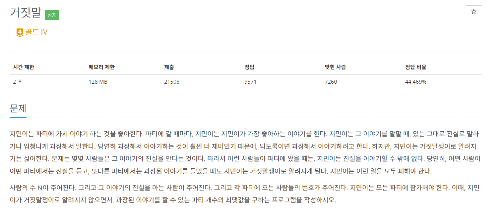

[상위 페이지 · Graph](/study/algorithms/graph/)

[https://www.acmicpc.net/problem/1043](https://www.acmicpc.net/problem/1043)



## 아이디어

이 문제는 분리된 집합속에 사람을 매개체로 연결 될 수 있다는걸 보여준다.

이 문제는 분리 집합(Union Find) 알고리즘을 이용해서 만난 사람들끼리는 하나의 공통된 부모를 가지게 만든다.

예를 들어1

1) 4 3 1 2

2) 5 2 9 7

이 참여한다고 하면

4와 3 1 2를 묶어 한 집합으로 만든다.

그러면 3,1,2는 4가 부모가 되는것이다

다음 2)를 보면 5와 2 9 7 를 묶어 한 집합으로 만드는데 2의 부모는 4이기 때문에 4의 부모가 5로 바뀐다

이러면 

3,1,2는 부모로 4를 가지게되고 4,9,7은 부모 5를 가지게 돼 1) 2)는 같은 하나의 집합으로 묶이게 된다.

하지만 단순히 이렇게 묶는다면 최고 부모가 진실을 모른다면 그 집합 전체는 진실을 모르는것으로 간주되고. 최고 부모가 진실을 안다면 그 집합 전체는 진실을 아는것이 된다.

여기서 중요한 포인트는 위에서도 말했듯 분리된 두 집합을 하나로 합칠 때 누가 부모가 되냐가 제일 중요하다고 볼 수 있다. 합치는 두 집합의 부모 중 진실을 아는 사람이 부모가 돼야한다. 

이제 위 과정을 통해 모든 파티를 여러개의 집합으로 만들었으면 단순히 각 파티당 아무나 한명을 뽑아 그 사람의 부모가 누구인지 확인하면 그 파티 집합이 진실을 앎을 보장할 수 있다

## 정답

```python
N,M = map(int,input().split())
parent = [i for i in range(N+1)]
know_Truth = [False] * (N+1)

arr = list(map(int,input().split()))

for i in arr[1:]:
    know_Truth[i] = True

def find(x):
    if parent[x] == x:
        return parent[x]
    y = find(parent[x])
    parent[x] = y
    return y

def union(x,y):
    root1 = find(x)
    root2 = find(y)

    if know_Truth[root1]:
        parent[root2] = parent[root1]
    elif know_Truth[root2]:
        parent[root1] = parent[root2]
    else:
        parent[root1] = parent[root2]

parties = []

for _ in range(M):
    party = list(map(int,input().split()))[1:]
    parties.append(party)
    person = party[0]
    for i in range(1,len(party)):
        union(person,party[i])

count = 0
for i in parties:
    if not know_Truth[find(i[0])]:
        count += 1
print(count)
```

ㅁ
