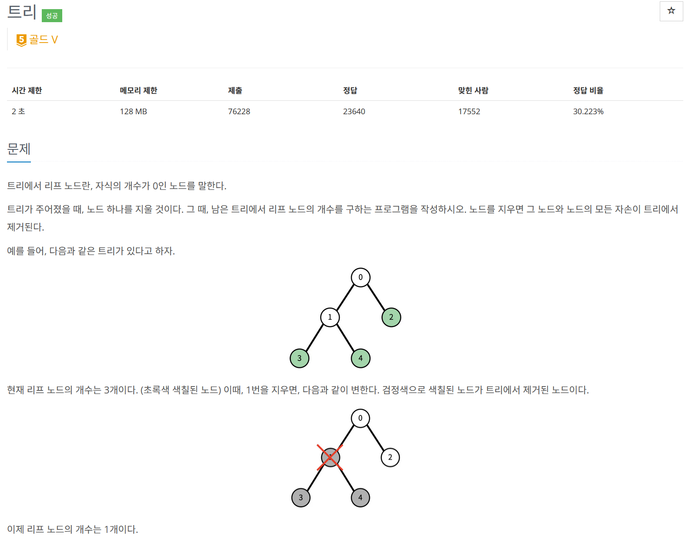

[상위 페이지 · 골드/레벨3](/study/algorithms/graph/gold-level-3/)



## 문제 태그

- 그래프 이론
- 그래프 탐색
- 트리
- DFS

## 아이디어

- dfs로 트리를 탐색하면서 각 노드마다 자식의 개수를 세어준다. 만약 유효한 자식의 개수가 0이라면 자신은 리프노드이다
- root가 지워졌을때가 코너케이스로 존재한다

## 정답

```python
import sys

sys.setrecursionlimit(10 ** 3)

n = int(input())
parent = list(map(int, input().split()))
delete_node = int(input())

adj_list = [[] for _ in range(n)]
root = -1
for i, p in enumerate(parent):
    if p == -1:
        root = i
        continue
    adj_list[p].append(i)

count = 0

def dfs(node):
    global count
    valid_child_count = 0
    for child in adj_list[node]:
        if child != delete_node:
            valid_child_count += 1
            dfs(child)
    if valid_child_count == 0:
        count += 1

if root != delete_node:
    dfs(root)

print(count)
```
