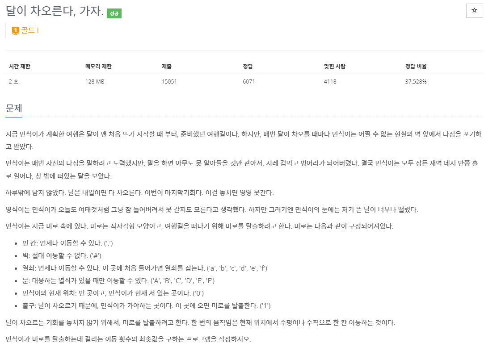

[상위 페이지 · 골드/레벨3](/study/algorithms/graph/gold-level-3/)

[https://www.acmicpc.net/problem/1194](https://www.acmicpc.net/problem/1194)



## 아이디어

bfs를 돌리는데 키를 먹었다면 새로운 차원에서 이전 발걸음만 유지한 상태로 시작한다고 봐도 무방하다.

키를 관리하는건 비트마스킹으로 관리를 해 int 값으로 만든 뒤 visited의 인덱스로 사용 가능하게 만들어준다.

## 정답

```python
from collections import deque

dir = [[1, 0], [-1, 0], [0, -1], [0, 1]]
R, C = map(int, input().split())
graph = [list(input()) for _ in range(R)]

key = {"a": 0, "b": 1, "c": 2, "d": 3, "e": 4, "f": 5}

def bfs(x,y):
    queue = deque()
    visited = [[[-1] * 70 for _ in range(C)] for _ in range(R)]
    queue.append((x,y,0))
    visited[x][y][0] = 0
    while queue:
        r,c,key_holding = queue.popleft()
        for dr,dc in dir:
            ddr = dr + r
            ddc = dc + c
            if 0<=ddr<R and 0<=ddc<C and graph[ddr][ddc] != "#" and visited[ddr][ddc][key_holding] == -1:
                space = graph[ddr][ddc]
                if "a"<=space<="f":
                    visited[ddr][ddc][key_holding] = visited[r][c][key_holding] + 1
                    temp = key_holding | (1<<key[space])
                    visited[ddr][ddc][temp] = visited[r][c][key_holding] + 1
                    queue.append((ddr,ddc,temp))
                elif "A"<=space<="F" and key_holding & (1 << key[space.lower()]):
                    visited[ddr][ddc][key_holding] = visited[r][c][key_holding] + 1
                    queue.append((ddr,ddc,key_holding))
                elif space == "." or space == "0":
                    visited[ddr][ddc][key_holding] = visited[r][c][key_holding] + 1
                    queue.append((ddr, ddc, key_holding))
                elif space == "1":
                    return visited[r][c][key_holding] + 1
    return -1

for i in range(R):
    for j in range(C):
        if graph[i][j] == "0":
            print(bfs(i, j))
            exit(0)
```
