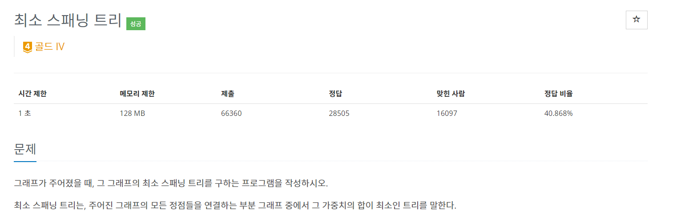

[상위 페이지 · 골드/레벨3](/study/algorithms/graph/gold-level-3/)

[https://www.acmicpc.net/problem/1197](https://www.acmicpc.net/problem/1197)



## 아이디어

단순히 크루스칼 알고리즘을 사용하여 문제를 해결하면 된다.

## 정답

```python
import sys

sys.setrecursionlimit(10 ** 5)

N, M = map(int, input().split())
graph = []
for _ in range(M):
    _from, to, weight = map(int, input().split())
    graph.append((weight,_from,to))

parent = [i for i in range(N+1)]
graph.sort()

def find(x):
    if parent[x] == x:
        return parent[x]
    y = find(parent[x])
    parent[x] = y
    return y

def union(x,y):
    root1 = find(x)
    root2 = find(y)
    if root1 < root2:
        parent[root2] = parent[root1]
    else:
        parent[root1] = parent[root2]

answer = 0
for weight,_from,to in graph:
    if find(_from) != find(to):
        answer += weight
        union(_from,to)
print(answer)
```
