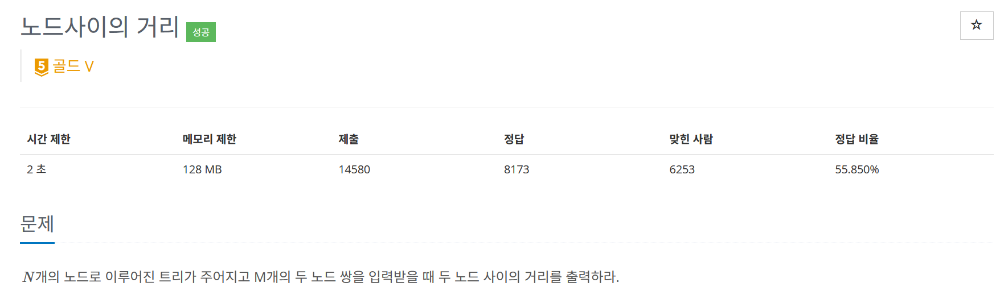

[상위 페이지 · 골드/레벨3](/study/algorithms/graph/gold-level-3/)



## 문제 태그

- 그래프 이론
- 그래프 탐색
- 트리
- BFS
- DFS

## 아이디어

- 주어진 그래프를 구성한 뒤 u에서부터 v를 찾을때까지 dfs든 bfs든 돌려준다
- 트리이기에 dfs로 탐색해도 최단거리를 보장하는것

## 정답

```python
from collections import deque

N,M = map(int, input().split())
adj_list = [] + [[] for i in range(N + 1)]
for i in range(N - 1):
    u,v,cost = map(int, input().split())
    adj_list[u].append((v,cost))
    adj_list[v].append((u,cost))

def get_distance(u,v):
    queue = deque()
    queue.append((u,0))
    visited = [False] * (N+1)
    while queue:
        node,cost = queue.popleft()
        if node == v:
            return cost
        for child,edge_cost in adj_list[node]:
            if not visited[child]:
                visited[child] = True
                queue.append((child,cost + edge_cost))

for _ in range(M):
    u,v = map(int, input().split())
    print(get_distance(u,v))
```
