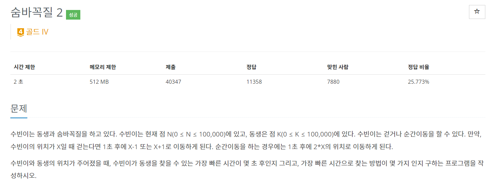

[상위 페이지 · Graph](/study/algorithms/graph/)

[https://www.acmicpc.net/problem/12851](https://www.acmicpc.net/problem/12851)



## 아이디어

문제는 [13549번 숨바꼭질 3](/study/algorithms/graph/gold-level-3/boj-13549/) 와 비슷한 문제지만 거기까지 갈 수 있는 경로가 몇개인지 구하는것이다.

이 문제는 2차원배열을 써 visited[시간][경로]로 만약 같은 시간내에 같은 위치로 갈 수 있다면 그 경로들을 다 더해주는것으로 해결 했다.

## 정답

```python
from collections import deque

N,M = list(map(int,input().split()))
visited = [[-1] * 2 for _ in range(100001)]
queue = deque()
queue.append(N)
visited[N][0] = 0
visited[N][1] = 1
while queue:
    temp = queue.popleft()
    count = visited[temp]
    if 0<=temp-1<100001 and visited[temp-1]:
        if visited[temp - 1][0] == -1:
            queue.append(temp - 1)
            visited[temp - 1][0] = visited[temp][0] + 1
            visited[temp - 1][1] = visited[temp][1]
        elif visited[temp - 1][0] == visited[temp][0] + 1:
            visited[temp - 1][1] += visited[temp][1]
    if 0<=temp*2<100001 and visited[temp*2]:
        if visited[temp * 2][0] == -1:
            queue.append(temp * 2)
            visited[temp * 2][0] = visited[temp][0] + 1
            visited[temp * 2][1] = visited[temp][1]
        elif visited[temp * 2][0] == visited[temp][0] + 1:
            visited[temp * 2][1] += visited[temp][1]
    if 0<=temp+1<100001:
        if visited[temp+1][0] == -1:
            queue.append(temp+1)
            visited[temp+1][0] = visited[temp][0] + 1
            visited[temp+1][1] = visited[temp][1]
        elif visited[temp + 1][0] == visited[temp][0] + 1:
            visited[temp + 1][1] += visited[temp][1]

print(visited[M][0])
print(visited[M][1])
```
