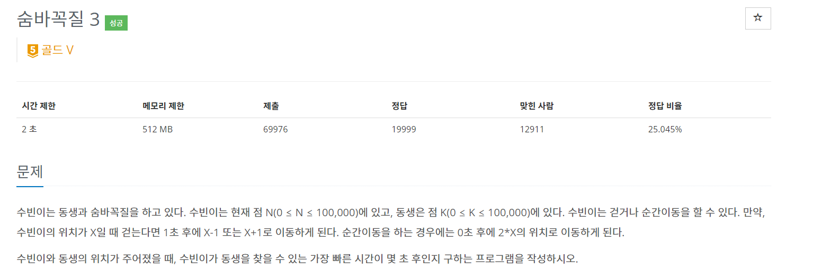

[상위 페이지 · Graph](/study/algorithms/graph/)

## 문제



## 아이디어

그냥 +1 -1 *2 방향으로 BFS 돌려서 M값을 찾은 순간 리턴하면 될 것 같았다

## 주요 포인트

주요 포인트는 별로 없고 조금이라도 시간 복잡도를 줄이려면 아마도 가장 밸류가 높은 *2를 먼저 탐색하는게 좋지 않을까 싶다 ← 확인해본결과 빠르긴 빠르나 푸는데엔 문제가 없었다

## 첫번째 시도

```python
from collections import deque

N,M = list(map(int,input().split()))
visited = [-1] * (100001)
queue = deque()
queue.append(N)
visited[N] = 0
while queue:
    temp = queue.popleft()
    count = visited[temp]
    if temp == M:
        print(count)
        break
    dir = [temp + 1,temp-1]
    if 0<=temp*2<100001 and visited[temp*2] == -1:
        queue.appendleft(temp*2)
        visited[temp*2] = count
    for i in dir:
        if not 0<=i<100001 and visited[i] != -1:
            continue
        queue.append(i)
        visited[i] = count + 1
```

for문의 문제인지 시간 초과가 떴다 그래서 그냥 for문 없애고 if문으로 다 처리하기로 했다

## 정답

```python
from collections import deque

N,M = list(map(int,input().split()))
visited = [-1] * (100001)
queue = deque()
queue.append(N)
visited[N] = 0
while queue:
    temp = queue.popleft()
    count = visited[temp]
    if temp == M:
        print(count)
        break
    if 0<=temp-1<100001 and visited[temp-1] == -1:
        queue.append(temp-1)
        visited[temp-1] = count + 1
    if 0<=temp*2<100001 and visited[temp*2] == -1:
        queue.appendleft(temp*2)
        visited[temp*2] = count
    if 0<=temp+1<100001 and visited[temp+1] == -1:
        queue.append(temp+1)
        visited[temp+1] = count + 1
```
