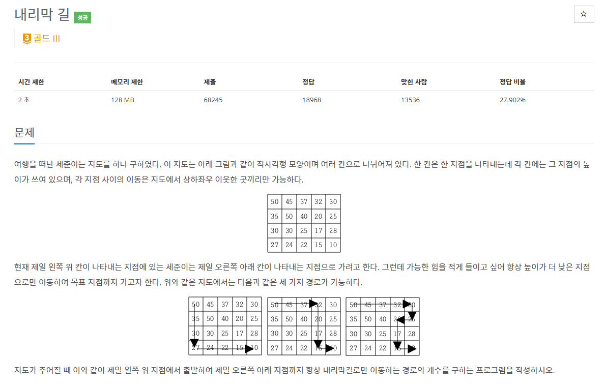
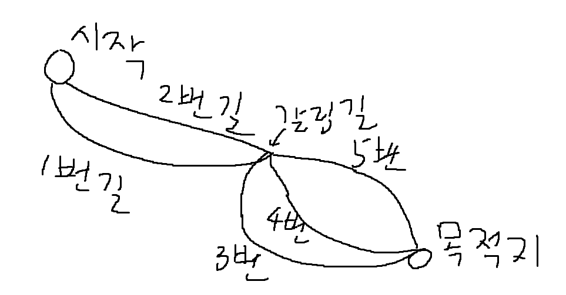

[상위 페이지 · Graph](/study/algorithms/graph/)

[https://www.acmicpc.net/problem/1520](https://www.acmicpc.net/problem/1520)



## 아이디어

기본적인 dfs문제이다 다만 한가지 다른건 목적지에 도착하는 모든 경우의 수를 구하는것인데 N이 500까지 갔을 때 모든 경우의 수를 다 체크하면 너무 너무 오래걸린다.



1번길이후 3번 4번 5번을 통해서 가면 목적지에 도달 할 수 있다. 갈림길에서 목적지까지 갈 수 있는 길은 총 3가지 케이스이다.

다음 2번길을 통해 갔을때는 이미 1번길을 통해 갈림길부터 목적지까지 도달할 수 있는 케이스를 이미 체크 해뒀으니 또 체크 할 필요가 없어진다.

위 같은 성질을 이용하여 이미 체크를 한곳이면 이 전경로에다가 +를 해주면 되겠다

## 정답

```python
import sys

sys.setrecursionlimit(10 ** 8)
input = sys.stdin.readline

def dfs(sx, sy):
    # 목적지 도착 시 리턴
    if sx == m - 1 and sy == n - 1:
        return 1

    # 이미 방문한 적이 있다면 저장된 값 리턴
    if dp[sx][sy] != -1:
        return dp[sx][sy]

    # 방문하지 않았다면 방문 표시를 하고 갈 수 있는 경로가 있는지 확인한다.
    ways = 0
    for i in range(4):
        nx, ny = sx + dx[i], sy + dy[i]
        if 0 <= nx < m and 0 <= ny < n and graph[sx][sy] > graph[nx][ny]:
            ways += dfs(nx, ny)

    # 현재 위치에서 목적지까지 갈 수 있는 경우의 수를 저장하고 리턴
    dp[sx][sy] = ways
    return dp[sx][sy]

# main 함수 시작
m, n = map(int, input().split())
graph = [list(map(int, input().split())) for _ in range(m)]

# 방문 여부를 저장하는 리스트 dp를 -1로 초기화
dp = [[-1] * n for _ in range(m)]

# 이동할 수 있는 방향을 나타내는 리스트 dx, dy 정의
dx, dy = [1, -1, 0, 0], [0, 0, 1, -1]

# dfs 함수 호출 후 결과 출력
print(dfs(0, 0))

```
