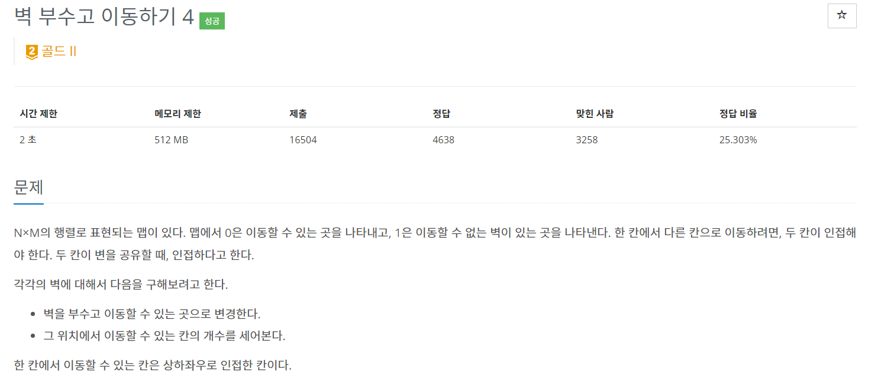

[상위 페이지 · 골드/레벨3](/study/algorithms/graph/gold-level-3/)

[https://www.acmicpc.net/problem/16946](https://www.acmicpc.net/problem/16946)



## 아이디어

문제의 설명이 좀 난해하다.

| 1 | 1 | 0 | 0 | 1 |
| --- | --- | --- | --- | --- |
| 0 | 0 | 1 | 1 | 1 |
| 0 | 1 | 0 | 1 | 0 |
| 1 | 0 | 1 | 0 | 1 |

이라면 

| 1 | X | 0 | 0 | 1 |
| --- | --- | --- | --- | --- |
| 0 | 0 | 1 | 1 | 1 |
| 0 | 1 | 0 | 1 | 0 |
| 1 | 0 | 1 | 0 | 1 |

X의 값을 구할때는 X로부터 갈 수 있는 칸이 몇개인지를 구하는게 목적이다.

한마디로 오른쪽 공간 2칸 아래쪽 공간 3칸 자기칸 1칸 총 6칸이 정답이다.

모든 벽의 값을 이런식으로 구해야한다.

단순히 모든 벽을 bfs 돌린다면 무조건 시간초과다. 그래서 먼저 bfs로 0의 영역 개수를 구하고 중첩 for문으로 각 1마다 위 아래 왼쪽 오른쪽의 영역 크기를 더해주는 방법으로 생각했다. 하지만 이래서는 bfs돌리는데 $$O(NM)$$ + 중첩 for문 돌리는데에도 $$O(NM)$$이기에 bfs를 단 한번 돌리면서 벽에다가 값을 추가해줘야 겠다는 생각을 하게 됐다.

첫번째 시도는 시간초과.. 벽에 값을 중첩으로 넣지 않게 하기위해 not in을 썼더니 벽의 개수가 많아지면서 시간 복잡도가 늘어난것으로 보인다. 그래서 애초부터 중복이 허용되지 않는 set() 리스트를 사용해 해결했다.

## 첫번째 시도

```python
import sys
from collections import deque

sys.setrecursionlimit(10**5)

dir = [[1,0],[-1,0],[0,-1],[0,1]]
R,C = map(int,input().split())
graph = [list(map(int,input())) for _ in range(R)]
visited = [[0] * C for _ in range(R)]
def bfs(start):
    queue = deque()
    queue.append(start)
    count = 1
    wall = list()
    while queue:
        r, c = queue.popleft()
        for dr, dc in dir:
            ddr = r + dr
            ddc = c + dc
            if 0 <= ddr < R and 0 <= ddc < C:
                if graph[ddr][ddc] == 0:
                    if visited[ddr][ddc] == 0:
                        visited[ddr][ddc] = 1
                        queue.append((ddr, ddc))
                        count += 1
                else:
                    visited[ddr][ddc] = 1
                    if (ddr,ddc) not in wall:
                        wall.append((ddr,ddc))
    for r,c in wall:
        graph[r][c] += count

for i in range(R):
    for j in range(C):
        if visited[i][j] == 0 and graph[i][j] == 0:
            visited[i][j] = 1
            bfs((i,j))
for i in graph:
    for j in i:
        print(j%10,end="")
    print("")
```

## 정답

```python
import sys
from collections import deque

sys.setrecursionlimit(10**5)

dir = [[1,0],[-1,0],[0,-1],[0,1]]
R,C = map(int,input().split())
graph = [list(map(int,input())) for _ in range(R)]
visited = [[0] * C for _ in range(R)]

def bfs(start):  # bfs 함수 정의
    queue = deque()
    queue.append(start)
    count = 1  # 0 영역의 크기를 저장하는 count
    wall = set()  # 벽이 있는 칸의 좌표를 저장하는 set
    while queue:
        r, c = queue.popleft()
        for dr, dc in dir:  # 상하좌우 이동
            ddr = r + dr
            ddc = c + dc
            if 0 <= ddr < R and 0 <= ddc < C:
                if graph[ddr][ddc] == 0:  # 0 영역인 경우
                    if visited[ddr][ddc] == 0:
                        visited[ddr][ddc] = 1
                        queue.append((ddr, ddc))
                        count += 1
                else:  # 벽이 있는 경우
                    wall.add((ddr,ddc))
                    # set()을 사용해 중복된 값을 제거하고 빠른 시간에 값을 추가할 수 있음
    for r,c in wall:  # 벽이 있는 좌표를 하나씩 꺼내서
        graph[r][c] += count  # 0 영역의 크기를 더해줌

for i in range(R):
    for j in range(C):
        if visited[i][j] == 0 and graph[i][j] == 0:  # 0 영역을 찾으면
            visited[i][j] = 1
            bfs((i,j))  # bfs를 돌려서 벽에 값을 추가해줌
for i in graph:
    for j in i:
        print(j%10,end="")  # 한자리수만 출력
    print("")

```
