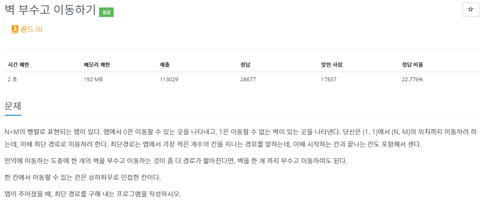

[상위 페이지 · Graph](/study/algorithms/graph/)

[https://www.acmicpc.net/problem/2206](https://www.acmicpc.net/problem/2206)



## 아이디어

기본적은 틀은 미로탐색을 따르지만 한가지 다른점은 벽을 1회 부시는게 가능하다.

벽을 부신경우와 안부신경우 두개로 나눠서 방문처리 해주면 간단하게 풀린다

## 정답

```python
import sys
from collections import deque
input = sys.stdin.read

R,C = list(map(int,input().split()))
miro = []
dir = [[1,0],[-1,0],[0,-1],[0,1]]
for i in range(R):
    temp = input()
    miro.append(list(temp))

def bfs(start):
    visited = [[[0] * 2 for _ in range(C)] for _ in range(R)]
    row,colum,breaked = start
    visited[row][colum][breaked] = 1
    queue = deque()
    queue.append((row,colum,breaked))
    while queue:
        row,colum,breaked = queue.popleft()
        count = visited[row][colum][breaked]
        if row == R-1 and colum == C-1:
            return visited[row][colum][breaked]
        for drow,dcolum in dir:
            ddrow = row + drow
            ddcolum = colum + dcolum
            if 0<=ddrow<R and 0<=ddcolum<C and visited[ddrow][ddcolum][breaked] == 0:
                if miro[ddrow][ddcolum] == "1" and breaked == 0:
                    visited[ddrow][ddcolum][1] = count + 1
                    queue.append((ddrow,ddcolum,1))
                if miro[ddrow][ddcolum] == "0":
                    visited[ddrow][ddcolum][breaked] = count + 1
                    queue.append((ddrow,ddcolum,breaked))
    return -1

print(bfs((0,0,0)))
```
