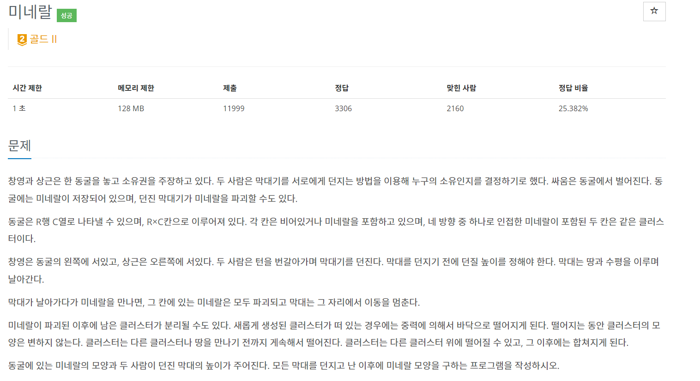
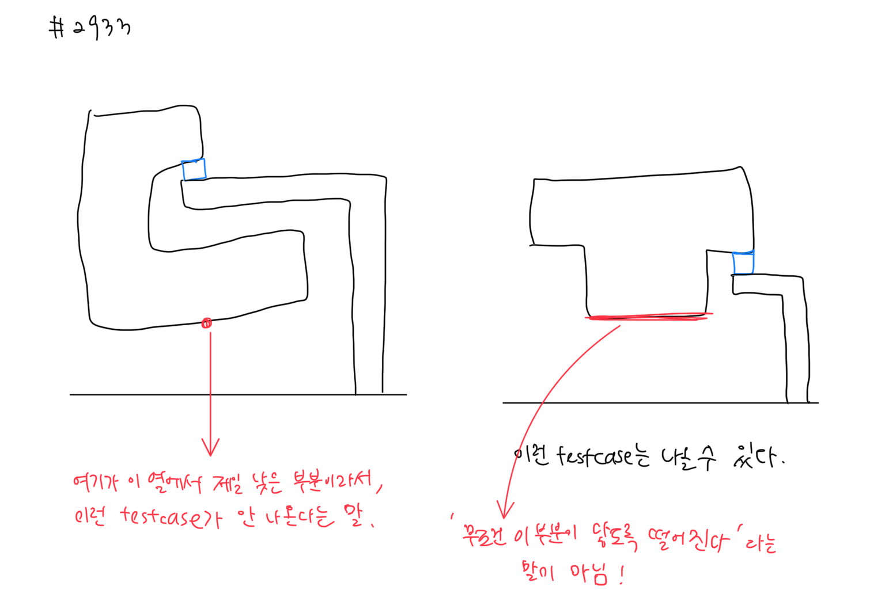

[상위 페이지 · 골드/레벨3](/study/algorithms/graph/gold-level-3/)

[https://www.acmicpc.net/problem/2933](https://www.acmicpc.net/problem/2933)

## 문제



## 아이디어

1. 막대 높이의  홀수번째면 왼쪽에서 첫번째 미네랄을 짝수번째면 오른쪽에서 첫번째 미네랄을 0으로 만든다
2. 부셔진곳을 기준으로 위쪽 미네랄 덩어리를 3번을 통해 확인한다
3. bfs로 어디까지가 덩어리인지 확인하고 노드를 방문 할 때마다 좌표값을 리스트에 넣는다
3-1.bfs 돌릴때 열이 N-1인곳이 있으면 isgrounded를 True로 만든다
4. 덩어리 체크가 됐으면 isgrounded가 false일때 열마다 가장 끝에 있는걸 기준으로 클러스터 열에 있는 x와 땅에 붙어있는 x의 차이가 가장 낮은걸 찾고 그 만큼 중력을 받게 한다
5. 입력된 막대를 1~4까지 계속 수행한다

## 주요 포인트



## 첫번째 시도

```python
from collections import deque

N,M = map(int,input().split())
cave = list()
for i in range(N):
 temp = input()
 cave.append(list(temp))
dx = [0,0,-1,1]
dy = [-1,1,0,0]
isLeft = True
def breakMineral(depth):
    global isLeft
    breaked = False
    temp = cave[N - depth]
    length = 0
    if isLeft:
        for j in range(len(temp)):
            if temp[j] == "x":
                cave[N-depth][j] = "."
                length = j
                breaked = True
                break
    else:
        for j in range(len(temp)-1,-1,-1):
            if temp[j]== "x":
                cave[N-depth][j] = "."
                length = j
                breaked = True
                break
    isLeft = not isLeft
    return (N-depth,length,breaked)

def bfs(start,visited):
    queue = deque([start])
    visited[start[0]][start[1]] = True
    cluster = [start]
    isgrounded = False
    while queue:
        (x, y) = queue.popleft()
        for m in range(4):
            nowdx = dx[m]
            nowdy = dy[m]
            if 0 <= x + nowdx < N and 0 <= y + nowdy < M and not visited[x+nowdx][y+nowdy]:
                if cave[x + nowdx][y + nowdy] == "x":
                    if x+nowdx == N-1:
                        isgrounded = True
                    cluster.append([x+nowdx,y+nowdy])
                    queue.append((x+nowdx,y+nowdy))
                    visited[x+nowdx][y+nowdy] = True
    return (isgrounded, cluster)

def printCave():
    for k in cave:
        print(k)
    print("-"*30)

def gravityOn(cluster):
    temp = {}
    for n in cluster:
        a = temp.get(n[1],-1)
        if n[0] > a:
            temp[n[1]] = n[0]
    for n in cluster:
        cave[n[0]][n[1]] = "."
    howMuchGravity = 99999999999
    for n in temp.keys():
        caveByRow = [t[n] for t in cave]
        if not "x" in caveByRow:
            if howMuchGravity>N-temp[n]-1:
                howMuchGravity = N-temp[n] -1
            continue
        if howMuchGravity>abs(temp[n] - caveByRow.index("x"))-1:
            howMuchGravity = abs(temp[n] - caveByRow.index("x"))-1
    for n in range(len(cluster)):
        (x,y) = cluster[n]
        cluster[n] = (x+howMuchGravity,y)
    for n in cluster:
        (x,y) = n
        if 0<=x<N and 0<=y<M:
            cave[n[0]][n[1]] = "x"

NN = int(input())
depths = list(map(int,input().split()))
debug = 1
for i in depths:
    #막대로 미네랄 부시기
    (x,y,breaked) = breakMineral(i)
    if not breaked:
        continue
    # 부셔진 미네랄 주변 탐색
    for h in range(4):
        ddx = x + dx[h]
        ddy = y + dy[h]
        if 0 <= ddx < N and 0 <= ddy < M:
            if cave[ddx][ddy] == ".":
                continue
            # 클러스터 무더기 탐색
            visited = [[False] * M for _ in range(N)]
            (isgrounded, cluster) = bfs((ddx,ddy), visited)
            # 땅에 붙어 있는 클러스터면 중력 영향 X
            if isgrounded:
                continue
            cluster.sort(key=lambda x: -x[0])
            gravityOn(cluster)
            break
    debug += 1
for i in range(N):
    for j in range(M):
        print(cave[i][j], end="")
    print("")
```

계시글에 있는 반례도 맞고 테스트케이스, 내가 만든 테스트케이스도 다 통과 했기에 문제점이 어떤것인지 제대로 파악이 안됐다. 그래서 나는 다시 짜는걸 선택했다

## 정답

```python
from collections import deque

N,M = map(int,input().split())
cave = list()
for i in range(N):
 temp = input()
 cave.append(list(temp))
dx = [0,0,-1,1]
dy = [-1,1,0,0]
isLeft = True

def breakMineral(depth):
    global isLeft
    breaked = False
    temp = cave[N - depth]
    length = 0
    if isLeft:
        for j in range(len(temp)):
            if temp[j] == "x":
                cave[N-depth][j] = "."
                length = j
                breaked = True
                break
    else:
        for j in range(len(temp)-1,-1,-1):
            if temp[j]== "x":
                cave[N-depth][j] = "."
                length = j
                breaked = True
                break
    isLeft = not isLeft
    return (N-depth,length,breaked)

def bfs(start):
    queue = deque([start])
    visited = [[False] * M for _ in range(N)]
    visited[start[0]][start[1]] = True
    isgrounded = False
    while queue:
        (x, y) = queue.popleft()
        for m in range(4):
            nowdx = x + dx[m]
            nowdy = y + dy[m]
            if 0 <= nowdx < N and 0 <= nowdy < M and not visited[nowdx][nowdy]:
                if cave[nowdx][nowdy] == "x":
                    if nowdx == N-1:
                        isgrounded = True
                    queue.append((nowdx,nowdy))
                    visited[nowdx][nowdy] = True
    return (isgrounded, visited)

def printCave():
    for k in cave:
        print(k)
    print("-"*30)

def gravityOn(visited):
    #행을 기준으로 제일 낮은 부분이 어딘지 찾기
    minXlist = [-999999] * M
    for y in range(M):
        for x in range(N - 1, -1, -1):
            if visited[x][y]:
                minXlist[y] = x
                break
    # 클러스터의 제일 밑 y값 밑에 "x"가 어디있는지 찾고 현 height와 "x"를 찾은 높이 - min_y-1중 작은 값이어야 함
    # 큰 값이 되면 넘어가는 경우가 생김
    height = 9999999
    for y, minX in enumerate(minXlist):
        if minX == -999999:
            continue
        for x in range(minX + 1, N):
            if cave[x][y] == 'x':
                height = min(height, x - minX - 1)
                break
            if x == N - 1:
                height = min(height, x - minX)
    # 위에서 찾은 height 만큼 클러스터를 내림
    for x in range(N-1, -1, -1):
        for y in range(M):
            if not visited[x][y]:
                continue
            cave[x][y] = '.'
            cave[x+height][y] = 'x'

NN = int(input())
depths = list(map(int,input().split()))
debug = 1
for i in depths:
    #막대로 미네랄 부시기
    (x,y,breaked) = breakMineral(i)
    if not breaked:
        continue
    # 부셔진 미네랄 주변 탐색
    for h in range(4):
        ddx = x + dx[h]
        ddy = y + dy[h]
        if 0 <= ddx < N and 0 <= ddy < M:
            if cave[ddx][ddy] == ".":
                continue
            # 클러스터 무더기 탐색
            (isgrounded, visited) = bfs((ddx,ddy))
            # 땅에 붙어 있는 클러스터면 중력 영향 X
            if isgrounded:
                continue
            gravityOn(visited)
            break
    debug += 1

for i in cave:
    print(*i ,sep="")
```
