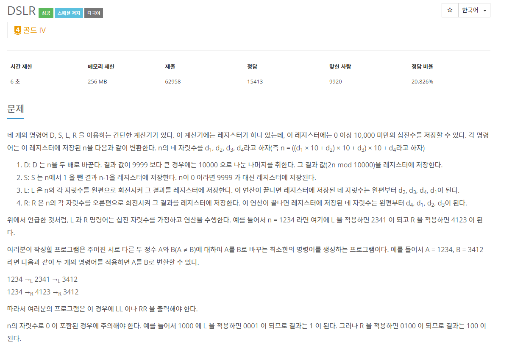

[상위 페이지 · 골드/레벨3](/study/algorithms/graph/gold-level-3/)

[https://www.acmicpc.net/problem/9019](https://www.acmicpc.net/problem/9019)



## 아이디어

그냥 BFS 돌린다

## 정답

```python
import sys
from collections import deque

input = sys.stdin.readline
N = int(input())
dir = ["D", "S", "L", "R"]

def bfs(start, end):
    visited = [False] * 10001
    queue = deque()
    queue.append([start, ''])
    visited[start] = True
    while queue:
        temp, command = queue.popleft()
        for dx in dir:
            temp2 = 0
            if dx == "D":
                temp2 = 2 * temp % 10000
            elif dx == "S":
                temp2 = (temp - 1) % 10000
            elif dx == "L":
                temp2 = temp // 1000 + (temp % 1000) * 10
            elif dx == "R":
                temp2 = (temp // 10) + (temp % 10) * 1000
            if temp2 == end:
                return command + dx
            if not visited[temp2]:
                visited[temp2] = True
                queue.append([temp2, command + dx])

for _ in range(N):
    start, end = list(map(int, input().split()))
    print(bfs(start, end))
```
