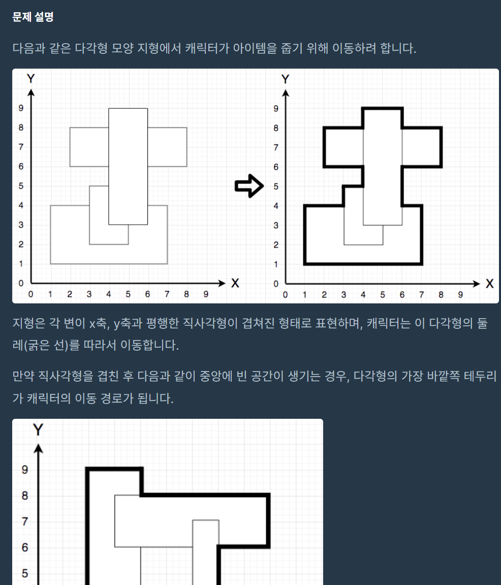
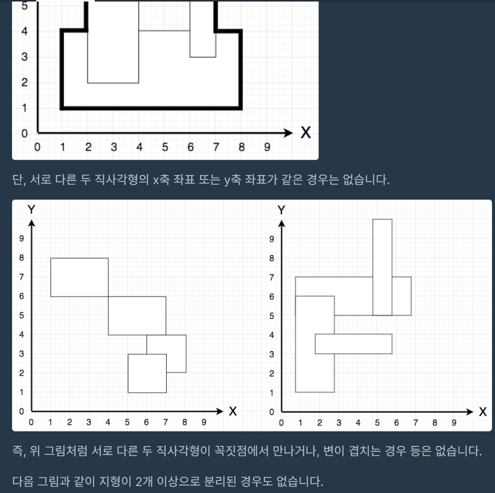
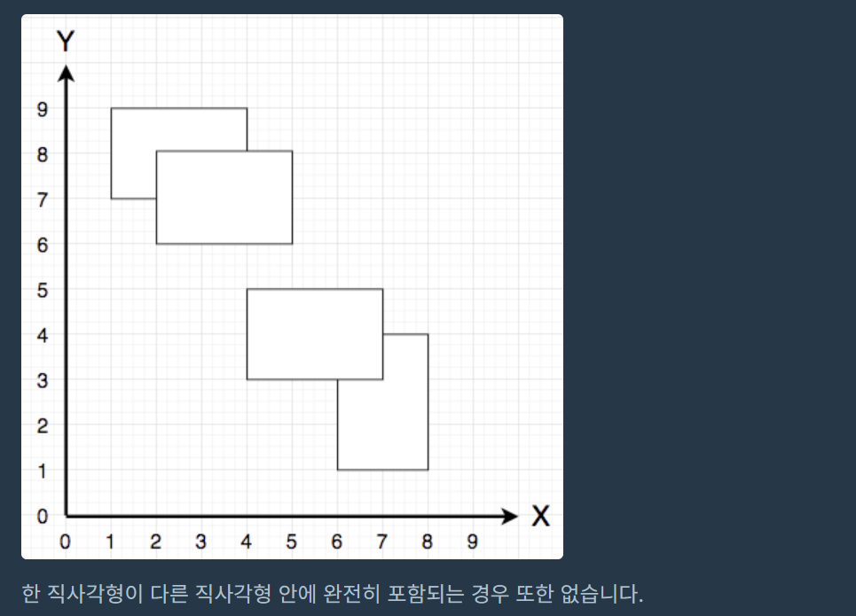
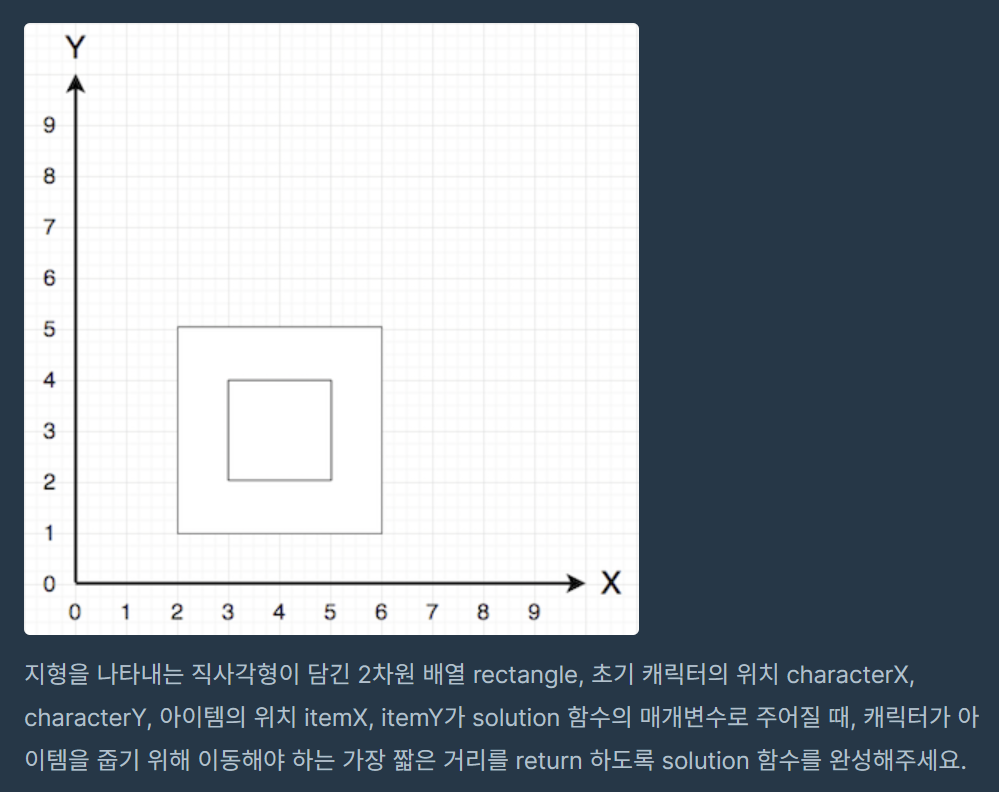

[상위 페이지 · 골드/레벨3](/study/algorithms/graph/gold-level-3/)









## 문제 태그

- 그래프 순회

## 아이디어

1. 최단거리를 구해야함으로 BFS를 사용한다
2. 전처리
    1. 먼저 직사각형의 좌표가 주어지면 해당하는 직사각형 면적을 1로 그려준다
    2. 가장자리 부분( 8가지 방향중 0이 존재하는 곳)을 2로 주어 경로를 표시한다
3. 가장 중요한점은 거리를 1로두면 ㄷ 모양에서 문제가 생긴다
    
    정상 루트
    
    
    
    하지만 bfs상으로는 이렇게 일직선으로 감
    
    
    
    이를 해결하기 위해 모든 좌표의 배수를 2로 맞춰 줌
    
    
    

## 정답

```python
from collections import deque
def solution(rectangle, characterX, characterY, itemX, itemY):
    N = 200
    graph = [[0] * N for i in range(N)]
    dir = [[1,0],[-1,0],[0,1],[0,-1],[1,1],[-1,1],[1,-1],[-1,-1]]
    rectangles = [(x1*2, y1*2, 2*x2, 2*y2) for x1, y1, x2, y2 in rectangle]
    dir_2 = [[1,0],[-1,0],[0,1],[0,-1]]
    for l_x,l_y,r_x,r_y in rectangles:
        for i in range(l_x,r_x+1):
            for j in range(l_y,r_y+1):
                graph[j][i] = 1
    for i in range(N):
        for j in range(N):
            for dx,dy in dir:
                if graph[i][j] == 1 and graph[dx+i][dy+j] == 0:
                    graph[i][j] = 2
                    break
    queue = deque()
    visited = [[False] * N for i in range(N)]
    queue.append((characterY * 2, characterX * 2,0))
    visited[characterY * 2][characterX * 2] = True
    while queue:
        y,x,distance = queue.popleft()
        if x == itemX * 2 and y ==itemY * 2:
            return distance//2
        for dx,dy in dir_2:
            ddx = dx + x
            ddy = dy + y
            if 0<=ddx<N and 0<=ddy<N and graph[ddy][ddx] == 2 and not visited[ddy][ddx]:
                visited[ddy][ddx] = True
                queue.append((ddy,ddx,distance + 1))
    return 0
```
