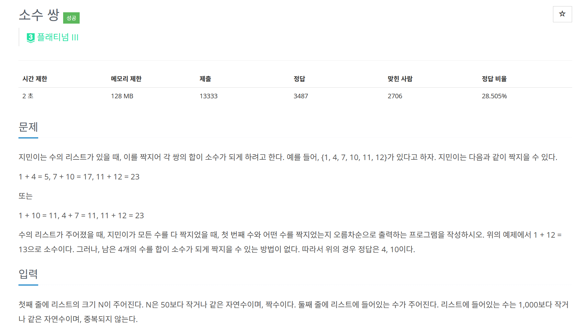

[상위 페이지 · 플래티넘](/study/algorithms/graph/platinum/)



## 문제 태그

- 에라토스테네스의 체
- 이분 매칭

## 아이디어

1. 수학문제인척 하는 그래프 문제
2. 이러한 그래프에서 이분매칭을 하는것과 똑같음
    
    
    
3. 에라토스테네스의 체로 미리 소수를 구하고 그래프 연결할때 써먹으면 된다
4. 첫숫자는 고정하고 맨 숫자의 간선을 하나씩 고정해보면서 이분매칭을 시행한다
5. 이분매칭할때 첫숫자와 고정한 간선은 바뀌지 않게 한다.
6. 만약 매치된 수가 N-2개(첫숫자와 고정한 간선은 매칭에 포함이 되지 않음)면 모두 매칭된것이니 정답처리해주면 된다

번외.

소수는 짝수 + 홀수만으로 이루어질 수 있다는걸 빨리 알았으면 더 쉬웠을듯… 홀수 그룹과 짝수 그룹을 나누어 이분매칭으로 생각했어야….

## 정답

```python
import math

is_prime = [True for _ in range(3000)]
is_prime[0] = is_prime[1] = False

for i in range(2, int(math.sqrt(3000)) + 1):
    if not is_prime[i]:
        continue
    for j in range(i*i,3000,i):
        is_prime[j] = False

N = int(input())
nums = list(map(int, input().split()))

graph = {}

for i in range(N):
    graph[nums[i]] = []
    for j in range(N):
        if i != j and is_prime[nums[j] + nums[i]]:
            graph[nums[i]].append(nums[j])

def dfs(num,visited,matched,connected):
    if num in visited:
        return False
    visited.add(num)
    for i in graph[num]:
        if num in connected or i in connected:
            continue
        if matched[i] == - 1 or dfs(matched[i],visited,matched,connected):
            matched[i] = num
            return True
    return False

answer = []
def solve():
    for connected in graph[nums[0]]:
        matched = [-1] * 1001
        flow = 0
        for i in range(1,N):
            if nums[i] == connected:
                continue
            visited = set()
            if dfs(nums[i],visited,matched,(nums[0],connected)):
                flow += 1
        if flow == N - 2:
            answer.append(connected)
solve()
if answer:
    print(*sorted(answer))
else:
    print(-1)
```
