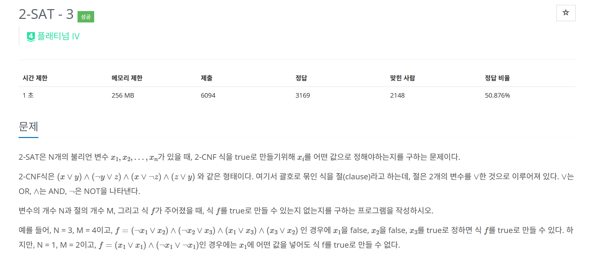

[상위 페이지 · 플래티넘](/study/algorithms/graph/platinum/)



## 문제 태그

- 그래프 이론
- SCC
- 2-SAT

## 아이디어

1. 2-SAT 문제이므로 각 절에 따라 ¬A→B, ¬B→A로 향하는 두 간선을 만들어준 뒤 SCC를 나누었을 때, ¬A와 A처럼 같은 변수가 동시에 SCC에 존재하지 않으면 그 식은 True로 만들 수 있는 식. 만약 두 변수가 동시에 존재하면 그 식은 모순이 생기므로 어떤 값을 넣어도 식이 true가 되지 않는다.

## 정답

```python
import sys
sys.setrecursionlimit(10**6)

def get_idx(x):
    return (abs(x) - 1) * 2 + (0 if x > 0 else 1)

def get_not_idx(idx):
    return idx ^ 1

def tarjan_scc(graph):
    n = len(graph)
    id = 0
    ids = [-1] * n
    low = [0] * n
    on_stack = [False] * n
    stack = []
    sccs = []
    scc_id = [0] * n
    def dfs(at):
        nonlocal id
        ids[at] = low[at] = id
        id += 1
        stack.append(at)
        on_stack[at] = True

        for to in graph[at]:
            if ids[to] == -1:
                dfs(to)
                low[at] = min(low[at], low[to])
            elif on_stack[to]:
                low[at] = min(low[at], ids[to])

        if ids[at] == low[at]:
            scc = []
            while True:
                node = stack.pop()
                on_stack[node] = False
                scc.append(node)
                scc_id[node] = len(sccs)
                if node == at:
                    break
            sccs.append(scc)

    for i in range(n):
        if ids[i] == -1:
            dfs(i)

    return scc_id

# 입력 처리
N, M = map(int, input().split())
graph = [[] for _ in range(N * 2)]

for _ in range(M):
    A, B = map(int, input().split())
    A_idx = get_idx(A)
    B_idx = get_idx(B)
    not_A = get_not_idx(A_idx)
    not_B = get_not_idx(B_idx)
    graph[not_A].append(B_idx)
    graph[not_B].append(A_idx)

scc_id = tarjan_scc(graph)

is_possible = True
for i in range(N):
    if scc_id[i * 2] == scc_id[i * 2 + 1]:
        is_possible = False
        break

print(1 if is_possible else 0)

```
