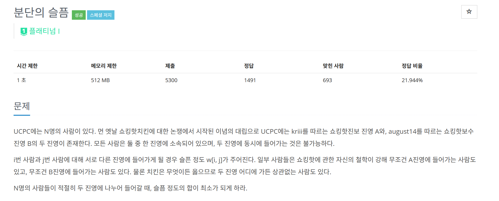

[상위 페이지 · 플래티넘](/study/algorithms/graph/platinum/)



## 문제 태그

- 그래프
- 최대유량
- 최대유량최소컷

## 아이디어

최대유량 문제는 항상 그래프 모델링이 중요하다.

- 그래프 모델링
    - 우선 고정적인 사람들만 1, 2에 따라 A진영에 속해야 하는 사람은 S→i, B진영에 속해야 하는 사람은 i→T로 연결하여 최소컷을 구할 때 끊기지 않도록 한다.
    - 나머지 0들은 인접 리스트에 따라 그래프를 일반적으로 모델링한다.
- 디닉 알고리즘을 활용해 최대유량 계산을 최적화한다.  << 매우 중요함
- residual graph에서 **S로부터 도달 가능한 정점**을 BFS/DFS로 모두 찾으면 이들이 A진영이 된다.
- 나머지는 B진영이 된다.

## 정답

```python
import sys
from collections import deque

sys.setrecursionlimit(10**7)
input = sys.stdin.readline

INF = float('inf')

class Edge:
    def __init__(self, to,capacity):
        self.to = to
        self.rev = None
        self.capacity = capacity

def add_edge(u, v, c):
    forward = Edge(v, c)
    backward = Edge(u, 0)
    forward.rev = backward
    backward.rev = forward
    graph[u].append(forward)
    graph[v].append(backward)

def bfs(s,t):
    for i in range(len(level)):
        level[i] = -1
    queue = deque([s])
    level[s] = 0
    while queue:
        u = queue.popleft()
        for e in graph[u]:
            if e.capacity > 0 and level[e.to] < 0:
                level[e.to] = level[u] + 1
                queue.append(e.to)
    return level[t] >= 0

def dfs(u,t,f):
    if u == t or f == 0:
        return f
    for i in range(ptr[u], len(graph[u])):
        e = graph[u][i]
        if level[e.to] == level[u] + 1 and e.capacity > 0:
            pushed = dfs(e.to,t,min(f,e.capacity))
            if pushed:
                e.capacity -= pushed
                e.rev.capacity += pushed
                return pushed
        ptr[u] += 1
    return 0

def max_flow(s,t):
    flow = 0
    while bfs(s,t):
        for i in range(len(ptr)):
            ptr[i] = 0
            while True:
                pushed = dfs(s,t,INF)
                if not pushed:
                    break
                flow += pushed
    return flow

N = int(input())
fixed = list(map(int, input().split()))
adj = [list(map(int, input().split())) for _ in range(N)]

S,T = N, N+1
graph = [[] for _ in range(N + 2)]
level = [0] * (N + 2)
ptr = [0] * (N + 2)

for i , f in enumerate(fixed):
    if f == 1:
        add_edge(S,i,INF)
    elif f == 2:
        add_edge(i,T,INF)

for i in range(N):
    for j in range(i+1,N):
        if adj[i][j] > 0:
            add_edge(i,j,adj[i][j])
            add_edge(j,i,adj[i][j])

min_sad = max_flow(S,T)

visited = [False] * (N + 2)
queue = deque([S])
visited[S] = True

while queue:
    u = queue.popleft()
    for e in graph[u]:
        if e.capacity > 0 and not visited[e.to]:
            visited[e.to] = True
            queue.append(e.to)

print(min_sad)
print(*[i + 1 for i in range(N) if visited[i]])
print(*[i + 1 for i in range(N) if not visited[i]])
```
