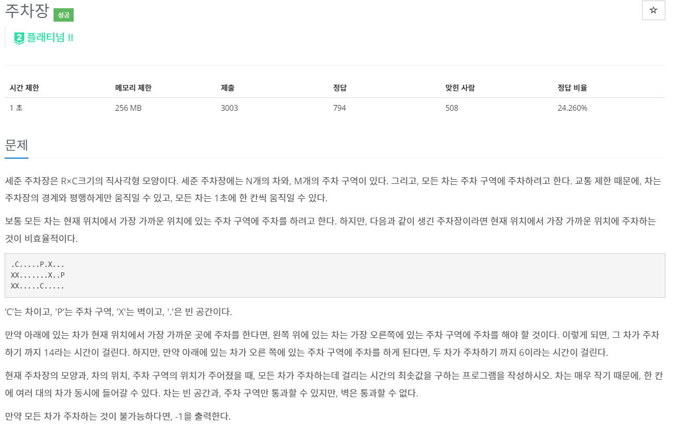

[상위 페이지 · 플래티넘](/study/algorithms/graph/platinum/)

[https://www.acmicpc.net/problem/1348](https://www.acmicpc.net/problem/1348)



## 아이디어

저번에 풀었던 [1886. 프리즌 브레이크](/study/algorithms/graph/diamond/boj-1886/) 와 매우 유사한 문제로 프리즌 브레이크와는 다르게 1:1 매칭만 해주면 된다.

1. bfs로 자동차와 막히지 않은 모든 주차장과 1:1 매칭을 한다. 여기서 한 주차장에 대해 거리가 같은 차가 여러대가 있을 수 있으니까 유니크한 값으로 경로를 구분해준다.
2. bfs를 돌려 모든 경로가 파악이 됐다면 모든 차가 주차장과 1:1 매칭이 될 수 있음을 확인해준뒤, 이분탐색으로 mid를 조절해주면서 모든 차가 주차장과 매칭을 할 수 있으면서 그것이 최소시간임인것을 구하면 된다

## 정답

```python
from collections import deque, defaultdict

R,C = map(int,input().split())
graph = [list(input()) for _ in range(R)]
dir = [[1,0],[-1,0],[0,-1],[0,1]]
adj = defaultdict(list)

def get_id(x,y):
    return x * R + y

sink = get_id(R - 1, C - 1) + 1

def bfs(starty,startx):
    visited = [[-1]*C for _ in range(R)]
    queue = deque()

    queue.append((starty,startx))
    visited[starty][startx] = 0
    id = get_id(starty,startx)
    is_parkable = False

    while queue:
        r,c = queue.popleft()
        for dr,dc in dir:
            ddr = r + dr
            ddc = c + dc
            if 0<=ddr<R and 0<=ddc<C and graph[ddr][ddc] != "X" and visited[ddr][ddc] == -1:
                visited[ddr][ddc] = visited[r][c] + 1
                queue.append((ddr,ddc))
                if graph[ddr][ddc] == "P":
                    is_parkable = True
                    adj[id].append((visited[ddr][ddc],get_id(ddr,ddc)))
    return is_parkable

def dfs(num,limit,matched,visited):
    if visited[num]:
        return False
    visited[num] = True

    for cost,path in adj[num]:
        if cost > limit:
            continue
        if matched[path] == -1 or dfs(matched[path],limit,matched,visited):
            matched[path] = num
            return True
    return False

def nf(limit,cnt):
    matched = [-1] * sink
    flow = 0
    for i in range(R):
        for j in range(C):
            if graph[i][j] != "C":
                continue
            visited = [False] * sink
            if dfs(get_id(i,j),limit,matched,visited):
                flow += 1
    return flow == cnt

def solution():
    car_cnt = 0
    park_cnt = 0
    for i in range(R):
        for j in range(C):
            if graph[i][j] == "C":
                car_cnt += 1
                if not bfs(i,j):
                    return -1
            elif graph[i][j] == "P":
                park_cnt += 1

    if car_cnt > park_cnt:
        return -1
    if car_cnt == 0:
        return 0

    low = 0
    high = 10000000
    while low + 1 < high:
        mid = (low + high) // 2
        if nf(mid,car_cnt):
            high = mid
        else:
            low = mid
    return high

print(solution())
```
