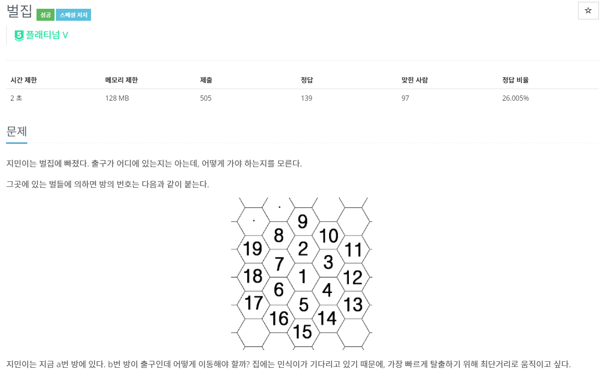

[상위 페이지 · 플래티넘](/study/algorithms/graph/platinum/)

[https://www.acmicpc.net/problem/1385](https://www.acmicpc.net/problem/1385)



## 아이디어

bfs문제이지만 bfs 자체는 간단한 bfs를 쓰기에 근본적으로는 그래프로 벌집을 표현 할 수 있냐 없냐의 문제이다.

벌집을 표현해주기 위해서 나는 이런 과정을 거쳤다.

size를 지정하고 x,y 좌표를 size의 절반에서 부터  위, 오른쪽, 오른아래, 아래, 왼쪽, 왼쪽 위 순으로 돌아가며 숫자를 채운다. 여기서 오른쪽으로 향하는건 i-1번 해야한다.

벌집을 표현할때 미리 N의 위치를 파악해두면 시간 복잡도면에서 당연히 낮아진다.

N의 위치에서부터 bfs를 돌리면서 역추적을 위해 visited에는 자신이 어디서 왔는지 기록한다.

K를 찾았다면 visited를 통해 경로를 파악하고 출력한다.

## 정답

```python
from collections import deque

N,K = map(int,input().split())
if N == K:
    print(N)
    exit(0)
dir = [[-1, 0],[0,1], [1, 1], [1, 0], [0, -1],[-1,-1]]
size = 1500
#위 오른위 오른아래 아래 왼아래 왼위
graph = [[-1]*size for _ in range(size)]
c = size//2
r = size//2
now_num = 1
graph[r][c] = now_num
startr = r
startc= c
level = 1
while now_num <= 1000000:
    for direction in range(6):
        for k in range(level -1 if direction == 1 else level):
            r += dir[direction][0]
            c += dir[direction][1]
            if 0<=r<size and 0<=c<size:
                now_num += 1
                if now_num == N:
                    startr = r
                    startc = c
                graph[r][c] = now_num
    level += 1

def bfs():
    queue = deque()
    queue.append((startr,startc))
    visited = [[-1] * size for _ in range(size)]
    visited[startr][startc] = (0,0)
    endr = -1
    endc = -1
    while queue:
        r,c = queue.popleft()
        if graph[r][c] == K:
            endr = r
            endc = c
            break
        for dr,dc in dir:
            ddr = r + dr
            ddc = c + dc
            if 0<=ddr<size and 0<=ddc<size and visited[ddr][ddc] == -1 and graph[ddr][ddc] != -1:
                queue.append((ddr,ddc))
                visited[ddr][ddc] = (r,c)

    if endc == -1 and endr == -1:
        print("에러 발생")
    else:
        tmp_list = [K]
        r = endr
        c = endc
        while True:
            if visited[r][c] == (startr,startc):
                break
            r,c = visited[r][c]
            tmp_list.append(graph[r][c])
        tmp_list.append(N)
        while tmp_list:
            print(tmp_list.pop() , end=" ")
bfs()
```
