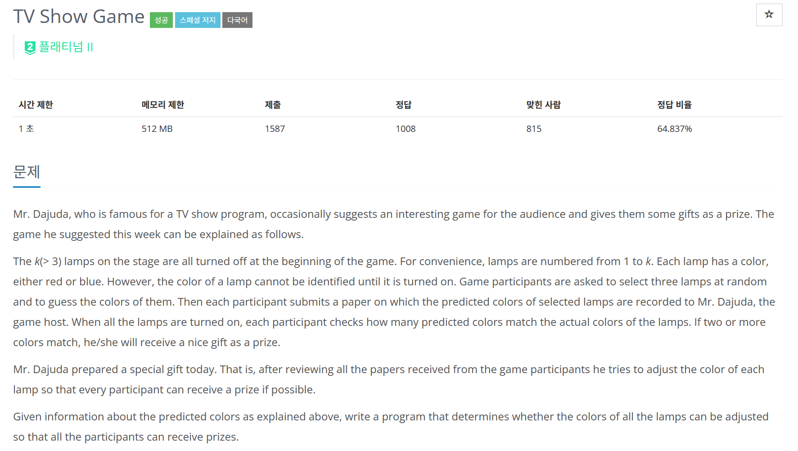

[상위 페이지 · Graph](/study/algorithms/graph/)



## 문제 해석

- **램프와 색 추측**
    - 무대 위에 k개의 램프(번호 1부터 k)가 있고, 각 램프는 빨강(R) 또는 파랑(B) 중 하나의 색을 갖는다.
    - 실제 색은 램프를 켤 때까지 알 수 없다.
- **참가자의 예측**
    - n명의 참가자가 각각 임의로 3개의 램프를 선택하고 각 램프에 대해 R 또는 B를 예측하여 제출한다.
    - 예컨대 "램프 3 → R, 램프 5 → B, 램프 7 → R"처럼 세 쌍을 기록한다

## 문제 태그

- 그래프 이론
- 2-SAT
- SCC

## 아이디어

1. 참가자마다 총 2개의 램프 색을 맞춰야하므로 선택한 $$w_i,w_j$$ 두개가 동시에 틀리는 경우가 발생하면 안된다.
2. 고로 $$w_i → ¬w_j$$여야함
3. 참가자는 총 3개의 램프를 선택하므로 나올 수 있는 조합은 $$(w_1,w_2),(w_1,w_3),(w_2,w_3)$$으로 이 모두를 그래프 모델링하여 R또는 B를 not 절로 생각하여 2-SAT 문제를 풀어주면 된다

## 정답

```python
import sys
sys.setrecursionlimit(10**7)
input = sys.stdin.readline

k, n = map(int, input().split())
N = 2 * k
g = [[] for _ in range(N)]

def var(lamp, val):
    return 2 * lamp + val

for _ in range(n):
    tokens = input().split()
    wrong = []
    for i in range(0, 6, 2):
        lamp = int(tokens[i]) - 1
        guess = tokens[i+1]
        if guess == 'R':
            wrong.append(var(lamp, 0))
        else:
            wrong.append(var(lamp, 1))
    for i in range(3):
        for j in range(i+1, 3):
            A = wrong[i]
            B = wrong[j]
            notA = A ^ 1
            notB = B ^ 1
            g[A].append(notB)
            g[B].append(notA)

index = 0
stack = []
onstack = [False] * N
indices = [-1] * N
lowlink = [0] * N
comp = [-1] * N
cid = 0

def dfs(v):
    global index, cid
    indices[v] = lowlink[v] = index
    index += 1
    stack.append(v)
    onstack[v] = True
    for w in g[v]:
        if indices[w] == -1:
            dfs(w)
            lowlink[v] = min(lowlink[v], lowlink[w])
        elif onstack[w]:
            lowlink[v] = min(lowlink[v], indices[w])
    if lowlink[v] == indices[v]:
        while True:
            w = stack.pop()
            onstack[w] = False
            comp[w] = cid
            if w == v:
                break
        cid += 1

for v in range(N):
    if indices[v] == -1:
        dfs(v)

ans = []
for i in range(k):
    if comp[2*i] == comp[2*i+1]:
        print(-1)
        sys.exit()
    ans.append('R' if comp[2*i] > comp[2*i+1] else 'B')

print(''.join(ans))

```
