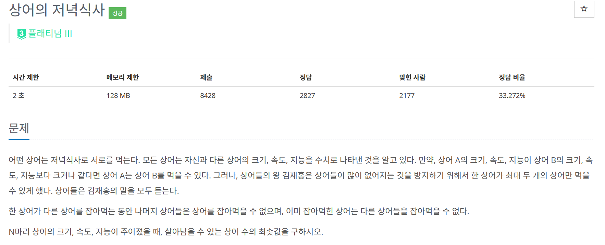

[상위 페이지 · 플래티넘](/study/algorithms/graph/platinum/)



## 문제 태그

- 이분 매칭

## 아이디어

1. 포식자와 먹이 그룹으로 나누어 그래프를 모델링하고 이분 매칭 한다.
2. 각 상어는 2번씩 먹을 수 있으므로, 포식자 그룹에 1~n번 상어를 각각 두 번씩(n+1 ~ 2n)에도 추가한다.
3. 잡아먹힌 상어가 다른 상어를 잡아먹을 수 없다는 조건으로 혼란스러울 수 있으나, 이 조건은 상호 포식 상황이나 i→k,k→j상황에서 의미가 있다. 하지만 실제로 상호 포식 상황은 발생하지 않는다.그리고 i→k, k→j 순서로 잡아먹는 경우, k→j, i→k 순서로 재배치하면 된다.

## 정답

```python
import sys

sys.setrecursionlimit(10 ** 7)
input = sys.stdin.readline

N = int(input())
sharks = [tuple(map(int, input().split())) for _ in range(N)]

L = 2 * N
graph = [[] for _ in range(L)]
for i in range(N):
    for j in range(N):
        if i == j:
            continue
        ai, bi, ci = sharks[i]
        aj, bj, cj = sharks[j]
        if ai >= aj and bi >= bj and ci >= cj:
            if sharks[i] == sharks[j] and i > j:
                continue
            graph[i].append(j)
            graph[i + N].append(j)

parent = [-1] * N

def dfs(u, visited):
    for v in graph[u]:
        if not visited[v]:
            visited[v] = True
            if parent[v] == -1 or dfs(parent[v], visited):
                parent[v] = u
                return True
    return False

flow = 0
for u in range(L):
    visited = [False] * N
    if dfs(u, visited):
        flow += 1

print(N - flow)

```
