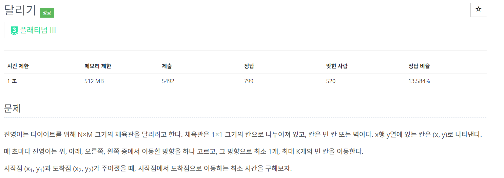

[상위 페이지 · 플래티넘](/study/algorithms/graph/platinum/)

[https://www.acmicpc.net/problem/16930](https://www.acmicpc.net/problem/16930)



## 아이디어

문제는 시작점, 도착점이 주어져있고 최소 시간을 구하는것이다. 일단 최소 시간을 구하는것이니 만큼 BFS를 써야하는건 당연하다. 

일단 초가 늘어는건

1. 방향을 바꿀 때
2. K만큼 갔을 때

이 점을 주의 해서 코드를 짜야한다

BFS 돌릴때 방향 하나를 선택해서 K만큼 가되 벽이 있으면 멈춰야한다

첫번째 시도에서는 시간초과가 떴다. 내 생각에는 시간복잡도가 O(NMK)로 N,M,K의 입력값의 최대가 1000임 만큼 시간초과가 걸릴만 하다…

여기서 NM은 어쩔 수 없지만 K는 줄일만하다 왜냐하면 

| 초 | o | .o | o | o |
| --- | --- | --- | --- | --- |

처음에 1번자리에서 시작해서 4번자리까지 뛰어간다 가정하면

| 초 | 1 | .1 | 1 | 1 |
| --- | --- | --- | --- | --- |

이 채워진다

이제 2번자리에서 시작해보자 근데 이미 오른쪽으로는 다 체크가 돼 있으니까 굳이 체크 할 이유가 없다 그래서 이미 체크를 했다면 그냥 K번 반복하는걸 빠져나오는게 좋다 2번자리에서 시작해서 5번자리로 갈 수 있지 않느냐 하면 그냥 5번자리에서 체크 또 하면 된다

## 첫번째 시도

```python
from collections import deque

N,M, K = map(int, input().split())
graph = list()
dir = [[1,0],[-1,0],[0,-1],[0,1]]
for i in range(N):
    graph.append(list(input()))

x1,y1,x2,y2 = map(int,input().split())

def bfs(x1,y1,x2,y2,visited):
    queue = deque()
    queue.append((x1,y1))
    visited[x1][y1] = 0
    while queue:
        x,y = queue.popleft()
        for i in range(4):
            for j in range(1, K + 1):
                ddx = x + (dir[i][0] * j)
                ddy = y + (dir[i][1] * j)
                if 0 <= ddx < N and 0 <= ddy < M and graph[ddx][ddy] == ".":
                    if visited[ddx][ddy] == -1:
                        if ddx == x2 and ddy == y2:
                            return visited[x][y] + 1
                        queue.append((ddx, ddy))
                        visited[ddx][ddy] = visited[x][y] + 1
                else:
                    break
    return -1

visited = [[-1] * M for _ in range(N)]
x1 -= 1
y1 -= 1
x2 -= 1
y2 -= 1
print(bfs(x1,y1,x2,y2,visited))
```

## 정답

```python
# deque은 큐를 구현할 때 사용하는 파이썬 내장 모듈
from collections import deque

# N, M, K를 공백으로 구분되어 입력받아 정수형으로 변환하여 저장
N, M, K = map(int, input().split())

# 그래프를 저장할 리스트 생성
graph = list()

# 상하좌우 이동을 위한 방향 리스트
dir = [[1,0],[-1,0],[0,-1],[0,1]]

# 그래프를 입력받아 리스트에 저장
for i in range(N):
    graph.append(list(input()))

# 시작점과 도착점의 좌표를 입력받아 정수형으로 변환하여 저장
x1, y1, x2, y2 = map(int,input().split())

# bfs 함수 정의
# 인자로 시작점의 좌표와 방문 여부를 저장할 2차원 리스트 visited를 전달받음
def bfs(x1, y1, x2, y2, visited):

    # 큐 생성
    queue = deque()

    # 시작점의 좌표를 큐에 추가하고, 방문 여부를 0으로 설정
    queue.append((x1, y1))
    visited[x1][y1] = 0

    # 큐가 빌 때까지 반복
    while queue:

        # 큐에서 좌표를 하나씩 꺼냄
        x, y = queue.popleft()

        # 상하좌우로 이동
        for i in range(4):

            # K칸까지 이동
            for j in range(1, K + 1):

                # 이동한 좌표 계산
                ddx = x + (dir[i][0] * j)
                ddy = y + (dir[i][1] * j)

                # 그래프 내에 있는 좌표인지 확인하고, 방문하지 않은 경우
                if 0 <= ddx < N and 0 <= ddy < M and graph[ddx][ddy] == ".":
                    if visited[ddx][ddy] == -1:

                        # 도착점에 도달한 경우
                        if ddx == x2 and ddy == y2:
                            return visited[x][y] + 1

                        # 큐에 좌표 추가
                        queue.append((ddx, ddy))

                        # 방문 여부를 현재 좌표의 방문 여부 + 1로 설정
                        visited[ddx][ddy] = visited[x][y] + 1

                    # 이미 방문한 경우 or 가려는곳이 더 적은 시간이 걸리는 경우
                    elif visited[ddx][ddy] <= visited[x][y]:
                        break

                # 그래프 내에 없는 경우
                else:
                    break

    # 도착점에 도달하지 못한 경우
    return -1

# 방문 여부를 저장할 2차원 리스트 초기화
visited = [[-1] * M for _ in range(N)]

# 시작점과 도착점의 좌표를 0부터 시작하도록 변경
x1 -= 1
y1 -= 1
x2 -= 1
y2 -= 1

# bfs 함수 호출하여 결과 출력
print(bfs(x1, y1, x2, y2, visited))

```
