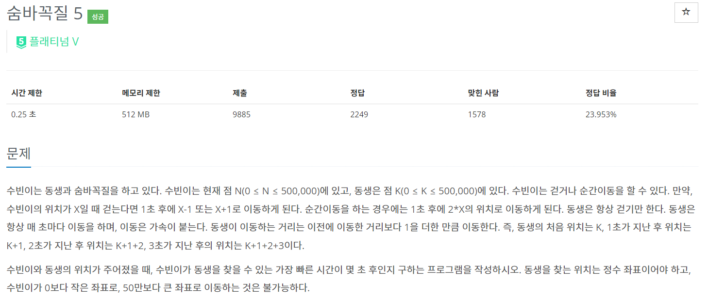

[상위 페이지 · 플래티넘](/study/algorithms/graph/platinum/)

[https://www.acmicpc.net/problem/17071](https://www.acmicpc.net/problem/17071)



## 아이디어

아이디어는 [13549번 숨바꼭질3](/study/algorithms/graph/gold-level-3/boj-13549/)과 같은 알고리즘으로 그냥 입력 제한 50만으로 풀리고 움직이는 정점에 대해 최단 거리를 구하는 아주 쉬운 문제인 줄 알았다. 그래서 첫 번째 시도에서는 숨바꼭질3 코드 그대로 정점만 움직여 주고 입력 제한을 50만으로 늘려서 제출했다. 당연히 실패하고, "움직이는 정점"이 꽤나 골치 아픈 문제임을 깨달았다.

테스트 케이스 2번의 입력 값인

17 5를 표를 만들어 보면,

| 거리\초 | 0 | 1 | 2 | 3 | 4 |
| --- | --- | --- | --- | --- | --- |
| 5 | 동생 |  |  |  |  |
| 6 |  | 동생 |  |  |  |
| 7 |  |  |  |  |  |
| 8 |  |  | 동생 |  |  |
| 9 |  |  |  |  |  |
| 10 |  |  |  |  |  |
| 11 |  |  |  | 동생 |  |
| 12 |  |  |  |  |  |
| 13 |  |  |  |  |  |
| 14 |  |  |  | 수빈 |  |
| 15 |  |  | 수빈 |  | 동생,수빈 |
| 16 |  | 수빈 |  |  |  |
| 17 | 수빈 |  |  |  |  |

으로 최소 거리가 나온다.

즉, 여기서는 재방문이 가능해진다는 것이다. 움직이는 정점이니 당연한 것이다. 그래서 두 번째 시도에서는 visited를 없애고 그냥 재방문을 가능하게 해줬다. 테스트 케이스는 맞았지만, 시간 제한 0.25초와 메모리 제한 512MB는 생각보다 더 가혹했다.

시간 제한과 메모리를 모두 지키려면 일단 재방문을 막되 막지 않는 방법이 필요했다.

| 거리\초 | 0 | 1 | 2 | 3 | 4 |
| --- | --- | --- | --- | --- | --- |
| 5 | 동생 |  |  |  |  |
| 6 |  | 동생 |  |  |  |
| 7 |  |  |  |  |  |
| 8 |  |  | 동생 |  |  |
| 9 |  |  |  |  |  |
| 10 |  | 수빈 |  | 수빈 |  |
| 11 | 수빈 |  | 수빈 | 동생 |  |

| 거리\초 | 0 | 1 | 2 | 3 | 4 |
| --- | --- | --- | --- | --- | --- |
| 5 | 동생 |  |  |  |  |
| 6 |  | 동생 |  |  |  |
| 7 |  |  |  |  |  |
| 8 |  |  | 동생 |  |  |
| 9 |  |  |  |  |  |
| 10 | 수빈 |  | 수빈 |  |  |
| 11 |  | 수빈 |  | 동생,수빈 |  |

(물론 -2를 하는게 최단 시간이지만 케이스를 넓히기 위해 일부로 이랬다)

표를 만들어 계속 보다보니 해결 방법이 보였다. 홀수 N번째 시간에 15에 도착했다면 N+2초에 다시 15에 방문하게 하면 된다.

좀 더 예를 확장해서 수빈이가 6초에 200에 도착했다고 하자. 동생이 12초에 걸쳐서 200에 도착했다면, 수빈이는 6, 8, 10, 12초 동안 200에 있으니까 언제든지 짝수 시간에 다시 200에 갈 수 있다. 홀수로 예를 들어도 같다. 그러므로, 일반화하자면 수빈이가 먼저 동생보다 도착했던 점에 대해 홀수 시간에 도착한 정보와 짝수 시간에 도착한 정보만 있다면, 동생이 거기에 도착했을 때 이미 수빈이가 기다리고 있는지 아닌지 알 수 있을 것이다.

## 첫번째 시도

```python
from collections import deque

N,M = list(map(int,input().split()))
if N == M:
    print(0)
    exit(0)
visited = [-1] * (500001)
queue = deque()
queue.append(N)
visited[N] = 0
while queue:
    temp = queue.popleft()
    count = visited[temp]
    brotherdis = M + ((count+1)*count/2)
    if brotherdis > 500000 or temp > 500000:
        print(-1)
        break
    if 0<=temp-1<500001:
        if temp-1 == brotherdis + count+1:
            print(count+1)
            break
        if visited[temp - 1] == -1:
            queue.append(temp-1)
            visited[temp-1] = count + 1
    if 0<=temp*2<500001:
        if temp*2 == brotherdis + count+1:
            print(count+1)
            break
        if visited[temp * 2] == -1:
            queue.append(temp * 2)
            visited[temp*2] = count + 1
    if 0<=temp+1<500001:
        if temp+1 == brotherdis + count+1:
            print(count+1)
            break
        if visited[temp+1] == -1:
            queue.append(temp + 1)
            visited[temp+1] = count + 1
```

## 두번째 시도

```python
from collections import deque

N,M = list(map(int,input().split()))
queue = deque()
queue.append((N,0))
while queue:
    temp,count = queue.popleft()
    brotherdis = M + ((count+1)*count/2)
    if brotherdis > 500000 or temp > 500000:
        print(-1)
        break
    if brotherdis == temp:
        print(count)
        break
    if 0<=temp-1<500001:
        queue.append((temp-1,count + 1))
    if 0<=temp*2<500001:
        queue.append((temp*2, count + 1))
    if 0<=temp+1<500001:
        queue.append((temp + 1,count + 1))
```

## 정답

```python
from collections import deque

N,M = list(map(int,input().split()))
if N == M: # 수빈이와 동생의 위치가 같은 경우
    print(0)
    exit(0)
visited = [[-1] * (500001) for _ in range(2)] # visited 배열을 [0]은 짝수 시간에, [1]은 홀수 시간에 방문한 경우에 대해 저장
queue = deque()
queue.append((N,0)) # (현재 위치, 현재 시간)을 큐에 삽입
while queue:
    temp,count = queue.popleft()
    odd = count%2 # 현재 시간이 짝수인지 홀수인지 판단
    if 0<=temp-1<500001 and visited[1-odd][temp-1] == -1: # temp-1 위치를 방문한 적이 없고, 0 이상 500001 미만인 경우
        queue.append((temp-1,count + 1))
        visited[1-odd][temp-1] = count + 1 # 방문 처리
    if 0<=temp*2<500001 and visited[1-odd][temp*2] == -1: # temp*2 위치를 방문한 적이 없고, 0 이상 500001 미만인 경우
        queue.append((temp*2,count + 1))
        visited[1-odd][temp*2] = count + 1 # 방문 처리
    if 0<=temp+1<500001 and visited[1-odd][temp+1] == -1: # temp+1 위치를 방문한 적이 없고, 0 이상 500001 미만인 경우
        queue.append((temp+1,count + 1))
        visited[1-odd][temp+1] = count + 1 # 방문 처리

brotherdistance = M
time = 0
res = -1
while brotherdistance < 500001:
    if visited[time%2][brotherdistance] != -1 and visited[time%2][brotherdistance]<=time: # 동생이 time 시간에 현재 위치에 도착할 수 있고, 수빈이가 동생보다 먼저 도착한 경우
        res = time
        break
    time += 1
    brotherdistance += time
print(res)

```
