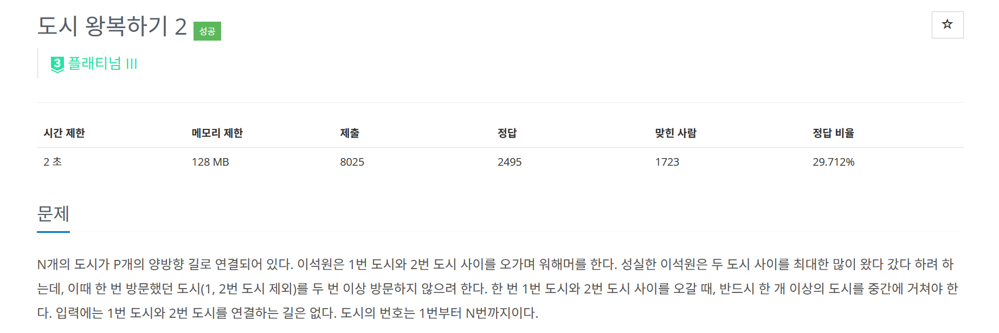

[상위 페이지 · 플래티넘](/study/algorithms/graph/platinum/)



## 문제 태그

- 최대유량

## 아이디어

1. 최대 도시는 한번씩만 거쳐야 함으로 정점 분할
    1. 1번 노드 in → 1번 노드 out << 용량 1
    2. 그 외의 용량은 INF

## 정답

```python
import sys
from collections import deque

graph = list()
INF = sys.maxsize

class Edge:

    def __init__(self, to, capacity):
        self.capacity = capacity
        self.to = to
        self.flow = 0
        self.inverse_edge = None

    def getRemain(self):
        return self.capacity - self.flow

    def push(self, value):
        self.flow += value
        self.inverse_edge.flow -= value

def buildEdge(a, b, capacity):
    to, come = Edge(b, capacity), Edge(a, 0)
    come.inverse_edge = to
    to.inverse_edge = come
    graph[a].append(to)
    graph[b].append(come)

def BFS(source, sink, visited, path):
    queue = deque()
    queue.append(source)
    visited[source] = source
    while queue:
        now = queue.popleft()
        for edge in graph[now]:
            there = edge.to
            if edge.getRemain() > 0 and visited[there] == -1:
                visited[there] = now
                path[there] = edge
                if there == sink:
                    return True
                queue.append(there)
    return False

def getFlow(source, sink):
    total = 0
    while True:
        visited = [-1] * len(graph)
        path = [None] * len(graph)
        if not BFS(source, sink, visited, path):
            break
        minFlow = INF
        current = sink
        while current != source:
            minFlow = min(minFlow, path[current].getRemain())
            current = visited[current]

        current = sink
        while current != source:
            path[current].push(minFlow)
            current = visited[current]

        total += minFlow
    return total

n, p = map(int, input().split())
graph = [[] for _ in range((n+1)*2)]

for _ in range(p):
    a, b = map(int, input().split())
    buildEdge(a*2 + 1, b*2, INF)
    buildEdge(b*2 + 1, a*2, INF)

for i in range(1, n + 1):
    if i == 1 or i == 2:
        buildEdge(i*2, i*2+1, INF)
    else:
        buildEdge(i*2, i*2+1, 1)

source = 1 * 2 + 1
sink = 2 * 2

print(getFlow(source, sink))
```
