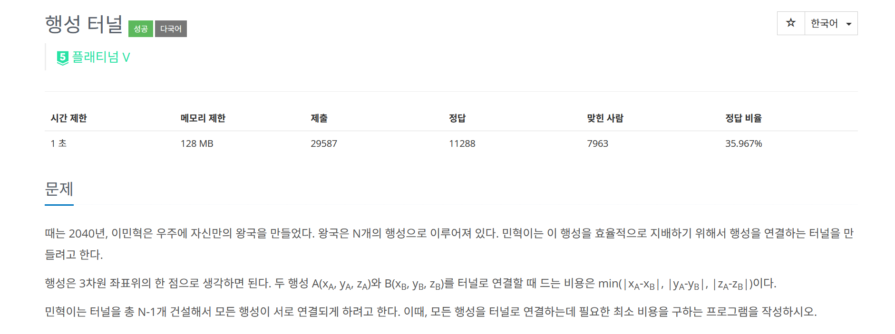

[상위 페이지 · 플래티넘](/study/algorithms/graph/platinum/)



## 문제 태그

- 그래프 이론
- 최소 스패닝 트리
- 크루스칼

## 아이디어

1. 이딴게 플레?
2. min(|xA-xB|, |yA-yB|, |zA-zB|)를 가중치로 크루스칼 알고리즘을 돌려 최소 스패닝 트리를 구하면 된다

## 정답

```python
import sys

input = sys.stdin.readline

def find(parent, x):
    if parent[x] != x:
        parent[x] = find(parent, parent[x])
    return parent[x]

def union(parent, a, b):
    a = find(parent, a)
    b = find(parent, b)
    if a < b:
        parent[b] = a
    else:
        parent[a] = b

def solve():
    N = int(input())
    planets = []

    for i in range(N):
        x, y, z = map(int, input().split())
        planets.append((i, x, y, z))

    edges = []

    planets.sort(key=lambda t: t[1])
    for i in range(1, N):
        a = planets[i - 1]
        b = planets[i]
        cost = abs(a[1] - b[1])
        edges.append((cost, a[0], b[0]))

    planets.sort(key=lambda t: t[2])
    for i in range(1, N):
        a = planets[i - 1]
        b = planets[i]
        cost = abs(a[2] - b[2])
        edges.append((cost, a[0], b[0]))

    planets.sort(key=lambda t: t[3])
    for i in range(1, N):
        a = planets[i - 1]
        b = planets[i]
        cost = abs(a[3] - b[3])
        edges.append((cost, a[0], b[0]))

    edges.sort(key=lambda e: e[0])

    parent = [i for i in range(N)]
    result = 0
    edge_count = 0

    for cost, a, b in edges:
        if find(parent, a) != find(parent, b):
            union(parent, a, b)
            result += cost
            edge_count += 1
            if edge_count == N - 1:
                break

    print(result)
solve()
```
