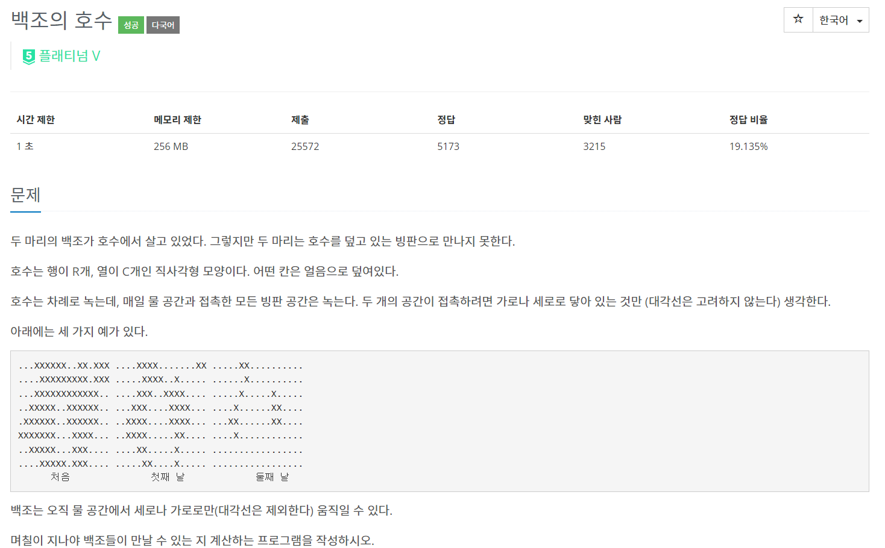

[상위 페이지 · 플래티넘](/study/algorithms/graph/platinum/)

[https://www.acmicpc.net/problem/3197](https://www.acmicpc.net/problem/3197)



## 아이디어

1.물의 영역을 탐색하면서 닿아있는 얼음을 탐색하고 녹인다

2.백조가 만날 수 있는지 탐색을 한다

---

여기까지는 처음에 생각했던 아이디어고 이 아이디어는 시간제한이 걸린다는 소리를 풀기전에 들었다. 그래서 시간제한을 안걸리게 더 아이디어를 떠올릴 필요가 있었다.

내 생각에 시간제한이 걸리는 이유는 모든 물을 또 탐색하고 탐색하고 백조도 탐색한곳 탐색하고 또 탐색해서 그런 것 같다. [2933번 미네랄](/study/algorithms/graph/gold-level-3/boj-2933/) 에서 풀었던것과 같이 모든 부위를 다 탐색 할 필요는 없고 일정부분만 다시 탐색하면 되지 않을까 싶었다.

그래서 생각한 아이디어는 첫째날에 탐색한 부분은 다음날에 탐색하지 말자 → 둘째날에 탐색할 부위를 미리 첫째날에 예측해서 큐에 담아두자로 됐고 녹일 얼음도 첫째날에 녹이고 난부분부터 둘째날에 다시 탐험하는걸로 시간제한을 없애기 위해 노력했다.

이미 시간제한이 걸린다는걸 알고 풀어서인지 틀리지 않고 풀 수 있었다

## 코드

```python
from collections import deque
R,C = list(map(int,input().split()))
lake = []
swan = []
water = deque()
dir = [[1,0],[-1,0],[0,-1],[0,1]]

# lake을 입력받습니다.
for i in range(R):
    tempList = list(input())
    for j in range(C):
        # 백조의 위치와 물의 위치를 저장합니다.
        if tempList[j] == "." or tempList[j] == "L":
            # i가 Row j가 Colum
            water.append((j,i))
        if tempList[j] == "L":
            swan.append((i,j))
        # lake에 물과 얼음을 저장합니다.
        lake.append(tempList)

# 백조 탐색 -> 녹이기 -> 백조탐색
def find_swan(queue,visited):
    nextDayDeque = deque()
    while queue:
        #y가 Row x가 colum. 큐에서 물의 위치를 꺼내옵니다.
        (x,y) = queue.popleft()
        # 만약 두 번째 백조를 찾았다면, True를 반환합니다.
        if y == swan[1][0] and x == swan[1][1]:
            return True,None
        # 상하좌우에 대해서 탐색합니다.
        for dx, dy in dir:
            ddx = x + dx
            ddy = y + dy
            # 만약 이동한 좌표가 유효하고, 처음 방문하는 좌표라면,
            if 0<=ddx<C and 0<=ddy<R and not visited[ddy][ddx]:
                # 얼음이라면, 다음날 탐색할 좌표를 저장합니다.
                if lake[ddy][ddx] == "X":
                    nextDayDeque.append((ddx,ddy))
                # 얼음음이 아니라면, 큐에 저장합니다.
                else:
                    queue.append((ddx,ddy))
                # 방문한 좌표를 표시합니다.
                visited[ddy][ddx] = True
    # 두 번째 백조를 찾지 못한 경우, False를 반환합니다.
    return False,nextDayDeque

# 얼음을 녹이는 함수입니다.
def melt_ice(water):
    # 다음날 탐색 할 좌표를 저장하는 큐입니다.
    nextDayWater = deque()
    while water:
        x,y = water.popleft()
        for dx,dy in dir:
            ddx = x + dx
            ddy = y + dy
            # 만약 이동한 좌표가 유효하고, 얼음이라면,
            if 0 <= ddx < C and 0 <= ddy < R:
                if lake[ddy][ddx] == "X":
                    # 다음날 탐색할 좌표를 저장합니다.
                    nextDayWater.append((ddx,ddy))
                    # 얼음을 녹입니다.
                    lake[ddy][ddx] = "."
    # 다음날 탐색 할 좌표를 반환합니다.
    return nextDayWater

# 시작점을 큐에 저장하고, 방문 체크합니다.
day = 0
queue = deque()
queue.append((swan[0][1],swan[0][0]))
visited = [[False] * C for _ in range(R)]
visited[swan[0][0]][swan[0][1]] = True
while True:
    # 두 번째 백조를 찾았다면 종료합니다.
    found,nextDayQueue = find_swan(queue,visited)
    if found:
        break
    # 두 번째 날 탐색할 부분을 저장합니다.
    queue = nextDayQueue
    # 얼음을 녹입니다.
    water = melt_ice(water)
    # 날짜를 1 증가시킵니다.
    day += 1
print(day)
```
