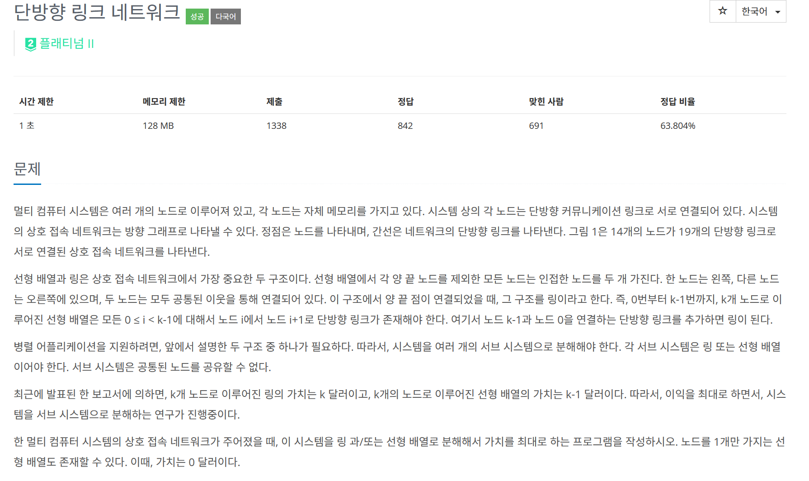

[상위 페이지 · Graph](/study/algorithms/graph/)



## 문제 태그

- 이분 매칭

## 아이디어

1. 문제가 길고 이상한 그림으로 현혹하는데 걍 한마디로 단방향 간선 줄테니 이분매칭하라는것임.

## 정답

```python
import sys
from collections import deque

def hopcroft_karp(graph, nL, nR):
    INF = 10**9
    pairU = [-1] * nL
    pairV = [-1] * nR
    dist = [0] * nL

    def bfs():
        q = deque()
        for u in range(nL):
            if pairU[u] == -1:
                dist[u] = 0
                q.append(u)
            else:
                dist[u] = INF
        found = False
        while q:
            u = q.popleft()
            for v in graph[u]:
                pu = pairV[v]
                if pu == -1:
                    found = True
                elif dist[pu] == INF:
                    dist[pu] = dist[u] + 1
                    q.append(pu)
        return found

    def dfs(u):
        for v in graph[u]:
            pu = pairV[v]
            if pu == -1 or (dist[pu] == dist[u] + 1 and dfs(pu)):
                pairU[u] = v
                pairV[v] = u
                return True
        dist[u] = INF
        return False

    matching = 0
    while bfs():
        for u in range(nL):
            if pairU[u] == -1 and dfs(u):
                matching += 1
    return matching

input = sys.stdin.readline
T = int(input())
for _ in range(T):
    n, m = map(int, input().split())
    # left: u_out = [0..n-1], right: v_in = [0..n-1]
    graph = [[] for _ in range(n)]
    for _ in range(m):
        u, v = map(int, input().split())
        # (u -> v) 간선을 u_out → v_in 으로 추가
        graph[u].append(v)
    # 최대 매칭 크기가 곧 답이다
    print(hopcroft_karp(graph, n, n))

```
